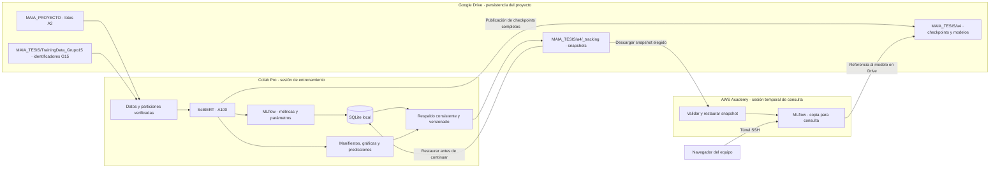

# A4 · Propuesta de arquitectura para entrenamiento y seguimiento

**Proyecto:** clasificación de la función de citas académicas · Grupo 15.  
**Fecha:** 29 de octubre de 2026, America/Bogota.  
**Actualización de rutas:** 1 de noviembre de 2026.  
**Estado:** seguimiento integrado; primera corrida de SciBERT en Colab pendiente.

Entrenaremos SciBERT en **Colab Pro con A100**, registraremos el avance con
**MLflow y SQLite dentro de Colab** y conservaremos los respaldos en **Google Drive**.
Una máquina temporal de **AWS Academy** restaurará una copia del historial para
consultar el panel de MLflow. El entrenamiento funcionará aunque AWS esté apagado.

Este README define la arquitectura implementada. El notebook incorpora MLflow,
respaldos automáticos y recuperación de checkpoints. Conserva el modelo y sus
hiperparámetros, lee desde `MAIA_PROYECTO` y guarda en `MAIA_TESIS`.
Para iniciar el entrenamiento sigue [PRIMERA_CORRIDA.md](PRIMERA_CORRIDA.md).
No se necesita S3. El usuario dispone de 5 TB en Drive; la frecuencia de copia se
ajustará a la velocidad de transferencia y al tamaño de los archivos.

Para preparar los entornos y hacer una prueba de extremo a extremo, sigue
[README_INSTALACION.md](README_INSTALACION.md): contiene pasos separados para
Colab, Drive, Windows y AWS Academy. Para entrenar usa [PRIMERA_CORRIDA.md](PRIMERA_CORRIDA.md).

## 1. Decisiones acordadas

| Aspecto | Decisión |
|---|---|
| Entrenamiento | Colab Pro, GPU A100 |
| Modelos | SciBERT base y SciBERT con secciones y Top-3 |
| Registro durante entrenamiento | Cliente MLflow conectado a SQLite local de Colab |
| Persistencia del historial | Respaldos versionados en Drive |
| Origen de los datos A2 | Acceso directo `Mi unidad/MAIA_PROYECTO`, usado para lectura |
| Checkpoints y modelos exportados | `Mi unidad/MAIA_TESIS/a4/<RUN_ID>/` |
| Snapshots de MLflow | `Mi unidad/MAIA_TESIS/a4/_tracking/snapshots/` |
| Consulta del panel | MLflow en una máquina temporal de AWS Academy, sin GPU |
| Restricción de AWS | Según lo informado por el usuario: sesiones de hasta cuatro horas e IP cambiante |
| Relación Colab–AWS | El entrenamiento no envía métricas al servidor de AWS |
| S3 | Fuera de esta arquitectura |
| Concurrencia inicial | Una sesión de Colab escribe el historial del proyecto a la vez |

MLflow admite registrar métricas y parámetros directamente en una base SQLite, sin
un servidor remoto. El panel se puede iniciar posteriormente contra una copia de
esa base. [Registro con base local](https://mlflow.org/docs/latest/ml/tracking/tutorials/local-database/).

## 2. Arquitectura



Las flechas de restauración representan operaciones al iniciar o retomar una sesión.
No hay sincronización bidireccional de bases activas. AWS consulta una versión
identificada del historial; para ver avances posteriores se restaura otro snapshot.
Los pesos se obtienen de Drive cuando se necesiten para validar inferencia: el panel
no los descarga automáticamente al mostrar una referencia.

## 3. Responsabilidad de cada componente

| Componente | Función | Disponibilidad necesaria |
|---|---|---|
| Colab/A100 | Entrenar y evaluar en validación; generar checkpoints | Durante la ejecución |
| SQLite local | Guardar experimentos, ejecuciones, parámetros y series de métricas | Durante el registro |
| Almacén local de artefactos MLflow | Manifiestos, reportes, gráficas y referencias a pesos | Durante el registro y la preparación del respaldo |
| Drive | Conservar datos, snapshots, checkpoints y exportaciones | Durante lectura y publicación; una falla de copia se reporta |
| AWS/MLflow | Mostrar una copia restaurada del historial | Solo al consultar el panel |

MLflow separa los metadatos de los archivos asociados a una ejecución. Aquí los
metadatos estarán en SQLite y los archivos pequeños en un directorio local que se
incluye en el respaldo. Los pesos permanecerán en los resultados de Drive.
[Almacenamiento de MLflow](https://mlflow.org/docs/latest/tracking/backend-stores/),
[artefactos](https://mlflow.org/docs/latest/self-hosting/architecture/artifact-store/).

## 4. Rutas y estructura de almacenamiento

### 4.1. Ruta local común en Colab y AWS

La implementación utilizará esta ruta dentro del entorno Linux de ambos equipos:

```text
/opt/maia/a4_tracking/
├── mlflow.db
├── artifacts/
└── staging/
```

SQLite y los artefactos activos se escribirán en el disco local, no directamente en
el montaje de Drive. El URI será `sqlite:////opt/maia/a4_tracking/mlflow.db`.

Al crear el experimento se fijará explícitamente su `artifact_location` dentro de
`file:///opt/maia/a4_tracking/artifacts/`. Las subcarpetas de cada ejecución las
gestiona MLflow. En AWS se restaurarán los archivos bajo **la misma ruta absoluta**.
Esto evita que la base restaurada apunte a archivos que solo existían bajo
`/content/...` en Colab. Cambiar después el directorio raíz exige una migración
controlada; cambiar únicamente una opción del servidor no reescribe los URI ya
guardados en los experimentos. [URI de artefactos](https://www.mlflow.org/docs/latest/api_reference/python_api/mlflow.html#mlflow.get_artifact_uri),
[servidor y ubicaciones](https://www.mlflow.org/docs/latest/self-hosting/architecture/tracking-server/).

En AWS se propone un contenedor con esta ruta interna y una carpeta local montada
como volumen. Colab y el visor usarán **la misma versión exacta de MLflow**, que se
seleccionará y fijará durante la implementación. No se hará una actualización de
esquema al abrir un respaldo original.

### 4.2. Organización propuesta en Drive

```text
MAIA_PROYECTO/
└── a2/batches_norw/                       # Acceso directo; solo lectura

MAIA_TESIS/
├── TrainingData_Grupo15/                 # Identificadores y etiquetas ya subidos
└── a4/
    ├── <RUN_ID>/                         # Resultados actuales del notebook
    │   ├── run_manifest.json
    │   ├── split_train_ids.jsonl
    │   ├── split_validation_ids.jsonl
    │   ├── base/
    │   │   ├── checkpoints/
    │   │   └── model/
    │   └── fragmentos/
    │       ├── checkpoints/
    │       └── model/
    └── _tracking/
        ├── snapshots/
        │   └── <SNAPSHOT_ID>/
        │       ├── snapshot.zip
        │       ├── snapshot.sha256
        │       └── COMPLETE.json
        └── recovery_notes/
```

Las variables en Colab serán `DATA_ROOT = /content/drive/MyDrive/MAIA_PROYECTO`
y `RESULTS_ROOT = /content/drive/MyDrive/MAIA_TESIS`. Los lotes y el pool opcional se
leen con `DATA_ROOT`; los resultados y respaldos se derivan de `RESULTS_ROOT`.
El acceso directo evita duplicar los textos compartidos. El bloque de configuración
de la guía comprueba escritura únicamente en la carpeta propia de resultados.

`SNAPSHOT_ID` será único: fecha UTC más un identificador aleatorio. Los registros
conservarán fechas UTC; el panel o las notas podrán mostrarlas en America/Bogota.
Cada ZIP contendrá `mlflow.db`, `artifacts/` y un manifiesto del respaldo; excluirá
`staging/`, los archivos de trabajo de SQLite y el corpus textual.

Los snapshots preservarán los artefactos pequeños de **todos los runs incluidos en
la base**, no únicamente los del entrenamiento activo. Así el visor podrá comparar
ejecuciones anteriores desde un único respaldo acumulativo.

## 5. Organización de experimentos y ejecuciones

Se usará un experimento de MLflow denominado **`G15_A4_SciBERT`**.

`RUN_ID` seguirá identificando la ejecución definida por el notebook. Se guardará un
`tracking_index.json` dentro de sus resultados para relacionar los identificadores:

| Identificador | Significado |
|---|---|
| `project_run_id` | `RUN_ID` del notebook, por ejemplo `g15_a4_v0_seed42_01` |
| `logical_run_id` | Run padre de MLflow para una configuración: base o fragmentos |
| `attempt_id` | Run hijo para cada inicio o reanudación del entrenamiento |
| `snapshot_id` | Versión recuperable del historial completo |
| `checkpoint_id` | Checkpoint completo, con su paso global y manifiesto |

Ejemplo de nombres visibles:

```text
G15_A4_SciBERT
├── g15_a4_v0_seed42_01 · base
│   ├── intento_01
│   └── intento_02 · reanudado desde checkpoint-1000
└── g15_a4_v0_seed42_01 · fragmentos
    └── intento_01
```

Los hijos contendrán las curvas de cada intento. El padre conservará la
configuración y los resultados consolidados del intento que complete el modelo.
Para comparar modelos se filtrarán los padres finalizados. De esta forma una
reanudación desde un checkpoint anterior no mezcla en una misma curva los pasos
repetidos después de la interrupción.

Una nueva semilla, variante, partición, versión de gold o política de entrada
significará un nuevo `RUN_ID`. Un corte de sesión con la misma configuración será
un nuevo intento dentro del mismo run lógico.

## 6. Qué se registrará

| Tipo | Contenido |
|---|---|
| Parámetros | Modelo y revisión; configuración base/fragmentos; V0/V1/V2; semilla; LR; batch; acumulación; épocas; precisión; política de 512 tokens |
| Procedencia | Hashes de datos y particiones; archivos gold utilizados; versión de guía; commit de código si existe; versiones de bibliotecas y GPU |
| Progreso | Paso global, época, pérdida de entrenamiento, learning rate y tiempos |
| Validación | Loss, F1 macro/micro, precisión y recall; mejor checkpoint |
| Resultados finales | Métricas por clase, matrices de confusión y predicciones por clave |
| Respaldo | Último snapshot publicado, error de copia si existe y checkpoint recuperable |

Se conservarán los eventos de entrenamiento con su paso y fecha originales. La
frecuencia inicial de métricas seguirá la del notebook: logs cada 50 pasos y
validación al finalizar cada época. La integración de Trainer se dirigirá al run
hijo activo; la publicación del respaldo tendrá su propio temporizador.
[Integración MLflow de Transformers](https://huggingface.co/docs/transformers/v4.57.1/en/main_classes/callback).

La evaluación sobre T_B seguirá desactivada hasta recibir gold final. Registrar
historial no modifica ese protocolo ni los criterios de selección por validación.

### Archivos grandes y checkpoints

Los pesos y el estado de optimización seguirán en Drive bajo `<RUN_ID>/`. MLflow
incluirá un `model_reference.json` y referencias de checkpoints con ruta relativa
al proyecto, tamaño, hash, revisión y paso global. Esto permite verificar el modelo
sin copiar cientos de MB en cada snapshot de métricas.

Para reanudar hace falta un **checkpoint completo de Trainer**, incluidos modelo,
optimizador, scheduler, estado de Trainer y estado aleatorio cuando corresponda.
La carpeta `model/` exportada para inferencia no equivale a ese checkpoint.

La publicación de un checkpoint requerirá su manifiesto y un marcador de
finalización escrito después de verificar los archivos. El selector de recuperación
ignorará directorios parciales, aunque su nombre parezca el más reciente. En esta
fase se mantendrá el guardado por época del notebook; una frecuencia mayor se
decidirá después de medir duración y transferencia.

Los textos del corpus no se incluirán en los snapshots ni en los artefactos MLflow:
se conservarán las claves y hashes necesarios para reconstruirlos conforme al
contrato de datos del proyecto.

## 7. Protocolo de respaldo

### Frecuencia propuesta

| Momento | Acción |
|---|---|
| Inicio de sesión | Restaurar el último snapshot completo y compatible, o inicializar el historial |
| Cada 5 minutos como objetivo | Respaldar metadatos y artefactos pequeños |
| Checkpoint completo | Actualizar su referencia y solicitar un respaldo |
| Fin de cada modelo | Publicar métricas consolidadas y respaldo |
| Cierre normal de la sesión | Registrar el estado final y confirmar respaldo |

El callback comprobará el tiempo al terminar cada paso de optimización; no dependerá
de que termine una época. No hay un temporizador en un hilo separado. Los cinco minutos son una cadencia
objetivo, no una garantía de pérdida máxima: el límite real será la fecha del
último respaldo publicado y verificado, más cualquier demora de transferencia.

### Construcción y publicación

1. Serializar el registro de métricas y artefactos durante la preparación de una
   copia local consistente. Los logs pendientes deberán haberse escrito antes
   de establecer el punto de corte del respaldo.
2. Crear la copia de SQLite con `sqlite3.Connection.backup()`. No copiar mediante
   `cp` o `shutil.copy` una base activa ni copiar separadamente sus archivos WAL.
3. Congelar en `staging/` los artefactos pequeños correspondientes al mismo corte y
   registrar hasta qué paso y fecha contiene información el snapshot.
4. Liberar la sección crítica del registro. Empaquetar y transferir fuera de ella
   para que la subida a Drive no bloquee el entrenamiento durante toda la copia.
5. Validar la base copiada con `PRAGMA integrity_check`; generar el manifiesto,
   tamaños y SHA-256 de los archivos; comprobar el ZIP.
6. Escribir el ZIP y su hash en una carpeta nueva de Drive. Verificar el destino y
   escribir **`COMPLETE.json` al final**. No asumir que renombrar en Drive equivale
   a una transacción de todo el respaldo.
7. Registrar la publicación. Los lectores deberán comprobar marcador, manifiesto
   y hashes antes de aceptar el snapshot; la presencia del marcador por sí sola
   no basta si la transferencia está incompleta.

La API de respaldo de SQLite permite obtener una copia consistente de una base
en uso. La coordinación adicional con los artefactos es una decisión de esta
propuesta. [SQLite Backup API](https://www.sqlite.org/backup.html),
[API de Python](https://docs.python.org/3/library/sqlite3.html#sqlite3.Connection.backup).

El manifiesto del snapshot registrará al menos:

```text
schema_version, snapshot_id, created_at_utc, mlflow_version,
canonical_root, database_sha256, artifact_checksums,
experiment_ids, project_run_ids, active_attempt_ids,
latest_logged_step_by_attempt, checkpoint_references, source_commit
```

Los respaldos completos serán inmutables. La primera implementación no borrará
automáticamente snapshots ni modelos. Si una copia falla, conservará el último
respaldo completo y mostrará la antigüedad de ese respaldo; no marcará el nuevo
snapshot como publicado. La siguiente copia volverá a intentarlo desde el estado
local que siga disponible. Un fallo de respaldo no deberá lanzar por defecto una
excepción que interrumpa el entrenamiento, pero quedará visible en los logs.

## 8. Recuperación después de una interrupción de Colab

1. Montar Drive y seleccionar el snapshot completo válido más reciente. Si está
   incompleto o falla sus hashes, probar el anterior.
2. Verificar versión de MLflow, integridad de SQLite y correspondencia de archivos.
3. Restaurar base y artefactos en `/opt/maia/a4_tracking/` antes de iniciar un escritor.
4. Leer `tracking_index.json`, los manifiestos del experimento y los checkpoints
   completos. No usar únicamente el nombre de carpeta para elegir el checkpoint.
5. Comparar configuración, particiones, hashes y gold. Si cambiaron, iniciar un
   experimento nuevo en lugar de continuar la curva anterior.
6. Si el intento previo no cerró correctamente, conservar sus métricas y marcarlo
   como interrumpido mediante una etiqueta; el estado MLflow se cerrará como
   `KILLED` o `FAILED` según la causa. No inventar un estado nativo `INTERRUPTED`.
7. Abrir un nuevo intento hijo, guardar el checkpoint de origen y retomar Trainer
   desde su estado completo. Los pasos globales procederán del checkpoint.
8. Publicar un nuevo snapshot para registrar la recuperación.

El historial puede contener métricas posteriores al último checkpoint completo.
Esas métricas se conservarán en el intento anterior; el nuevo intento volverá a
calcular los pasos necesarios. Se reportarán por separado el último paso registrado
y el último paso de entrenamiento recuperable.

**Límite de concurrencia:** antes de arrancar una sesión escritora se confirmará que
la anterior terminó o se interrumpió. No se restaurarán dos copias de la misma base
para que escriban en paralelo y luego se sobrescriban en Drive. Si se necesitan
entrenamientos simultáneos, se deberá ampliar este diseño; no se fusionarán SQLite
por copia de archivos.

## 9. Consulta del historial en AWS Academy

AWS actuará como **visor de una réplica**, sin conexión de escritura desde Colab.
No requiere GPU ni tener acceso a los textos del corpus para mostrar las métricas.

Flujo de consulta previsto:

1. Iniciar la sesión de Academy y una instancia Linux con Docker y disco suficiente
   para el snapshot elegido. El tamaño se decidirá tras medir el primer respaldo.
2. Descargar de Drive un snapshot identificado. Para la primera implementación se
   propone descargarlo al computador y transferirlo por `scp`; así la instancia no
   necesita credenciales permanentes de Drive ni acceso a los 5 TB completos.
3. Verificar hash, manifiesto e integridad; restaurar la estructura bajo la ruta
   común dentro del contenedor. No abrir un ZIP de origen desconocido ni permitir
   que sus rutas de extracción escapen del directorio de restauración.
4. Arrancar MLflow con la versión fijada, conectado a la base restaurada.
5. Acceder al panel mediante un túnel SSH, abriendo `http://localhost:5000` en el
   navegador del computador.
6. Para actualizar el historial, detener el visor y restaurar otro snapshot en una
   carpeta de trabajo nueva. No reemplazar su SQLite mientras el servidor la usa.

Ejemplo orientativo del túnel, con los valores del laboratorio:

```bash
ssh -i <clave-del-laboratorio.pem> -L 5000:127.0.0.1:5000 <usuario>@<IP_ACTUAL>
```

El puerto del visor se publicará solo en el loopback de la instancia; no se expondrá
el 5000 directamente a Internet. La IP cambiante solo obliga a actualizar el
destino del túnel al reconectar. El servidor de MLflow sirve el panel y la API desde
el entorno donde se restaura la copia. [Servidor de MLflow](https://www.mlflow.org/docs/latest/self-hosting/architecture/tracking-server/).

La consulta en AWS será de solo lectura **por el flujo de trabajo**: cualquier
anotación o cambio hecho allí se quedará en esa copia. No se afirma que iniciar el
servidor lo convierta automáticamente en un servicio con permisos de solo lectura.
Nada de la base del visor se copiará de vuelta al historial de Drive.

Si Academy se apaga a las cuatro horas, se cierra el panel; Colab sigue registrando
y respaldando. Para volver a consultar se inicia otra sesión y se restaura el
snapshot deseado, independientemente de que la instancia conserve su disco previo.
No se necesita una IP fija para esta arquitectura.

## 10. Relación con el notebook actual

El punto de partida es [A4_SciBERT_G15_Colab_A100.ipynb](A4_SciBERT_G15_Colab_A100.ipynb),
generado por [crear_notebook.py](crear_notebook.py). La preparación y los controles
existentes están descritos en [analisis_y_plan_A4.md](analisis_y_plan_A4.md).

| Componente de entrenamiento | Seguimiento implementado |
|---|---|
| RUN_ID y manifiestos de configuración | Relacionarlos con los IDs de MLflow |
| Hashes de datos y particiones | Registrarlos como parámetros, etiquetas y artefactos |
| Métricas y training_log.json en resultados | Registro incremental durante el entrenamiento |
| Checkpoints por época en Drive | Manifiestos de finalización y selección segura para recuperar |
| Exportación del modelo y tokenizador | Referencia verificada al modelo desde MLflow |
| Evaluación de validación y test opcional | Publicar los reportes en el historial correspondiente |
| Entrenamiento de ambas configuraciones | Runs padres e intentos hijos sin mezclar curvas |

La implementación se incorpora en pares de celdas **explicación/código**, conservando
el formato del notebook. No cambiará las clases, las particiones, los modelos,
hiperparámetros ni el aislamiento para incorporar seguimiento. Los cambios que
afecten el experimento seguirán requiriendo otro `RUN_ID`.

## 11. Implementación del seguimiento

El módulo `tracking_runtime.py` se incrusta en el notebook: no es necesario subirlo
a Colab. El visor se instala con los comandos de `README_INSTALACION.md`.
La tabla conserva los componentes del plan original. La ejecución completa en A100
y la interrupción de una sesión real deben validarse en la primera corrida.

Los snapshots se publican al inicio, cierre, checkpoints y al terminar un paso de
optimización si han pasado 300 segundos. No se usa un hilo de fondo: evaluaciones
largas pueden ampliar ese intervalo. Los intentos interrumpidos se separan y los
checkpoints se verifican con hashes antes de reanudar.

| Paso | Entregable | Condición de cierre |
|---|---|---|
| 1 | Versión de MLflow fijada y configuración de rutas | Colab y AWS abren la misma versión de prueba |
| 2 | Módulo de registro y callbacks | Run padre/hijo, parámetros y métricas asociados al RUN_ID correcto |
| 3 | Publicador de snapshots y manifiestos de checkpoints | Respaldo validado, versionado y recuperable desde Drive |
| 4 | Restaurador con validación de hashes y rutas | Rechaza respaldos parciales o incompatibles |
| 5 | Integración en el generador y notebook | Mantiene alternancia explicación/código y pruebas anteriores |
| 6 | Imagen y guía del visor en AWS | Panel accesible mediante túnel con métricas y artefactos visibles |
| 7 | Ensayo de interrupción y recuperación | Reanuda desde checkpoint completo en un intento nuevo |

Se utilizará primero una ejecución corta de prueba para verificar el flujo antes de
gastar una sesión larga de A100. La configuración final de entrenamiento seguirá
identificada por su propio RUN_ID.

## 12. Criterios de aceptación

- Entrenar sin una instancia de AWS encendida y registrar métricas correctamente.
- Crear snapshots periódicos y al cierre, con integridad verificada y publicación
  distinguible de una copia parcial.
- Abrir el historial en AWS después de terminar Colab, con las curvas originales
  y los artefactos pequeños disponibles bajo las rutas restauradas.
- Identificar y descargar desde Drive el modelo exacto vinculado a los resultados.
- Conservar el último respaldo completo si se interrumpe una transferencia.
- Recuperarse de una sesión cortada sin confundir el último log con el último
  checkpoint recuperable, y sin mezclar pasos repetidos de intentos distintos.
- Consultar el panel después de reiniciar Academy y cambiar su IP, sin alterar el
  entrenamiento ni tener que configurar una dirección fija en Colab.
- Mantener separados los datos de validación y el gold de T_B según el protocolo A4.

La duración exacta del respaldo y el tiempo de restauración se medirán en el ensayo.
No se presupone que el espacio de Drive elimine sus límites de velocidad o que el
disco local de Colab tenga los mismos 5 TB. Las sesiones de Colab son temporales y
los accesos a Drive pueden demorarse o fallar. [FAQ de Colab](https://research.google.com/colaboratory/faq.html).

## 13. Documentación del proyecto

- [Análisis y plan de A4](analisis_y_plan_A4.md).
- [Notebook actual](A4_SciBERT_G15_Colab_A100.ipynb).
- [Auditoría de identificadores y aislamiento](auditoria_datos_A4.json).
- [Auditoría de textos y tokenización](auditoria_textos_A4.json).
- [Plan de trabajo general](../plan_de_trabajo.md).

El notebook incorpora el registro, respaldo y recuperación. La primera corrida
en Colab permitirá validar el flujo con SciBERT y medir sus tiempos reales.
