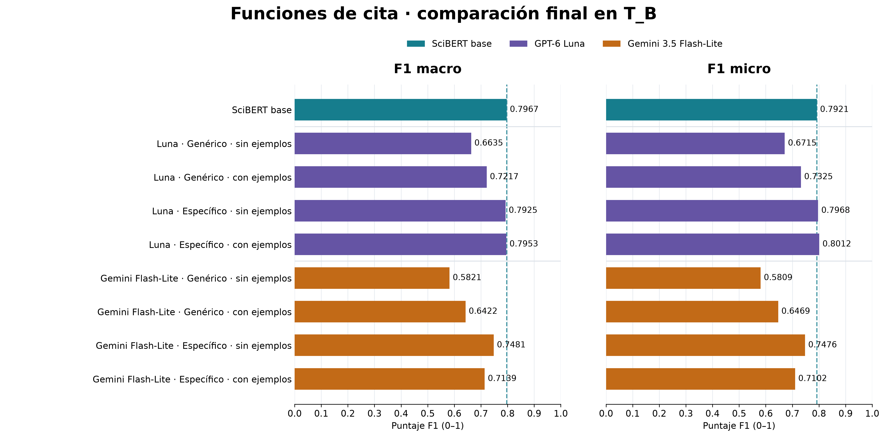

# Análisis final de A5: evaluación con modelos comerciales

Fecha de corte: 16 de noviembre de 2026. Este documento cierra la implementación experimental de A5 y entrega resultados e insumos a los responsables de A6 y A7. No sustituye el análisis integral de esas actividades.

## 1. Propósito y alcance implementado

Se evaluó la clasificación de funciones de cita mediante APIs comerciales, sin reentrenamiento. Los modelos finales fueron **GPT-6 Luna (`gpt-6-luna`)** y **Gemini 3.5 Flash-Lite (`gemini-3.5-flash-lite`)**. GPT-6.1 Sol se utilizó en desarrollo y en un piloto de 45 casos; no se evaluó sobre todo T_B y no integra la comparación final.

El flujo de A5 recibe **contexto citante → título del documento citado → resumen del documento citado**. No incorpora chunks, Top-1 ni Top-3. La comparación supervisada corresponde exclusivamente a SciBERT base; las otras variantes de A4 quedan fuera de este contraste.

La guía de la Universidad, `GUIA_Propuesta_Proyecto PLN.pdf`, página 8, solicita comparar zero-shot/few-shot y prompts genéricos/específicos, con nueve puntajes por caso. La implementación conserva ese alcance. El JSON con claves de categoría permite el procesamiento automático; exigir suma 1 es una decisión operativa adicional, no una calibración probabilística.

## 2. Datos, referencias humanas y aislamiento

Se utilizaron **2.968 casos evaluables de T_B**, con referencia humana adjudicada. Se excluyeron los dos casos `unclear` según el cierre de A3. La categoría Improvement/Modification contiene 268 casos; se conserva esa distribución, sin completar la cuota con preetiquetas.

La configuración identifica los datos como `training_v2+A3_gold_2026-11-09`, la guía de anotación como `rev3.1` y el aislamiento como `V2`. Los ejemplos y el piloto proceden de T_A, separados de T_B por documentos en ambos roles: citante y citado.

El banco few-shot contiene **nueve ejemplos humanos, uno por categoría**. El piloto utiliza 45 casos adicionales, cinco por categoría, separados del banco. Una asociación incorrecta entre un recurso y el título/resumen de su documento citado se excluyó del desarrollo antes de fijar el banco; no se modificó el gold del test.

Para las entradas base se aplicó la política de retención de texto de A4: hasta 512 tokens SciBERT, con hasta 192 para el contexto, hasta 64 para el título y el espacio restante para el resumen. Se preservó `[[TARGET]]` y se utilizó el texto decodificado de los tokens retenidos. Esto no iguala los tokenizadores comerciales al de SciBERT.

En la comparación final se comprobó que los CSV de los tres modelos contienen **los mismos 2.968 identificadores y las mismas etiquetas humanas**, caso por caso. Los archivos de SciBERT se verificaron contra los hashes de `FINAL_COMPLETE.json`. Esta comprobación no certifica por sí sola identidad byte a byte de todos los textos de entrada.

## 3. Categorías y condiciones experimentales

Las categorías son Background, Gap, Basis, Comparison, Application, Improvement/Modification, Evidence, Identification of the Originator y Further Reading.

| Condición | Instrucciones | Ejemplos | Entrada del caso |
|---|---|---|---|
| `base-generic-zero` | Definiciones generales | Ninguno | Contexto, título y resumen |
| `base-generic-few` | Definiciones generales | Los nueve ejemplos humanos | Contexto, título y resumen |
| `base-specific-zero` | Definiciones y criterios detallados por categoría | Ninguno | Contexto, título y resumen |
| `base-specific-few` | Definiciones y criterios detallados por categoría | Los mismos nueve ejemplos humanos | Contexto, título y resumen |

Cada modelo produjo **2.968 × 4 = 11.872 respuestas**. Las dos evaluaciones comerciales finales reúnen 23.744 respuestas; las conexiones y los pilotos se registran aparte. SciBERT base aporta una referencia supervisada de 2.968 predicciones: no tiene condiciones zero-shot/few-shot.

## 4. Prompts, parámetros y validación

El snapshot activo es `prompt_v11_1_snapshot.json`, versión `a5-v11.1-base-only-02`. Se deriva del antecedente v11.1, adaptado a contexto, título y resumen. El texto original de A2 se conserva únicamente para trazabilidad y no se envía en las solicitudes finales.

Se solicita un objeto `scores` con las nueve categorías exactas, valores finitos entre 0 y 1 y suma 1 con tolerancia 0,001. La predicción es la categoría con mayor puntaje; el orden fijo de las categorías resuelve empates. Los puntajes representan soporte relativo y no probabilidades calibradas. El gold del caso objetivo no se envía al modelo.

| Parámetro | Luna | Gemini |
|---|---|---|
| Modelo | `gpt-6-luna` | `gemini-3.5-flash-lite` |
| Formato final | `json_object` | `json_schema`, esquema estricto |
| Temperatura | Parámetro omitido | Parámetro omitido |
| Límite de salida configurado | 2.048 tokens | 2.048 tokens |
| Condiciones | Cuatro | Cuatro |
| Ejemplos few-shot | Banco fijo de nueve | El mismo banco |
| Semilla de orden y evaluación A5 | 42 | 42 |
| Reintentos automáticos | 0 | 0 |
| Réplicas específicas de estabilidad | 0 | 0 |
| Dataset final | T_B humano completo | El mismo T_B |

La semilla de A5 no hace determinista al proveedor comercial. Los formatos finales difieren entre proveedores; esta diferencia debe considerarse al interpretar el contraste entre modelos.

### Desarrollo y elección del formato de Gemini

El primer piloto Gemini generó nueve respuestas inválidas: seis alteraron nombres de categorías y tres devolvieron todos los puntajes en cero. El segundo piloto utilizó esquema estricto y produjo 180 respuestas válidas. Se mantuvieron los prompts, el banco, los casos y el límite de salida; no se corrigieron respuestas del test para mejorar métricas.

En T_B reaparecieron 22 respuestas inválidas de Gemini, todas por suma de puntajes distinta de 1. El esquema puede restringir campos y tipos, pero no garantiza la suma. En Luna se conservaron 25 respuestas inválidas: 24 por suma de puntajes distinta de 1 y una por clave JSON duplicada. Estos motivos se verificaron en la columna `error` de los CSV finales.

## 5. Resultados finales y contraste con SciBERT base

Se recalcularon las métricas desde los CSV finales sobre las mismas referencias humanas. Se mantienen las respuestas inválidas como errores en el denominador. F1 macro promedia las nueve clases; F1 micro coincide con accuracy en esta evaluación de etiqueta única que cuenta las salidas inválidas como fallos.

| Modelo | Condición | F1 macro | F1 micro | Cobertura (%) | Inválidas |
|---|---|---:|---:|---:|---:|
| SciBERT base | `base` | 0.7967 | 0.7921 | 100.0000 | 0 |
| gpt-6-luna | `base-generic-few` | 0.7217 | 0.7325 | 99.9326 | 2 |
| gpt-6-luna | `base-generic-zero` | 0.6635 | 0.6715 | 99.7642 | 7 |
| gpt-6-luna | `base-specific-few` | 0.7953 | 0.8012 | 99.9663 | 1 |
| gpt-6-luna | `base-specific-zero` | 0.7925 | 0.7968 | 99.4946 | 15 |
| gemini-3.5-flash-lite | `base-generic-few` | 0.6422 | 0.6469 | 100.0000 | 0 |
| gemini-3.5-flash-lite | `base-generic-zero` | 0.5821 | 0.5809 | 99.3261 | 20 |
| gemini-3.5-flash-lite | `base-specific-few` | 0.7139 | 0.7102 | 100.0000 | 0 |
| gemini-3.5-flash-lite | `base-specific-zero` | 0.7481 | 0.7476 | 99.9326 | 2 |

### Lectura de los resultados

- En Luna, específico con ejemplos alcanzó el mayor F1 macro, **0,7953**, y F1 micro **0,8012**. La condición específica sin ejemplos quedó cerca, con F1 macro 0,7925.
- En Gemini, específico sin ejemplos alcanzó el mayor F1 macro, **0,7481**. Agregar ejemplos no mejoró esa condición: específico con ejemplos obtuvo 0,7139. El beneficio de few-shot depende del modelo y de las instrucciones.
- Luna superó descriptivamente a Gemini en las cuatro condiciones equivalentes. Las instrucciones específicas mejoraron el resultado frente a las genéricas en ambos comerciales.
- SciBERT base obtuvo F1 macro **0,7967** y F1 micro **0,7921**. Frente a Luna específico con ejemplos, presenta una diferencia pequeña en macro, mientras Luna tiene mayor micro. Las métricas priorizan aspectos distintos; no se declara un ganador único por inspección de una sola cifra.

Los mejores resultados observados en T_B se describen como hallazgos finales. No se utilizan para reajustar prompts o ejemplos y presentar otra ejecución sobre el mismo test como evaluación independiente.

### Diferencias pareadas de F1 macro

Se ejecutó un bootstrap pareado de 2.000 repeticiones, semilla `20261113`, agrupado por **2.764 artículos citantes**. Todos los modelos utilizan los mismos remuestreos. Los intervalos son percentiles bilaterales del 95% sobre la diferencia **comercial − SciBERT base**.

- Luna específico con ejemplos: delta **−0,0014**, intervalo **[−0,0197; 0,0162]**.
- Luna específico sin ejemplos: delta **−0,0042**, intervalo **[−0,0223; 0,0122]**.
- Gemini específico sin ejemplos: delta **−0,0487**, intervalo **[−0,0669; −0,0311]**.

En las dos condiciones específicas de Luna el intervalo incluye cero: el contraste no aporta evidencia suficiente de una diferencia en F1 macro frente a SciBERT con este procedimiento. **Esto no demuestra equivalencia.** Las otras seis condiciones comerciales tienen intervalos negativos frente a SciBERT base. Son contrastes exploratorios sin ajuste por comparaciones múltiples; no se deben presentar como una batería confirmatoria ajustada.

### Resultados por función: condiciones con mayor F1 macro observado

| Función | SciBERT base | Luna específico con ejemplos | Gemini específico sin ejemplos |
|---|---:|---:|---:|
| Background | 0.6385 | 0.7064 | 0.6381 |
| Gap | 0.7762 | 0.7797 | 0.6850 |
| Basis | 0.7977 | 0.5726 | 0.6553 |
| Comparison | 0.8244 | 0.8364 | 0.8113 |
| Application | 0.7984 | 0.8469 | 0.7593 |
| Improvement/Modification | 0.7440 | 0.7281 | 0.6384 |
| Evidence | 0.7556 | 0.7968 | 0.7454 |
| Identification of the Originator | 0.9156 | 0.9340 | 0.8443 |
| Further Reading | 0.9203 | 0.9568 | 0.9556 |

En Luna específico con ejemplos, Basis es la categoría con menor F1, por lo que A6 puede priorizar sus confusiones. Further Reading e Identification of the Originator presentan resultados altos. En Gemini específico sin ejemplos, Background e Improvement/Modification también requieren atención. Las matrices de confusión y los desacuerdos por caso permiten desarrollar ese análisis sin volver a inferir.

## 6. Figura y reproducibilidad

El notebook [Comparacion_Metricas_A5.ipynb](Comparacion_Metricas_A5.ipynb) genera dos paneles: F1 macro y F1 micro para las nueve configuraciones. Utiliza el CSV validado, eje de 0 a 1 y colores por familia de modelo. La línea discontinua indica la referencia SciBERT en cada panel; las barras son descriptivas y no representan intervalos de confianza.

- PNG de 300 dpi: `Comparacion_SciBERT/resultados/Comparacion_Metricas_A5.png`.
- PDF vectorial: `Comparacion_SciBERT/resultados/Comparacion_Metricas_A5.pdf`.
- Procedencia y hashes de la figura: `Comparacion_SciBERT/resultados/figura_manifest.json`.

Los programas `exportar_resultados_csv.py` y `comparar_modelos.py` permiten reproducir exportaciones y comparación sin entrenamiento ni API. Las pruebas verifican la conservación de inválidos, la correspondencia del gold, el F1 vectorizado y el remuestreo agrupado. Los notebooks se guardan sin salidas de datos; las claves se introducen de forma oculta y no forman parte de los CSV.

## 7. Consumo registrado e incidencias de ejecución

| Ejecución | Respuestas finales | Inválidas | Costo calculado disponible, USD | Base del cálculo |
|---|---:|---:|---:|---|
| Luna, `a5_luna_test_01` | 11.872 | 25 (0,2106 %) | 7,0644348 | Registro recuperado y continuación |
| Gemini, `a5_gemini_3_5_flash_lite_test_01` | 11.872 | 22 (0,1853 %) | 19,3204378 | Tokens guardados en todas las predicciones finales |

Los importes se calculan a partir del uso de tokens y las tarifas configuradas. No sustituyen la facturación del proveedor, no incorporan necesariamente descuentos de caché y no incluyen conexiones ni pilotos. La comparación económica definitiva corresponde a A7.

En Luna, una desconexión dejó el diario disponible por detrás del reporte de progreso. Se preservaron 10.908 respuestas y se autorizaron 964 solicitudes para completar las predicciones faltantes, aceptando posibles cobros repetidos. El registro final conserva un intento con costo desconocido y una reserva contable adicional de USD 0,01. **El costo disponible no permite recuperar el consumo de las respuestas previas cuyo registro se perdió**, por lo que no representa necesariamente todo lo facturado.

En Gemini, el diario disponible conserva 2.988 resultados de llamadas, pero las 11.872 predicciones, sus tokens y el resumen final están completos. Se construyó un registro complementario de consumo desde las predicciones, validado contra el resumen final. El diario original se conserva sin inventar eventos ni tiempos faltantes. La procedencia se incluye en los artefactos de consumo del snapshot; el panel principal muestra resultados científicos y consumo calculado.

Estas incidencias afectan la trazabilidad técnica de las llamadas y el alcance de la contabilidad, pero no eliminan predicciones del conjunto final ni alteran el denominador de las métricas. Deben considerarse al elaborar las conclusiones económicas de A7.

## 8. Archivos y publicaciones

### Ejecuciones comerciales en Drive

- Luna: `MAIA_TESIS/A5/outputs/a5_luna_test_01/`.
- Gemini: `MAIA_TESIS/A5/Gemini/outputs/a5_gemini_3_5_flash_lite_test_01/`.
- Cada carpeta contiene manifiesto, predicciones, resumen final, métricas y matrices. La subcarpeta `csv/` contiene un CSV completo de 11.872 filas y cuatro CSV por condición de 2.968 filas, más el manifiesto de exportación.
- `requests.jsonl`, cuando está disponible, conserva los mensajes enviados. Los resultados privados y los textos no se suben a Git.

### Referencia SciBERT

- Cierre A4: `MAIA_TESIS/a4/g15_scibert_test_B_final_01/`, en el Drive compartido de Sebastián.
- Predicciones: `base/test_predictions.csv`.
- Medición: `d763d4f1adee47bbb709e4b6e7860f68`.
- Modelo de origen: `grid_base_contexto_192_lr3em05_wd0p1_s42`, estudio `g15_scibert_reparto_v2_01`.
- Los archivos `evaluation_protocol.json`, `data_audit.json`, `test_instances.csv`, `PREDICTIONS_COMPLETE.json` y `FINAL_COMPLETE.json` documentan el protocolo y sus hashes.

### Comparación local

Carpeta: `A5/Comparacion_SciBERT/resultados/`.

| Archivo | Uso para A6/A7 |
|---|---|
| `comparacion_metricas.csv` | Nueve configuraciones, F1, cobertura y diferencias pareadas |
| `comparacion_por_categoria.csv` | Precision, Recall, F1 y soporte por función |
| `desacuerdos_por_caso.csv` | Casos donde el comercial y SciBERT difieren, con referencia humana |
| `comparacion_completa.json` | Métricas completas, parámetros estadísticos y hashes de las fuentes |
| `scibert_base_compatible.csv` | CSV adaptado para el bloque 13 de A5, sin modificar el original A4 |
| `Comparacion_Final.md` | Interpretación de la comparación y sus límites |

### Historial compartido MLflow

Los cuatro resultados finales por comercial se incorporaron a `G15_A5_Comerciales`, conservando los registros anteriores de A4 y los pilotos. La importación no realiza inferencia ni modifica AWS.

- Snapshot posterior al test Gemini: `20261116T130202406229Z_ce3ad28a`, de 86 a 90 ejecuciones.
- Snapshot acumulado posterior al test Luna: **`20261116T133734315428Z_3bb6e7aa`**, de 90 a 94 ejecuciones.
- La publicación se confirmó en la carpeta compartida de snapshots. La carga y visualización efectivas en AWS requieren validación por el responsable del visor; publicar en Drive no certifica por sí solo esa actualización.

## 9. Entrega a A6 y A7

### Para A6: evaluación comparativa

Se entregan las predicciones comerciales completas, referencias humanas coincidentes con SciBERT base, métricas macro/micro, resultados por clase, matrices, desacuerdos por caso y el contraste pareado. Se recomienda analizar las confusiones de Basis, Background e Improvement/Modification y contrastarlas con ejemplos concretos. La comparación con variantes adicionales de A4 o con el modelo abierto corresponde al responsable de A6, si forma parte de su alcance.

### Para A7: eficiencia y comportamiento de salida

Se entregan los tokens y costos calculados disponibles, `latency_seconds` de las predicciones originales, validez y motivos de error. El CSV de comparación no incluye latencias; deben extraerse de los JSON originales. El CSV de SciBERT informa latencias promedio por ejemplo dentro de lotes de tamaño 32, en FP32 sobre A100, que incluyen tokenización y transferencias pero excluyen carga del modelo, IO y calentamiento. Las latencias API incorporan otras operaciones y red; deben armonizarse las definiciones antes de comparar.

La cobertura y los errores de formato están medidos por condición. No se ejecutaron réplicas específicas de estabilidad: el valor cero de «Grupos de estabilidad» significa ausencia de esa medición, no ausencia de variabilidad. El entrenamiento de SciBERT y su costo computacional deben obtenerse de A4. Los diarios y consumos recuperados deben interpretarse con el alcance indicado en la sección 7.

## 10. Estado de cierre de A5

| Requisito de A5 | Evidencia | Estado |
|---|---|---|
| Inferencia comercial sin reentrenamiento | Tests completos de Luna y Gemini | Completado |
| Zero-shot frente a few-shot | Cuatro condiciones por comercial | Completado |
| Prompts genéricos frente a específicos | Snapshot y mensajes de cada ejecución | Completado |
| Contexto, título, resumen y nueve puntajes | Preparación base y validación de salida | Completado |
| Evaluación contra gold humano | 2.968 casos coincidentes por condición | Completado |
| Evidencia reproducible | Código, manifiestos, predicciones, CSV y hashes | Disponible con las limitaciones técnicas documentadas |
| Insumos para A6 y A7 | Tablas, figura y apartados 7–9 | Entregados como archivos locales y resultados en Drive |

La implementación y las evaluaciones principales de A5 quedan documentadas. Resta integrar este material al informe global, coordinar con A6/A7 la interpretación final y confirmar la visualización del último snapshot en AWS. No se requieren nuevas inferencias masivas para reproducir estas tablas o figuras.
