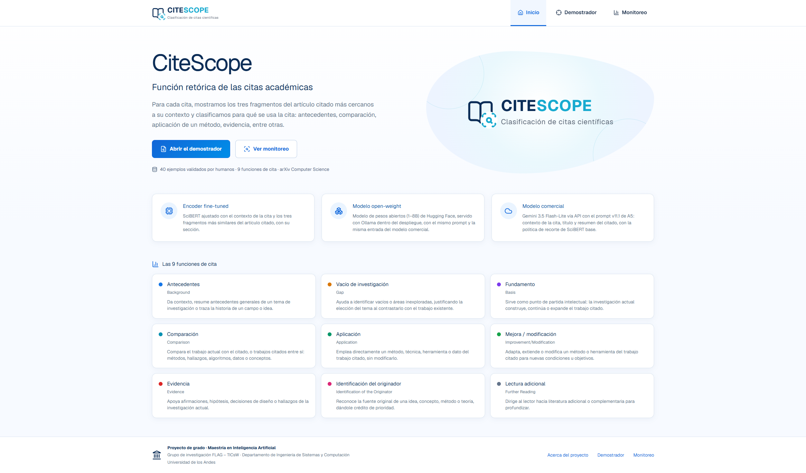

<p align="center">
  <picture>
    <source media="(prefers-color-scheme: dark)" srcset="../assets/logo-uniandes-oscuro.svg">
    
  </picture>
</p>

# CiteScope · Demostrador

**Clasificación de la función de citas académicas: arquitectura, instalación y operación con Docker.**


CiteScope permite examinar la función que cumple una cita en un artículo académico mediante su contexto y la información del documento citado. La aplicación presenta los tres fragmentos recuperados, la categoría predicha, los puntajes de las nueve funciones y la correspondencia con una etiqueta humana de referencia. Cada solicitud se registra para consultar sus resultados, latencia y posibles errores.

El demostrador integra los componentes del proyecto de grado **«Recuperación semántica y clasificación de la función de citas académicas en Computer Science»**. Ofrece tres alternativas de clasificación: SciBERT Top-3, un modelo de pesos abiertos servido por Ollama y un modelo comercial mediante API. La información del artículo citado que recibe cada alternativa se especifica en la sección 2.

**Maestría en Inteligencia Artificial · Universidad de los Andes.** La propuesta identifica como organización al Grupo de investigación FLAG — TICSW, Departamento de Ingeniería de Sistemas y Computación.



*Pantalla inicial: presentación del proyecto, acceso al demostrador y monitoreo de las clasificaciones.*

## 1. Alcance y componentes funcionales

| Componente de la interfaz | Función |
|---|---|
| Inicio `/` | Presentación del proyecto, alternativas de clasificación y definiciones de las nueve funciones de cita. |
| Demostrador `/demo` | Selección de un ejemplo, consulta de los textos y ejecución de la clasificación. |
| Monitoreo `/monitoreo` | Consulta del historial, modelos utilizados, predicciones, etiquetas humanas, latencias, estados y detalle de cada solicitud. |

La aplicación contiene **40 ejemplos con etiquetas humanas**, procedentes de artículos de arXiv incluidos en unarXive 2022. Cada registro conserva enlaces y licencias de los artículos citante y citado. La interfaz muestra esa atribución.

Las categorías son Background, Gap, Basis, Comparison, Application, Improvement/Modification, Evidence, Identification of the Originator y Further Reading.

El demostrador utiliza ejemplos fijos y sus **Top-3 precalculados**. No realiza recuperación de nuevos fragmentos ni entrenamiento durante la consulta. Las estadísticas del historial describen las solicitudes realizadas y no sustituyen la evaluación del test humano completo. La repetición de un ejemplo genera nuevas solicitudes, no nuevas observaciones independientes.

## 2. Modelos, entradas y salidas

| Alternativa | Modelo por defecto | Entrada | Salida y validación |
|---|---|---|---|
| Encoder | SciBERT Top-3 ajustado en A4 | Contexto de la cita y tres fragmentos del artículo citado, con sus secciones. | Categoría predicha, nueve puntajes softmax y auditoría de tokens. |
| Open-weight | Llama 3.1 8B Instruct, GGUF Q4_K_M, mediante Ollama | Contexto, título y resumen del citado, alineados con la política de SciBERT base; prompt v11.1 de A5, condición `base-specific-zero`. | Nueve puntajes sujetos al validador de A5, con temperatura 0 y semilla 42. Si la única falla es la suma, los puntajes se dividen por su total y el ajuste queda registrado en Monitoreo; la función predicha no cambia. |
| Comercial | Gemini 3.5 Flash-Lite, mediante API | La misma representación y condición de prompt de la alternativa open-weight. | Nueve puntajes sujetos al validador de A5. Una suma inválida produce un error. |

La API recibe texto plano. SciBERT aplica su tokenizador para obtener identificadores y máscaras; no requiere embeddings precalculados como entrada. Los LLM reciben mensajes de texto. La etiqueta humana se utiliza para contrastar la predicción y no forma parte de la entrada enviada al modelo.

### Política de entrada de SciBERT

- Configuración `fragmentos`, con un máximo de **512 tokens totales**, incluidos los tokens especiales.
- Presupuesto de **192 tokens para el contexto**; la información del citado utiliza el espacio restante según la política exportada.
- Puntajes sin calibración adicional; no representan certeza garantizada.

La selección y evaluación se documentan en [Métricas de A4](../A4/Final/M%C3%A9tricas.md), [modelos, entradas y salidas](../A4/Final/Modelos_Entradas_Salidas.md) y el [notebook de evaluación final](../A4/Evaluacion_Final/SciBERT_Evaluacion_Final.ipynb).

Llama se consulta con temperatura 0 y semilla 42, es decir, con decodificación determinista. Gemini conserva la configuración con la que se evaluó en A5.

## 3. Organización del directorio

```text
Demostrador/
├── docker-compose.yml
├── .env.example
├── .env                         # configuración privada
├── api/                         # FastAPI, inferencia y persistencia
│   ├── main.py
│   ├── database.py
│   ├── schemas.py
│   ├── a5_*.py
│   ├── prompt_v11_1_snapshot.json
│   └── examples_TB_con_resumen.jsonl
├── frontend/                    # interfaz Next.js y TypeScript
└── models/
    └── top3/                    # paquete SciBERT extraído
```

Los textos de ejemplo y los contratos de la API se distribuyen con el código. Los pesos se obtienen mediante la preparación del modelo y se mantienen separados del repositorio.

## 4. Requisitos de despliegue

- Docker y Docker Compose v2, con capacidad para ejecutar contenedores Linux.
- Conexión a Internet para construir las imágenes, instalar dependencias y descargar modelos.
- Memoria y almacenamiento suficientes para la API, la interfaz, PostgreSQL y el modelo de lenguaje.
- Acceso al paquete de SciBERT en Drive. Su ZIP ocupa aproximadamente **409 MB**, además del espacio necesario para extraerlo.
- Almacenamiento para el modelo de Ollama: aproximadamente **4,9 GB** para la alternativa predeterminada, además de las imágenes y dependencias.
- Una clave de Gemini si se utilizará la clasificación comercial.

Los recursos y tiempos de respuesta dependen de la infraestructura y del modelo configurado. Todos los servicios de la aplicación se ejecutan mediante Compose; Gemini se consulta como servicio externo.

## 5. Configuración del despliegue

Desde la raíz del repositorio, ingresar al directorio:

```sh
cd Demostrador
```

Crear `.env` a partir de `.env.example` antes del primer arranque y completar los valores necesarios. Si el archivo ya existe, editarlo sin sobrescribir sus credenciales.

| Variable | Descripción |
|---|---|
| `GEMINI_API_KEY` | Clave privada de la alternativa comercial. Puede quedar vacía si esta opción no se utilizará. |
| `OPEN_WEIGHT_MODEL` | Modelo que descarga y sirve Ollama. Por defecto: `hf.co/bartowski/Meta-Llama-3.1-8B-Instruct-GGUF:Q4_K_M`. |
| `OPEN_WEIGHT_TIMEOUT` | Tiempo máximo de espera de la petición a Ollama, en segundos; por defecto **600**. Puede añadirse a `.env`. Gemini utiliza **90 segundos** fijados en el código. |
| `TOP3_GDRIVE_ID` | ID del paquete de SciBERT. Por defecto: `1Y6_RADwbvXl9VY5OLfpaOY8BL77syUrd`. |
| `POSTGRES_PASSWORD` | Contraseña inicial de PostgreSQL; Compose utiliza `citas` si está vacía. Para un despliegue compartido debe establecerse una contraseña propia. |
| `FRONTEND_PORT` | Puerto publicado de la interfaz; por defecto **3001**. |
| `API_PORT` | Puerto de la API; por defecto **8002**, accesible mediante `127.0.0.1`. |

Compose establece la dirección interna de Ollama como `http://ollama:11434`. La configuración descrita no requiere modificar esa dirección mediante `.env`.

Las credenciales deben conservarse fuera del control de versiones. Tras modificar variables de entorno, ejecutar nuevamente el comando de arranque para recrear los servicios afectados; `restart` por sí solo no aplica dichos cambios.

## 6. Arquitectura del despliegue

La interfaz Next.js envía las solicitudes a FastAPI. La API prepara las entradas, ejecuta SciBERT o consulta uno de los LLM y registra la operación en PostgreSQL.

Compose define seis servicios:

| Servicio | Responsabilidad |
|---|---|
| `db` | Base PostgreSQL para el historial de inferencias. |
| `model-init` | Preparación inicial del paquete SciBERT. |
| `ollama` | Servidor del modelo de pesos abiertos. |
| `ollama-pull` | Descarga inicial del modelo configurado en Ollama. |
| `api` | Inferencia, consulta de ejemplos y persistencia de solicitudes. |
| `frontend` | Interfaz de Inicio, Demostrador y Monitoreo. |

`model-init` y `ollama-pull` son tareas de preparación: su finalización correcta con estado `Exited (0)` no representa un fallo. Los otros servicios permanecen activos durante la operación.

## 7. Instalación y arranque con Docker

Ejecutar desde `Demostrador/`:

```sh
docker compose config --quiet
docker compose up -d --build
docker compose ps --all
```

El primer arranque construye las imágenes y prepara los modelos. La descarga del modelo de lenguaje puede continuar aunque la interfaz ya esté disponible. Su progreso se consulta con:

```sh
docker compose logs -f ollama-pull
```

Con los puertos predeterminados, los puntos de acceso son:

| Recurso | Dirección |
|---|---|
| Inicio | <http://localhost:3001> |
| Demostrador | <http://localhost:3001/demo> |
| Monitoreo | <http://localhost:3001/monitoreo> |
| Documentación interactiva de la API | <http://localhost:8002/docs> |
| Estado de los modelos | <http://localhost:8002/health> |

El proyecto Compose utiliza el nombre `demo-citas-prd`. Para despliegues independientes debe asignarse otro nombre mediante `docker compose -p nombre-distinto ...` y configurar puertos distintos. Ese nombre debe conservarse en los comandos posteriores de operación y respaldo.

## 8. Preparación de SciBERT y acceso a Drive

El servicio `model-init` comprueba si existe `models/top3/inference.py`. Si lo encuentra, omite la descarga. En caso contrario, descarga el ZIP desde Drive y lo extrae en `models/top3/`.

**El código actual no extrae un ZIP guardado manualmente en `models/`.** Si Drive impide la descarga automática:

1. Descargar el [paquete SciBERT](https://drive.google.com/file/d/1Y6_RADwbvXl9VY5OLfpaOY8BL77syUrd/view) desde el navegador con una cuenta autorizada.
2. Guardar el ZIP fuera del repositorio.
3. Descomprimir su contenido directamente en `Demostrador/models/top3/`, sin una subcarpeta intermedia.
4. Confirmar esta estructura:

```text
models/top3/
├── inference.py
├── model.safetensors
├── config.json
├── input_policy.json
├── label_mapping.json
└── ...archivos del tokenizador y contratos
```

No es suficiente copiar únicamente `inference.py`: el directorio debe contener el paquete completo. El ZIP debe mantenerse fuera de Git por su tamaño; no debe asumirse que las reglas del repositorio lo excluyen automáticamente.

Repetir el arranque y consultar la preparación:

```sh
docker compose up -d --build
docker compose logs --tail 40 model-init
```

La descarga automática no utiliza la sesión de Google del navegador. Requiere acceso al archivo sin autenticación. Si la política de la organización impide compartirlo públicamente, debe utilizarse la extracción manual. Referencia: [gestión de acceso y descarga en Drive](https://support.google.com/drive/answer/7166529?hl=es).

La presencia de `inference.py` es una comprobación de existencia, no una verificación de integridad de todo el paquete. Una extracción incompleta debe revisarse antes de repetir el arranque.

## 9. Verificación de la clasificación

Consultar `http://localhost:8002/health` o la documentación interactiva de la API. Este endpoint comprueba la carga de SciBERT y si Ollama anuncia el modelo configurado. Para Gemini, `available` indica únicamente que existe una clave: no verifica autenticación, permisos, cuota ni una inferencia exitosa.

En Demostrador, seleccionar un ejemplo, elegir una alternativa de clasificación y enviar la solicitud. La misma operación puede ejecutarse desde `/docs`, mediante `POST /predictions`:

```json
{
  "example_id": "B-001",
  "model_type": "encoder"
}
```

| Valor de `model_type` | Procesamiento | Respuesta inicial |
|---|---|---|
| `encoder` | Inferencia síncrona con SciBERT. | **201**, con el resultado si la inferencia es correcta. |
| `open_weight` | Consulta a Ollama en segundo plano. | **202**, estado `pending`. |
| `commercial` | Consulta a Gemini en segundo plano. | **202**, estado `pending`. |

Para los dos LLM, consultar el mismo `prediction_id` en Monitoreo o en `GET /predictions` hasta su estado final: `success` o `error`. Una respuesta 202 confirma la aceptación de la solicitud, no su finalización correcta. Las consultas comerciales pueden generar cargos del proveedor.

## 10. Historial, validación y diagnóstico

El historial se conserva en PostgreSQL, tabla `inference_logs`. Incluye identificador, fecha, ejemplo, modelo, predicción, puntajes, etiqueta humana, latencia y estado. Las solicitudes a LLM también conservan su entrada y respuesta original; la auditoría de tokens permite revisar el texto procesado. Este historial es independiente del seguimiento de entrenamientos en MLflow.

| Método | Ruta | Función |
|---|---|---|
| GET | `/health` | Consulta de disponibilidad con el alcance descrito en la sección 9. |
| GET | `/examples` | Consulta de los 40 ejemplos. |
| POST | `/predictions` | Solicitud de clasificación por ejemplo y tipo de modelo. |
| GET | `/predictions` | Consulta del historial y seguimiento de solicitudes. |

Monitoreo permite filtrar registros y consultar exactitud frente a las referencias humanas, latencia p95 y tasa de error. Los indicadores dependen de las solicitudes y filtros seleccionados; no equivalen a las métricas del test completo.

### Validación de los LLM

**Gemini y Llama utilizan el validador de A5**: se exigen nueve categorías exactas, valores finitos entre 0 y 1 y suma 1 con tolerancia de **±0,001**. En Gemini, una respuesta que incumple cualquiera de estas condiciones queda registrada como error. En Llama, que no se evaluó sobre el test, una respuesta que solo incumple la suma se renormaliza: cada puntaje se divide por el total, la función predicha no cambia y el detalle de la inferencia muestra la suma original. Si con temperatura 0 los nueve puntajes son cero, la consulta se repite una vez con temperatura 0,7 y semilla 42, y el detalle lo indica. Las demás fallas de Llama también quedan registradas como error.

Al reiniciar la API, las solicitudes que quedaron `pending` se marcan como interrumpidas; no se reanudan automáticamente.

| Incidencia | Comprobación |
|---|---|
| Docker no responde | Verificar el servicio de Docker y ejecutar `docker info`. |
| Falla `model-init` | Consultar sus logs y comprobar el acceso a Drive; utilizar extracción manual si corresponde. |
| SciBERT no carga | Verificar la extracción completa y la ubicación directa de `models/top3/inference.py`. |
| Ollama no está disponible | Consultar `docker compose logs --tail 60 ollama` y el estado del servicio. |
| Falta el modelo de lenguaje | Consultar los logs de `ollama-pull` y comparar `OPEN_WEIGHT_MODEL` con `docker compose exec ollama ollama list`. |
| Los puntajes no suman 1 | En Gemini, la respuesta queda registrada como error. En Llama, los puntajes se renormalizan y el detalle en Monitoreo muestra la suma original y la respuesta del modelo. |
| La solicitud permanece en curso | Los límites de espera son 600 segundos para Ollama y 90 para Gemini. Consultar la misma solicitud antes de enviarla nuevamente. |
| Gemini falla aunque figura disponible | Revisar el error del proveedor, la clave, los permisos y la cuota. |
| Puerto ocupado | Modificar `FRONTEND_PORT` o `API_PORT` y recrear los servicios. |

Comandos de diagnóstico:

```sh
docker compose ps --all
docker compose logs --tail 60 api frontend
docker compose logs --tail 60 model-init ollama-pull
docker compose exec ollama ollama ps
```

## 11. Persistencia, respaldo y detención

Para detener el despliegue conservando los volúmenes:

```sh
docker compose down
```

Para reanudarlo, ejecutar `docker compose up -d --build`. La opción `down -v` elimina los volúmenes del proyecto, incluida la base de datos y el almacenamiento de Ollama. El directorio `models/` es una carpeta del anfitrión montada en los contenedores y se conserva aparte.

### Respaldo de PostgreSQL

Con la base activa y los nombres predeterminados, generar una copia en formato de PostgreSQL y exportarla desde el contenedor:

```sh
docker compose exec -T db pg_dump -U citas -d citas -Fc -f /tmp/citescope.dump
docker compose cp db:/tmp/citescope.dump /ruta/respaldos/citescope.dump
```

El segundo comando requiere sustituir `/ruta/respaldos/citescope.dump` por una ruta existente fuera del repositorio. Ejecutarlo únicamente después de que `pg_dump` termine correctamente. Adaptar usuario y base si fueron modificados. El respaldo contiene entradas y respuestas del historial y debe conservarse con acceso adecuado.

### Cambio de contraseña sin eliminar datos

`POSTGRES_PASSWORD` establece la contraseña cuando se inicializa la base. Modificar `.env` no cambia automáticamente la contraseña de una base existente.

1. Realizar un respaldo.
2. Abrir `docker compose exec db psql -U citas -d citas`.
3. Utilizar `\password citas` para cambiar la contraseña mediante el diálogo de PostgreSQL y salir con `\q`.
4. Actualizar `POSTGRES_PASSWORD` en `.env` con el mismo valor. Verificar su incorporación a `DATABASE_URL`: los caracteres reservados de URL requieren tratamiento adecuado.
5. Ejecutar `docker compose up -d --build` y comprobar la disponibilidad y el historial.

Este procedimiento no requiere borrar el volumen.

## 12. Despliegue en EC2

Preparar Docker y Compose en la instancia siguiendo la [documentación para Ubuntu](https://docs.docker.com/engine/install/ubuntu/) y copiar el directorio `Demostrador` con su configuración.

- Crear un `.env` propio, con las credenciales necesarias y el modelo seleccionado. Configurar `FRONTEND_PORT=80` si ese es el puerto previsto para la interfaz.
- Preparar SciBERT mediante Drive o extracción manual y ejecutar `docker compose up -d --build`.
- Comprobar la descarga de Ollama mediante `docker compose logs -f ollama-pull` y revisar `/health` antes de utilizar los modelos.
- Configurar el grupo de seguridad para permitir el acceso a la interfaz a los destinatarios previstos y limitar SSH a las direcciones necesarias.
- Mantener la API en `127.0.0.1:8002`; PostgreSQL y Ollama no necesitan publicarse directamente.
- Conservar el volumen de PostgreSQL y sus respaldos. Un cambio de IP pública no elimina el historial; la pérdida del disco que lo almacena sí puede hacerlo.

La aplicación no incorpora autenticación de usuarios ni límites de consumo. Un despliegue compartido requiere controlar el acceso y la activación de consultas comerciales.

## 13. Documentación de referencia

| Recurso | Contenido |
|---|---|
| [Docker Compose](docker-compose.yml) y [variables de ejemplo](.env.example) | Servicios, puertos, volúmenes y configuración. |
| [API](api/main.py) y [contratos](api/schemas.py) | Modelos, entradas, estados y tiempos de espera. |
| [Validador de A5](api/a5_runtime.py) y [alineación de entradas](api/a5_alignment.py) | Estructura de puntajes y preparación del texto de los LLM. |
| [Ejemplos](api/examples_TB_con_resumen.jsonl) | Datos, etiquetas, fragmentos y atribución. |
| [Persistencia](api/database.py) | Estructura del registro de inferencias. |
| [Métricas de A4](../A4/Final/M%C3%A9tricas.md) | Selección de modelos, evaluación y evidencias en Drive. |
| [Análisis de A5](../A5/Analisis_Final_A5.md) | Evaluación con modelos comerciales. |
| [Informe final](../Documents/Informe%20Final%20G15.md) | Metodología y conclusiones del proyecto. |
| [README general](../README.md) | Recorrido por las etapas y acceso a los entregables. |

---

<p align="center">
  
</p>
