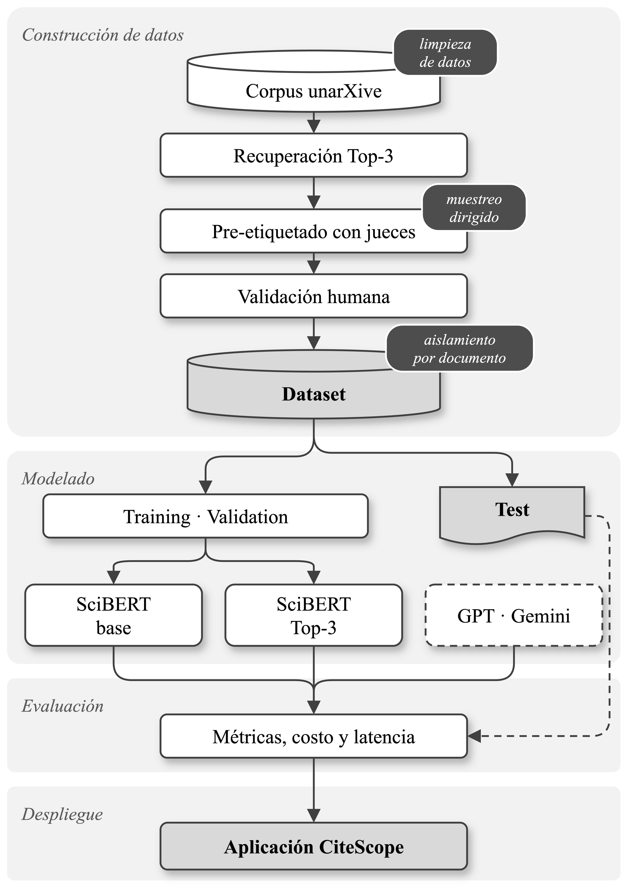
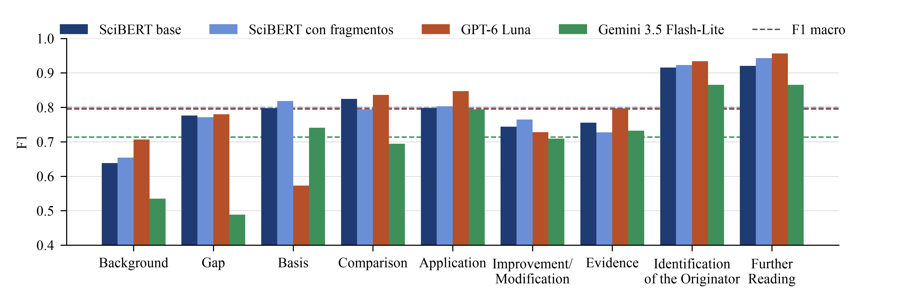
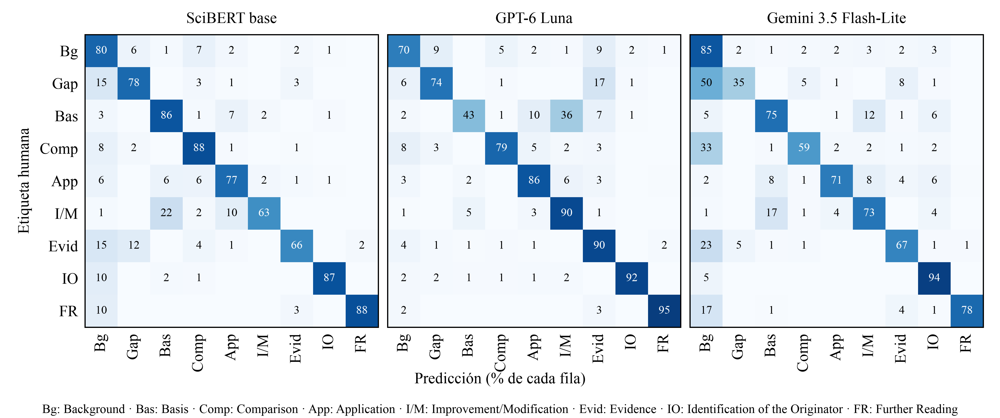

<!--
Versión de lectura del artículo para ir completando en equipo, una vez finalizada se pasa al formato IEEE.
-->

# CiteScope: Clasificación de la función de citas en Computer Science con modelos de lenguaje y recuperación semántica del artículo citado

**Camilo Bejarano, Germán Rodríguez, José Arteaga y Sebastián Toro**

> *[Instrucción de maquetación, no es texto del artículo: el siguiente párrafo va como nota al pie sin numerar en la primera columna de la página 1, según la plantilla IEEE.]*
>
> Documento recibido el 23 de noviembre de 2026. Este trabajo contó con el apoyo de la Universidad de los Andes y del grupo de investigación FLAG–TICSw del Departamento de Ingeniería de Sistemas y Computación, y con la asesoría del PhD. Juan Camilo Sanguino en la definición del problema, la orientación bibliográfica y la validación de las decisiones clave. Los autores pertenecen a la Maestría en Inteligencia Artificial (MaIA), Departamento de Ingeniería de Sistemas y Computación, Universidad de los Andes, Bogotá, Colombia. Camilo Bejarano (c.bejaranoc@uniandes.edu.co), Germán Rodríguez (gm.rodriguez@uniandes.edu.co), José Arteaga (j.arteagac@uniandes.edu.co), Sebastián Toro (s.torod@uniandes.edu.co).

**Resumen—** La cita es el principal mecanismo con el que un artículo científico se conecta con el conocimiento previo, aunque en la práctica suele reducirse a un conteo que no distingue si una referencia aporta contexto, fundamenta un método, respalda una afirmación o señala una limitación. Este trabajo aborda la clasificación automática de las citas en artículos de Computer Science en inglés según nueve funciones y evalúa si la evidencia recuperada del propio artículo citado mejora esa clasificación. A partir de unarXive 2022 se construyó un corpus de contextos de cita vinculados al texto completo del artículo citado; para cada par citante–citado se recuperaron con SciBERT los tres fragmentos más similares al párrafo citante. Tres modelos de lenguaje de pesos abiertos asignaron pre-etiquetas a 38.780 instancias, y dos grupos de anotadores validaron un conjunto de prueba (Test) de 2.968 instancias (κ de Cohen = 0,854). Se ajustó SciBERT con dos entradas —título y resumen del citado, frente a fragmentos recuperados— y se comparó con dos modelos comerciales sin ajuste, GPT-6 Luna y Gemini 3.5 Flash-Lite, cada uno en cuatro condiciones que combinan el tipo de prompt y el uso de ejemplos. SciBERT obtuvo un F1 macro de 0,800 con fragmentos y de 0,797 con título y resumen, una diferencia no concluyente. Los modelos comerciales obtuvieron entre 0,582 y 0,795, con un costo medio de 0,60 y 1,63 USD por cada mil instancias según el modelo; GPT-6 Luna, con un prompt específico, quedó apenas por debajo de SciBERT base (0,795 frente a 0,797). A diferencia de trabajos previos, el estudio combina una taxonomía de nueve funciones de cita, aplicada a artículos de Computer Science, evidencia recuperada del texto del citado y una comparación de desempeño, costo y latencia entre un codificador ajustado y modelos comerciales; la solución se ofrece como aplicación web.

**Índice de Términos—** función de cita, modelos de lenguaje, recuperación semántica, SciBERT, unarXive.

## I. Introducción

El volumen de artículos científicos en Computer Science crece a un ritmo que dificulta seguir cómo se relacionan los trabajos entre sí. Los indicadores de impacto más usados se basan en el número de citas, un conteo que trata por igual una referencia que fundamenta un método y otra que solo se menciona como antecedente [1]. Distinguir estas funciones permitiría, por ejemplo, identificar qué trabajos se usan efectivamente como base, cuáles se contrastan o cuáles se citan para señalar una limitación [2].

La función de una cita no siempre es explícita en la oración que la contiene. A menudo depende de lo que el artículo citado aporta, información que está dispersa en su texto completo y no solo en su título o resumen. Además, varias funciones tienen fronteras difusas —por ejemplo, entre el uso de un trabajo como base y su modificación—, lo que exige criterios de anotación consistentes.

El objetivo general de este trabajo es clasificar automáticamente las citas de artículos de Computer Science en inglés según nueve funciones, incorporando evidencia recuperada del artículo citado. Los objetivos específicos son: (i) construir un corpus que vincule cada contexto de cita con los fragmentos del artículo citado más similares, recuperados con SciBERT; (ii) construir un dataset trazable, con pre-etiquetado a escala, un conjunto de prueba (Test) validado por humanos, atención a las funciones escasas y aislamiento por documento para evitar fuga de información; (iii) medir si los fragmentos recuperados mejoran un clasificador SciBERT ajustado, frente a una entrada con título y resumen del citado; (iv) contrastar ese clasificador con modelos de lenguaje comerciales sin ajuste, en desempeño, costo y latencia; y (v) desplegar la solución como aplicación web.

La solución propuesta, CiteScope, opera en dos etapas. Primero, para cada par formado por un artículo citante y uno citado, compara el párrafo citante con los fragmentos del texto completo del artículo citado, excluidas sus secciones de trabajos relacionados, y recupera los tres más similares; cada fragmento conserva el título de la sección de la que proviene. Después, un clasificador basado en SciBERT, ajustado con instancias etiquetadas, asigna una de nueve funciones a partir del contexto y de esa evidencia. Para obtener las instancias de Training a escala, tres modelos de lenguaje de pesos abiertos propusieron pre-etiquetas, y 5.935 instancias (el 17,0 % del dataset), entre ellas las del Test, se validaron con anotadores humanos. La solución se compara con modelos de lenguaje comerciales y se ofrece como aplicación web que muestra la función predicha junto con los fragmentos que la sustentan.

Las contribuciones del trabajo son:
- Un dataset de 34.988 instancias de citas en Computer Science con nueve funciones, cada una vinculada al artículo citado y a sus tres fragmentos más similares: 5.935 tienen etiqueta humana de dos grupos de anotadores, entre ellas las 2.968 del Test, y el resto tiene pre-etiquetas de alta confianza de tres modelos de pesos abiertos, cuya concordancia con la validación humana se mide. Cada instancia puede reconstruirse desde unarXive mediante un identificador estable.
- Una medición controlada de si los fragmentos recuperados del artículo citado mejoran la clasificación: dos versiones de SciBERT entrenadas con las mismas instancias y la misma configuración, que solo difieren en la información del citado que reciben, evaluadas sobre el Test con etiquetas humanas.
- Una comparación de desempeño, costo y latencia entre SciBERT ajustado y modelos de lenguaje comerciales sin ajuste, en la que SciBERT base y los modelos comerciales reciben el mismo texto de la cita y del citado, de modo que las diferencias no se deben a la información disponible.

El resto del artículo se organiza así: la Sección II revisa el estado del arte; la Sección III describe datos, métodos y despliegue; la Sección IV presenta los resultados; la Sección V los discute, y la Sección VI concluye.

## II. Estado del arte

**Taxonomías.** Lyu et al. [2] sintetizaron 38 estudios sobre las motivaciones para citar y las agruparon en 13: diez científicas, que cumplen una función en la argumentación del texto, y tres tácticas, que responden a razones sociales o de beneficio del autor. Este trabajo adopta nueve de las diez funciones científicas; se excluye Assessment, la valoración del citante sobre el citado, porque expresa una postura que puede acompañar a cualquier otra función.

**Conjuntos de datos.** SciCite [3] reúne 11.020 citas de computación y medicina, anotadas en tres funciones; ACL-ARC [4] reúne 1.941 citas de lingüística computacional, anotadas en seis funciones. MultiCite [5] mostró que estos esquemas simplifican el fenómeno: en 12.653 contextos de lingüística computacional, anotados por expertos en siete funciones, el 17,1 % abarca más de una oración y el 19,3 % de las citas tiene más de una función. Ninguno vincula cada cita con el contenido del artículo citado ni cubre las nueve funciones científicas de Lyu et al. en artículos de Computer Science.

**Clasificadores y recuperación.** Cohan et al. [3] obtuvieron un F1 macro de 0,840 en SciCite con tareas auxiliares sobre la estructura del artículo citante, como predecir el título de la sección. SciBERT [6], preentrenado con el texto completo de 1,14 millones de artículos de biomedicina (82 %) y computación (18 %), alcanzó 0,855 con ajuste fino. La recuperación sobre artículos científicos se ha usado sobre todo para recomendar qué citar [7]; este trabajo invierte esa dirección y, dado un par citante–citado, recupera los fragmentos del citado que ayudan a explicar por qué se cita.

**Modelos de lenguaje grandes.** Koloveas et al. [8] evaluaron doce modelos de lenguaje de pesos abiertos en SciCite y ACL-ARC, con aprendizaje en contexto y ajuste fino; el ajuste fino del mejor modelo mejoró su F1 un 8 % relativo en SciCite y un 4,3 % en ACL-ARC, sin preentrenamiento científico específico. Usado como anotador, un modelo comercial superó a trabajadores de colaboración abierta en la mayoría de las tareas de anotación de tuits y noticias, con un costo unas treinta veces menor [9]. Este trabajo usa modelos de pesos abiertos como jueces que proponen pre-etiquetas y modelos comerciales como alternativa de clasificación sin ajuste.

**TABLA I.** Trabajos relacionados.

| Trabajo | Funciones | Dominio | Texto del citado | Modelos |
|---|---|---|---|---|
| SciCite [3] | 3 | Computación y medicina | No | BiLSTM con ELMo |
| MultiCite [5] | 7, multietiqueta | Lingüística computacional | No | SciBERT, RoBERTa |
| Koloveas et al. [8] | 3 y 6 | Computación, medicina y lingüística | No | Modelos de pesos abiertos |
| CiteScope | 9 | Computer Science | Sí | SciBERT; dos modelos comerciales |

Como resume la Tabla I, los conjuntos de datos existentes tienen pocas funciones o dominios acotados, y sus modelos clasifican la función solo con el texto citante. Ningún trabajo revisado combina las nueve funciones científicas de Lyu et al., aplicadas a artículos de Computer Science, evidencia recuperada del artículo citado y una comparación de desempeño, costo y latencia entre un codificador ajustado y modelos de lenguaje comerciales; esa es la brecha que aborda este trabajo.

## III. Metodología

La metodología sigue el ciclo de aprendizaje automático en cuatro fases (Fig. 1): la construcción de los datos, que comprende la obtención y limpieza del corpus, la recuperación de evidencia y la construcción de etiquetas; el modelado; la evaluación, y el despliegue. En la figura, los recuadros oscuros señalan los controles sobre los datos (limpieza, muestreo dirigido a las funciones escasas y aislamiento por documento para evitar fuga de información); la línea discontinua indica que el Test solo se usa en la evaluación, y la caja discontinua, los modelos sin ajuste. En cada etapa se indican las decisiones tomadas y su justificación; los resultados se presentan en la Sección IV.

**Fig. 1.** Arquitectura general de CiteScope.

### A. Datos y corpus

Se utilizó unarXive 2022 [10], derivado de las fuentes LaTeX de arXiv, porque conserva el texto estructurado por secciones y párrafos y vincula las referencias bibliográficas con identificadores de arXiv, lo que permite acceder al texto completo del artículo citado. unarXive contiene 405.947 artículos con alguna categoría cs.\*, principal o secundaria; de ellos, se conservaron los 358.494 cuya categoría principal es cs.\*, eess.\* o stat.ML, para excluir los artículos de otras áreas que solo tocan computación de forma secundaria. De los 117.194 artículos de arXiv distintos que estos citan, el 72,6 % pertenece al mismo subconjunto. El contexto de cita es el párrafo del citante que contiene la cita, tal como lo segmenta unarXive, y cada instancia es una cita concreta, identificada por una clave estable (citante, párrafo, posición del marcador y citado) que permite reconstruir el texto exacto; en una muestra de 300 contextos y fragmentos, todos se reconstruyeron idénticos desde unarXive.

La construcción inicial tomó como artículos citantes los de cs.CV, cs.SI, cs.HC, cs.CY y cs.ET; el artículo citado podía pertenecer a cualquier subcampo disponible en el corpus. El 97,8 % de los contextos de este piloto provino de cs.CV: además de tener más artículos en el corpus (59.780, frente a 7.033 o menos en los otros cuatro), el 25,8 % de sus referencias tiene identificador de arXiv, frente a entre 1,9 % y 8,2 % en los demás, y solo esas referencias permiten obtener el texto completo del artículo citado, de modo que cs.CV aporta muchos más pares citante–citado utilizables. Para aumentar el suministro de funciones escasas, el corpus se amplió con citantes de cs.LG, cs.CL y cs.DS.

La limpieza eliminó fragmentos duplicados, fragmentos de menos de 15 palabras y residuos de plantillas LaTeX; los fragmentos sin sección se conservaron, porque en su mayoría son texto real de artículos cuyos encabezados no se pudieron extraer. Se descartaron los artículos citados con menos de 1.000 palabras de texto, que corresponden a extracciones incompletas sin contenido suficiente para recuperar fragmentos, y los contextos de más de 512 tokens de SciBERT; estos se excluyeron en lugar de truncarse porque el párrafo completo es la consulta de la recuperación (Sección III-B) y truncarlo podría dejar fuera la cita objetivo. También se excluyeron los citantes en otros idiomas y las autocitas del mismo identificador. La Tabla II resume ambos corpus.

**TABLA II.** Corpus después de la limpieza.

| Corpus | Contextos | Artículos citantes | Artículos citados | Fragmentos |
|---|---:|---:|---:|---:|
| Piloto (cs.CV, cs.SI, cs.HC, cs.CY, cs.ET) | 1.113.513 | 50.538 | 31.532 | 1.229.408 |
| Ampliación (cs.LG, cs.CL, cs.DS) | 368.296 | 50.456 | 30.153 | 1.574.790 |

En los datos usados para el modelado, cs.CV sigue dominando según la categoría principal de arXiv del artículo citante. En Training y Validation (13.269 instancias) reúne el 77,2 %, seguido de cs.LG (8,9 %) y cs.DS (6,8 %), y los otros cinco subcampos suman el 7,1 %. En el Test (2.968 instancias), las proporciones son 88,4 %, 5,8 %, 2,4 % y 3,4 %, respectivamente.

El desbalance entre funciones responde a cómo se cita en la práctica: la mayoría de las citas cumple una función de antecedente (Background), mientras que funciones como Further Reading o Improvement/Modification son escasas. Por eso, además de lotes aleatorios, el pre-etiquetado incluyó lotes dirigidos por señales léxicas a las funciones escasas (muestreo dirigido), de modo que el conjunto pre-etiquetado, del que salen Training, Validation y Test, no refleja la distribución natural; el Test, además, se muestreó con una cuota por función (Sección III-C).

### B. Segmentación y recuperación de evidencia

El texto de cada artículo citado se segmentó respetando sus secciones, en fragmentos de hasta 300 palabras y dos párrafos. Cada contexto de cita y cada fragmento se codificó con SciBERT [6] sin ajuste (`allenai/scibert_scivocab_uncased`). La representación de un texto es el promedio de los vectores de la última capa oculta sobre sus tokens reales, sin contar el relleno (*mean pooling*). El vector se normalizó a norma unitaria, de modo que el producto punto equivale a la similitud coseno. Se prefirió el promedio al vector `[CLS]` porque, sin ajuste, este último no está entrenado como resumen del texto. A diferencia de los contextos de cita, que se excluyeron si superaban los 512 tokens (Sección III-A), los fragmentos se truncaron: la segmentación ya limitaba cada uno a ese tamaño, y solo 138 de 1.229.408 fragmentos del piloto (0,01 %) y 252 de 1.574.790 de la ampliación (0,02 %) lo superaron, por ser oraciones únicas demasiado largas para dividirse.

La consulta fue el párrafo citante completo, sin marcar la cita objetivo. Para cada par citante–citado se usó un único párrafo, el primero en que aparece el par en el corpus; se procesaron 721.335 pares. Se excluyeron los fragmentos de las secciones de trabajos relacionados del citado, porque describen trabajo ajeno a su aporte y aparecían sobrerrepresentados en las primeras posiciones; cuando quedaban menos de tres candidatos se conservaron los originales. Entre los fragmentos restantes del artículo citado se seleccionaron los tres más similares a la consulta (Top-3); cada uno conservó el título de su sección tal como aparece en el artículo citado, o quedó como sección desconocida (cerca del 1,6 % de los fragmentos). Como la consulta no distingue la cita objetivo, en párrafos que citan varios trabajos el Top-3 refleja el párrafo en conjunto y no solo esa cita.

La calidad de la recuperación se verificó de dos formas: una auditoría de las secciones de origen, que motivó excluir los trabajos relacionados, y el efecto de los fragmentos en las decisiones de los jueces y del clasificador (H5 y H6, Tabla V). La relevancia de cada fragmento no se anotó directamente, porque el esfuerzo de anotación humana se concentró en validar las etiquetas de los dos conjuntos de prueba (11.880 anotaciones); esa evaluación queda como trabajo futuro.

### C. Pre-etiquetado y validación humana

Anotar desde cero decenas de miles de citas no era viable, por lo que se usaron tres modelos de lenguaje de pesos abiertos como jueces que propusieron una pre-etiqueta: Qwen3.8-27B [11], Gemma 4 26B [12] y Mistral Small 3.2 24B [13]. Cada juez recibió las definiciones y reglas de la guía, el título y resumen del citado, sus tres fragmentos con sección, el párrafo citante y la oración de la cita objetivo, y devolvió el pasaje del párrafo citante que sustenta su decisión, una etiqueta principal y posibles secundarias. La decodificación fue determinista. La etiqueta principal de cada juez contó como un voto; una función con al menos dos votos generó una pre-etiqueta de alta confianza, y los empates quedaron sin pre-etiqueta.

La selección de jueces y del prompt se hizo sobre una muestra de desarrollo de 60 instancias, sesgada a propósito hacia casos difíciles: 20 en que los jueces confundían Further Reading con Background e Improvement/Modification con Application; 5 de cada una de cinco funciones escasas, buscadas por señales léxicas (Identification of the Originator, Further Reading, Evidence, Gap y Comparison), y 15 elegidas al azar. Su tamaño se limitó a lo que ambos grupos podían anotar a ciegas en una sesión; por eso, diferencias de uno o dos aciertos se consideran empates. Sus artículos citantes se excluyeron de Training, Validation y Test.

Para la validación, cada uno de los dos grupos del proyecto (Grupos 14 y 15; este trabajo es del 15) construyó su propio conjunto de prueba, disjunto del otro por instancia y artículo citante; en este trabajo se usa el propio, denominado Test. El muestreo fue estratificado por pre-etiqueta, con semilla fija, a lo sumo dos instancias por citante y una por grupo de citas contiguas, con una meta de 300 instancias válidas por función. Cada instancia fue anotada de forma independiente por una persona de cada grupo, con la pre-etiqueta visible y sin conocer la respuesta del otro, siguiendo una guía con reglas para las fronteras más confusas. Antes de iniciar se realizaron dos calibraciones; la segunda exigió un κ de Cohen ≥ 0,6 en cada pareja de anotadores. Los desacuerdos se adjudicaron por una pareja que no había anotado la instancia, y las instancias sin función identificable se excluyeron (2 en el Test). La meta de 300 se cumplió en todas las funciones excepto Improvement/Modification, que quedó con 268 instancias en el Test.

Para evitar fuga de información, se excluyeron del dataset las demás instancias de los artículos citantes del Test y de las calibraciones (2.261). El dataset resultante suma 34.988 instancias: las 2.968 del Test y 32.020 con pre-etiqueta de alta confianza, salvo las del conjunto de prueba del otro grupo, que llevan su etiqueta humana (sin las 3 de ese conjunto sin función identificable). Seis de las nueve funciones superan la meta de 2.000 instancias del proyecto; no la alcanzan Improvement/Modification (826), Identification of the Originator (1.692) y Further Reading (1.716). Estas cifras describen el conjunto construido; el clasificador se entrenó con menos instancias por el aislamiento descrito en la Sección III-D. En la Tabla III, Excluded reúne las instancias que no se usan por compartir un artículo, como citante o citado, con el Test o con Validation, y Correction es el porcentaje de las 330 instancias del Test muestreadas con cada pre-etiqueta cuya etiqueta final fue otra.

**TABLA III.** Instancias por función.

| Función | Dataset | Excluded | Training | Validation | Test | Correction |
|---|---:|---:|---:|---:|---:|---:|
| Background | 12.713 | 6.662 | 5.004 | 717 | 330 | 13,9 % |
| Gap | 3.189 | 1.483 | 1.217 | 179 | 310 | 12,7 % |
| Basis | 3.022 | 1.740 | 848 | 112 | 322 | 13,6 % |
| Comparison | 3.530 | 1.853 | 1.188 | 176 | 313 | 8,2 % |
| Application | 4.766 | 3.351 | 871 | 144 | 400 | 3,3 % |
| Improvement/ Modification | 826 | 399 | 140 | 19 | 268 | 25,2 % |
| Evidence | 3.534 | 1.664 | 1.318 | 166 | 386 | 1,5 % |
| Identification of the Originator | 1.692 | 981 | 329 | 58 | 324 | 3,6 % |
| Further Reading | 1.716 | 618 | 701 | 82 | 315 | 4,8 % |
| **Total** | **34.988** | **18.751** | **11.616** | **1.653** | **2.968** | **9,7 %** |

Antes de adjudicar, los anotadores de los dos grupos coincidieron en el 87,0 % de las instancias del Test; el 13,0 % restante (386 instancias) se adjudicó. Descontando las coincidencias esperables por azar, el acuerdo fue de 0,854 según el κ de Cohen, un valor que se considera casi perfecto (por encima de 0,80) [14] y que respalda la confiabilidad de las etiquetas del Test. Por función, el κ fue menor en Background (0,756) y mayor en Identification of the Originator (0,967).

### D. Clasificador supervisado

Se partió de las 32.020 instancias del dataset que no pertenecen al Test (Sección III-C), con autorización del Grupo 14 para usar las etiquetas humanas de su conjunto de prueba. Para evitar fuga de información se aplicó un aislamiento estricto por documento: se excluyeron las instancias cuyo artículo citante o citado aparece, en cualquiera de los dos papeles, en el Test, de modo que ningún documento del Test se vio durante el entrenamiento. La partición entre Training y Validation (90/10) se hizo por artículo citante con un hash fijo y, para que tampoco compartan documentos, se retiraron de Training las instancias con algún artículo presente en Validation. Quedaron 11.616 instancias en Training y 1.653 en Validation; 944 y 125 de ellas, respectivamente, tienen etiqueta humana y el resto conserva la pre-etiqueta. El aislamiento tuvo un costo en suministro: de las 34.988 instancias del dataset se usaron 13.269 para entrenar y validar, solo Background superó las 2.000 instancias en Training, Background pasó a ser el 43,1 % de Training e Improvement/Modification quedó con 140 instancias en Training y 19 en Validation (Tabla III).

Se ajustó SciBERT con una capa lineal de clasificación sobre el token `[CLS]` y nueve salidas, con todos los parámetros entrenables. Se entrenaron dos modelos independientes desde el mismo punto de partida y sobre las mismas instancias, que solo difieren en la información del citado:

- **Base:** `[CLS]` contexto `[SEP]` título y resumen del citado `[SEP]`.
- **Con fragmentos:** `[CLS]` contexto `[SEP]` tres fragmentos Top-3, cada uno precedido por su sección `[SEP]`.

Como SciBERT admite 512 tokens, el contexto se limitó a 192 tokens centrados en la cita objetivo y el resto se asignó al citado: hasta 64 tokens para el título en la configuración base y hasta 24 para cada encabezado de sección en la de fragmentos, recortando cada segmento desde el final y redistribuyendo el espacio no usado. Se probaron también límites de 128 y 256 tokens para el contexto, que no mejoraron el resultado en Validation. La pérdida fue la entropía cruzada sin pesos por clase: se probaron dos esquemas de pesos para compensar el desbalance (raíz de la frecuencia inversa y frecuencia inversa limitada), y ninguno superó en Validation al entrenamiento sin pesos (Sección IV-B). Los hiperparámetros de cada configuración se eligieron por separado mediante una búsqueda en rejilla sobre la tasa de aprendizaje (1e-5, 2e-5 y 3e-5) y el decaimiento de pesos (0,01 y 0,1), 12 ensayos entre las dos configuraciones con la semilla 42. La configuración elegida y cada alternativa (límites de contexto y esquemas de pesos) se repitieron con las semillas 17 y 73, para compararlas por su media de tres semillas y no por una sola corrida. En ambas se eligieron los mismos valores (Tabla IV). El modelo final de cada una fue el de semilla 42, y su mejor punto de control se eligió por F1 macro en Validation: la época 5 en la base y la 7 con fragmentos. Como Validation combina pre-etiquetas (92,4 %) y etiquetas humanas (7,6 %) y se usó para tomar estas decisiones, sus métricas son optimistas; la evaluación sin sesgo es la del Test, que se usó una sola vez con los modelos ya congelados.

**TABLA IV.** Configuración de entrenamiento.

| Parámetro | Valor |
|---|---|
| Modelo | `allenai/scibert_scivocab_uncased` |
| Longitud máxima | 512 tokens (contexto ≤ 192; se probaron 128 y 256) |
| Tasa de aprendizaje | 3e-5 en ambas configuraciones, elegida en Validation |
| Decaimiento de pesos | 0,1 en ambas configuraciones, elegido en Validation |
| Épocas | Hasta 12, parada temprana con paciencia 3 (mejor época: 5 en la base, 7 con fragmentos) |
| Lote efectivo | 32 (16 × acumulación 2) |
| Optimizador | AdamW, calentamiento 10 %, decaimiento lineal de la tasa |
| Pérdida | Entropía cruzada sin pesos por clase (se probaron dos esquemas de pesos) |
| Precisión y hardware | Entrenamiento en BF16; evaluación en FP32; GPU A100 de 40 GB (Colab) |
| Semillas | 42 (modelo principal), 17 y 73 |

### E. Modelos de lenguaje comerciales

Se evaluaron dos modelos de lenguaje comerciales de gama económica y de proveedores distintos: GPT-6 Luna (`gpt-6-luna`, OpenAI) [15], con tarifas de 0,10 y 0,50 USD por millón de tokens de entrada y de salida, y Gemini 3.5 Flash-Lite (`gemini-3.5-flash-lite`, Google) [16], con tarifas de 0,30 y 2,50 USD, consultados mediante sus API en noviembre de 2026. Se eligieron modelos de gama económica para comparar su desempeño con el de SciBERT a un costo acotado. Cada modelo se evaluó sin ajuste en las mismas cuatro condiciones, que combinan dos factores: el prompt (genérico, con definiciones breves de las nueve funciones, o específico, que añade las aclaraciones de la guía de anotación y las reglas de la versión final del prompt de los jueces) y el uso de ejemplos (*zero-shot*, o *few-shot* con nueve ejemplos con etiqueta humana del conjunto de prueba del otro grupo, uno por función). Los ejemplos no comparten artículos con el Test, ni como citante ni como citado.

Todos los modelos recibieron el contexto de cita con el título y el resumen del citado, la entrada que define el enunciado del proyecto; para que la comparación fuera justa, en el Test cada modelo recibió exactamente el mismo texto, ya recortado, que SciBERT base. Cada modelo devolvió en JSON un puntaje entre 0 y 1 por función, y la predicción fue la función con mayor puntaje; los empates se resolvieron con un orden fijo de las funciones. Una respuesta se consideró válida si contenía las nueve funciones con puntajes que sumaban 1 (con tolerancia de 0,001); una respuesta inválida se conservó como predicción fallida, sin reintentos. No se fijaron la temperatura ni el esfuerzo de razonamiento de GPT-6 Luna, de modo que cada servicio usó su valor por defecto, y la salida se limitó a 2.048 tokens. GPT-6 Luna se consultó en modo JSON; a Gemini 3.5 Flash-Lite se le exigió además un esquema JSON estricto, porque en un piloto de desarrollo de 45 instancias del conjunto de prueba del otro grupo, cinco por función y separadas de los ejemplos, la salida sin esquema produjo nueve respuestas inválidas, con nombres de función alterados o con todos los puntajes en cero.

Como condición principal de cada modelo se usa la del prompt específico con ejemplos, la que recibe más información, y no la de mejor resultado: en Gemini 3.5 Flash-Lite no es la mejor condición (Tabla X). Los prompts están en el Apéndice A.

### F. Diseño experimental

Los experimentos se formularon como hipótesis con una métrica de decisión (Tabla V). H1–H5 corresponden al desarrollo de la recuperación y del pre-etiquetado; H6 y H7 son la evaluación final sobre el Test.

**TABLA V.** Hipótesis y experimentos.

| | Hipótesis | Experimento | Métrica |
|---|---|---|---|
| H1 | Jueces de 24–27B superan a jueces de 7–8B | Trío Llama 3.1 8B [17], Qwen 2.5 7B [18] y Mistral 7B [19] frente al trío final | Aciertos en los 41 casos de desarrollo con acuerdo humano |
| H2 | El tercer juez afecta la calidad del trío, sobre todo en Gap | Mistral Small 3.2 24B [13] frente a Ministral 3 14B [20] | Aciertos en la muestra de desarrollo; precisión en 20 instancias adicionales de Gap |
| H3 | Incorporar reglas de adjudicación al prompt mejora el pre-etiquetado | Cuatro versiones sucesivas del prompt | Aciertos en la muestra de desarrollo |
| H4 | Sin filtro, las secciones de trabajos relacionados dominan las primeras posiciones de la recuperación | Auditoría de las secciones del fragmento en primera posición, con y sin filtro | Peso de esas secciones entre los candidatos frente a la primera posición |
| H5 | Los fragmentos mejoran las decisiones de los jueces | Ablación con y sin fragmentos | Aciertos en la muestra de desarrollo; cambios en 885 casos difíciles |
| H6 | El clasificador con fragmentos supera al clasificador base | Dos ajustes de SciBERT con las mismas instancias | Diferencia de F1 macro con intervalo *bootstrap* pareado por citante |
| H7 | Los modelos comerciales sin ajuste no superan a SciBERT ajustado y cuestan más | Cuatro condiciones de cada modelo comercial frente a SciBERT base, con la misma entrada | F1 macro con IC *bootstrap* pareado; costo por mil instancias; latencia |

### G. Métricas

Se reportan precisión, exhaustividad y F1 por función, sus promedios macro y micro, y matrices de confusión. El F1 macro es la métrica principal porque pondera igual a todas las funciones, incluidas las escasas:

$$F1_{macro} = \frac{1}{K}\sum_{k=1}^{K}\frac{2P_kR_k}{P_k+R_k} \qquad (1)$$

donde $K = 9$ es el número de funciones, y $P_k$ y $R_k$ son la precisión y la exhaustividad de la función $k$.

La diferencia de F1 macro entre las dos configuraciones de SciBERT, y la de cada condición de los modelos comerciales frente a SciBERT base, se acompañan de un intervalo de confianza del 95 % obtenido por *bootstrap* pareado por artículo citante, porque las citas de un mismo artículo no son independientes, con 2.000 remuestreos comunes a todos los modelos; son comparaciones exploratorias, sin corrección por comparaciones múltiples. Las respuestas inválidas cuentan como errores, de modo que todas las métricas se calculan sobre las 2.968 instancias del Test; en esta clasificación de etiqueta única, el F1 micro coincide con la exactitud.

La eficiencia se evalúa en cuatro dimensiones:

- **Costo:** por 1.000 instancias; en SciBERT, horas de GPU por su precio por hora, y en los modelos comerciales, tokens por la tarifa de cada proveedor.
- **Latencia:** segundos por instancia en SciBERT y por consulta en los comerciales.
- **Formato:** tasa de respuestas inválidas por modelo y condición.
- **Estabilidad:** variación entre semillas en SciBERT y consistencia del formato en los modelos comerciales.

### H. Despliegue

[[D-1 · CB: arquitectura de software de ML, con sus componentes y el flujo de datos: ejemplo → Top-3 precalculado → política de entrada compartida con el entrenamiento (recorte a 512 tokens) → clasificador elegido → puntajes de las nueve funciones. Cómo se cargan y versionan los modelos y cómo se consultan los modelos comerciales con el prompt de la condición principal y la validación de la respuesta. Basta nombrar en una frase el servicio donde se despliega (la guía pide "arquitectura y servicio utilizado"); sin detalle de infraestructura]]

**Fig. 2.** Arquitectura de software de CiteScope. [[D-1]]

[[D-2 · CB: backend FastAPI [21]: módulos de inferencia y endpoints, y modelo de pesos abiertos elegido, con su identificador exacto para la referencia]] [[D-3 · CB: frontend Next.js [22]: el demostrador trabaja sobre 40 ejemplos del Test con licencia abierta y el Top-3 precalculado (alcance aceptado por el experto); el usuario elige uno de ellos, ve los tres fragmentos recuperados, elige un clasificador y obtiene la función predicha con el puntaje de las nueve funciones]]

El desarrollo usó Python, PyTorch [23], Transformers [24], vLLM [25] y scikit-learn [26]; los datos se versionaron con DVC [27] y los experimentos se registraron en MLflow [28]. El entrenamiento se ejecutó en Colab con GPU A100.

## IV. Resultados

### A. Recuperación, pre-etiquetado y validación humana (H1–H5)

La Tabla VI reúne los indicadores de la construcción del dataset: recuperación, pre-etiquetado y validación humana. Las cifras de desarrollo provienen de la muestra de 60 instancias (Sección III-C), sesgada hacia casos difíciles: sirven para comparar alternativas, no para estimar la precisión de los jueces.

**TABLA VI.** Indicadores por etapa.

| Etapa | Indicador | Valor | H |
|---|---|---|---|
| Recuperación | Coseno medio del primer fragmento (piloto / ampliación) | 0,915 / 0,913 | — |
| | Brecha mediana entre el primer y el tercer fragmento | 0,013 | — |
| | Trabajos relacionados: % de candidatos frente a % de primeras posiciones, sin filtro | 8,6 % frente a 31,6 % | H4 |
| | Pares con algún fragmento de trabajos relacionados en el Top-3 sin filtro | 51,9 % | H4 |
| Pre-etiquetado (desarrollo) | Trío 7–8B frente a trío final (41 casos) | 13 frente a 30 | H1 |
| | Tercer juez: Mistral Small frente a Ministral (60 casos; 20 Gap) | 48 frente a 45; 17 frente a 12 | H2 |
| | Versiones del prompt (60 casos) | 43 → 47 → **48** → 47 | H3 |
| | Sin fragmentos frente a con fragmentos (60 casos) | 49 frente a 48 | H5 |
| Pre-etiquetado (producción) | κ de Fleiss entre jueces; unanimidad | 0,67; 63 % | — |
| | Instancias con pre-etiqueta de alta confianza | 37.254 de 38.780 (96,1 %) | — |
| | Estabilidad al repetir 300 instancias | 98 % | — |
| Validación humana | κ de Fleiss: primera frente a segunda calibración | 0,47 frente a 0,87 | — |
| | Corrección de la pre-etiqueta en el Test | 9,7 % (25,2 % en Improvement/Modification) | — |
| | κ de Cohen / α de Krippendorff en el Test | 0,854 / 0,854 | — |

Los jueces de mayor tamaño superaron con claridad a los pequeños (H1). El tercer juez casi no cambió el total, aunque sí en Gap, lo que respalda en parte H2. La versión final del prompt alcanzó 48 de 60 aciertos (H3); las diferencias de un caso entre versiones vecinas son empates.

Las similitudes coseno son altas y comprimidas, típicas de promedios de BERT sin ajuste: ordenan candidatos, aunque no prueban su relevancia. La auditoría de secciones respalda H4: sin filtro, los trabajos relacionados estaban sobrerrepresentados en las primeras posiciones y aparecían en el Top-3 de la mitad de los pares; con el filtro, la introducción del citado pasó a ser la sección más frecuente en la primera posición. Aun así, los fragmentos no mejoraron las decisiones de los jueces: los 45 cambios en 885 casos difíciles se repartieron casi por igual a favor y en contra (H5).

En la validación humana, la etiqueta final coincidió con la pre-etiqueta en el 90,3 % de las instancias del Test: en el 94,6 % cuando los tres jueces votaron igual y en el 82,2 % cuando votaron 2 de 3, de modo que la unanimidad es una señal útil de confiabilidad. Improvement/Modification concentró las correcciones, sobre todo hacia Basis y Application.

### B. Desempeño de clasificación (H6 y H7)

**TABLA VII.** Resultados sobre el Test.

| Modelo | Precisión macro | Exhaustividad macro | F1 macro | F1 micro |
|---|---:|---:|---:|---:|
| SciBERT base | 0,818 | 0,793 | 0,797 | 0,792 |
| SciBERT con fragmentos | 0,822 | 0,798 | 0,800 | 0,795 |
| GPT-6 Luna | 0,815 | 0,800 | 0,795 | 0,801 |
| Gemini 3.5 Flash-Lite | 0,770 | 0,709 | 0,714 | 0,710 |

La Tabla VII resume los resultados sobre el Test; para los modelos comerciales muestra la condición principal, y las cuatro condiciones están en la Tabla X (Apéndice C). Con fragmentos, SciBERT superó a la base en apenas 0,003 de F1 macro, una diferencia cuyo intervalo de confianza incluye el cero: los fragmentos no mejoraron el clasificador de forma demostrable (H6). En Validation, ninguna alternativa probada superó a la configuración elegida, y la variación entre semillas fue baja (desviación estándar de 0,002 en la base y 0,004 con fragmentos).

GPT-6 Luna obtuvo prácticamente el mismo F1 macro que SciBERT base, con un intervalo que incluye el cero, y el F1 micro más alto; Gemini 3.5 Flash-Lite quedó 0,083 por debajo. Ninguna de las ocho condiciones comerciales superó a SciBERT base (Tabla X). El prompt específico mejoró el F1 macro en todos los casos, entre 0,07 y 0,17, mientras que los ejemplos solo ayudaron con el prompt genérico.

El error más frecuente de SciBERT, en ambas configuraciones, es predecir Background: es la función con menor precisión (0,53) y menor F1. Le siguen las confusiones de Improvement/Modification con Basis y de Evidence con Gap. Con fragmentos, el F1 sube en seis funciones y baja en tres (Fig. 3), diferencias que son solo descriptivas.

**Fig. 3.** F1 por función sobre el Test.

Los modelos comerciales se equivocan de forma distinta (Fig. 4). GPT-6 Luna invierte la confusión de SciBERT: asigna Improvement/Modification a más de un tercio de las instancias de Basis, su función más débil, y en cambio supera a SciBERT en Background y Evidence. Gemini 3.5 Flash-Lite acentúa el sesgo hacia Background, al que asigna la mitad de las instancias de Gap. GPT-6 Luna y SciBERT base aciertan en instancias distintas: al menos uno de los dos acierta en el 93,0 %.

**Fig. 4.** Matrices de confusión sobre el Test.

### C. Eficiencia, latencia y costo (H7)

La Tabla VIII compara el costo, la latencia y el formato de los modelos, medidos como se describe en la Sección III-G; para los comerciales muestra la condición principal. Training son las horas de A100 del entrenamiento del modelo final, sin la búsqueda de hiperparámetros.

**TABLA VIII.** Costo y latencia por modelo.

| Modelo | Training | Costo por 1.000 instancias (USD) | Latencia (s/instancia) | Formato inválido |
|---|---:|---:|---:|---:|
| SciBERT base | 0,26 h | 0,0013 | 0,0088 | — |
| SciBERT con fragmentos | 0,35 h | 0,0016 | 0,0106 | — |
| GPT-6 Luna | — | 0,96 | 2,7 | 0,03 % |
| Gemini 3.5 Flash-Lite | — | 2,70 | 1,7 | 0 % |

Entrenar SciBERT costó unos 0,14 USD en la base y 0,19 USD con fragmentos, a 0,55 USD por hora de A100 en Colab, y su inferencia es casi gratuita: 1.000 instancias ocupan unos 10 s de GPU. Los modelos comerciales no requieren entrenamiento, aunque pagan cada consulta: las cuatro condiciones sobre el Test costaron 7,06 USD con GPT-6 Luna y 19,32 USD con Gemini 3.5 Flash-Lite (en promedio, 0,60 y 1,63 USD por 1.000 instancias), cuyas tarifas son entre tres y cinco veces mayores. Así, entrenar SciBERT cuesta menos que clasificar unos pocos cientos de instancias con GPT-6 Luna. Estos importes se calcularon con los tokens y las tarifas publicadas; en GPT-6 Luna, lo facturado sería algo mayor, unos 7,6 USD, por consultas repetidas tras una desconexión.

La latencia por consulta de los modelos comerciales fue de 1,0 a 1,7 s en Gemini 3.5 Flash-Lite y de 2,0 a 2,7 s en GPT-6 Luna, que razona antes de responder, y creció con la longitud del prompt; no es directamente comparable con la de SciBERT, medida por lotes y sin red.

Todas las condiciones comerciales produjeron menos del 0,7 % de respuestas inválidas, casi todas por puntajes que no sumaban 1 y en condiciones sin ejemplos; el esquema estricto de Gemini 3.5 Flash-Lite no bastó para garantizar esa suma. La estabilidad de SciBERT se midió como la variación entre semillas (Sección IV-B); la de los comerciales, solo como la consistencia del formato, porque cada condición se ejecutó una vez.

### D. Análisis cualitativo

Dos errores de SciBERT ilustran sus confusiones más frecuentes, y en ambos fallan las dos configuraciones. En el primero, el citante afirma que "CNNs [...] have been shown to outperform Deformable Part Model (DPM) based methods for recognition tasks" y cita el trabajo como respaldo (Evidence); SciBERT predice Background, posiblemente porque la cita aparece en una enumeración de trabajos dentro de una frase general. En el segundo, el citante declara: "Inspired by the success of convolutional-deconvolutional network (CNN-DecNN) in semantic segmentation [...], we adapt the network to detect salient objects"; la adaptación del método citado corresponde a Improvement/Modification, y SciBERT predice Basis, la confusión más frecuente de esa función, que también concentró las correcciones de los anotadores (Sección IV-A).

Los modelos comerciales aciertan en casos como el siguiente, en el que SciBERT base falla: el citante presenta "a novel background selective whitening (BSW) loss function, inspired by" el trabajo citado, que propone una función de pérdida de blanqueo selectivo por instancia. SciBERT base predice Basis, mientras que GPT-6 Luna y Gemini 3.5 Flash-Lite asignan Improvement/Modification, la etiqueta humana, porque el citante adapta la pérdida del citado a otro problema.

### E. Comparación con trabajos previos y análisis crítico

Las cifras de este trabajo no son directamente comparables con las publicadas. En SciCite, con tres funciones, Cohan et al. [3] reportaron un F1 macro de 0,840 y SciBERT [6], 0,855; MultiCite [5] es multietiqueta, con siete funciones, y Koloveas et al. [8] evalúan modelos de pesos abiertos sobre SciCite y ACL-ARC. Ninguno usa el texto del artículo citado. Este trabajo distingue nueve funciones, varias con fronteras difusas, y se evalúa sobre un Test con una cuota por función. Que SciBERT alcance un F1 macro cercano (0,797–0,800) indica que la tarea con nueve funciones es abordable, aunque no que el modelo supere a los anteriores.

**Análisis crítico.** Los resultados descansan en un único Test de 2.968 instancias. Las diferencias entre las dos configuraciones de SciBERT, y entre SciBERT base y GPT-6 Luna con prompt específico, son menores que la incertidumbre del muestreo y del mismo orden que la variación entre semillas, por lo que no permiten ordenar esos modelos. Sí son robustas la ventaja de SciBERT base sobre Gemini 3.5 Flash-Lite y sobre las condiciones con prompt genérico. Los contrastes con los modelos comerciales no se corrigieron por comparaciones múltiples, y el prompt específico deriva del de los jueces que generaron las pre-etiquetas, lo que podría favorecerlo frente al genérico; las demás fuentes de sesgo se discuten en las Limitaciones (Sección V).

## V. Discusión

Las hipótesis se resuelven así. H1, aceptada: los jueces grandes superaron con claridad a los pequeños. H2, aceptada en parte: el tercer juez solo marcó diferencia en Gap. H3, aceptada en desarrollo: la versión final del prompt fue la mejor, aunque por pocos casos. H4, aceptada: sin filtro, los trabajos relacionados dominaban las primeras posiciones. H5, rechazada: los fragmentos no mejoraron las decisiones de los jueces. H6, no concluyente: la ventaja de los fragmentos en SciBERT no se distingue del azar. H7, aceptada en parte: ninguna condición comercial superó a SciBERT y su costo por instancia es mayor, aunque GPT-6 Luna con prompt específico no se distingue de SciBERT en F1 macro.

**Aporte de los fragmentos.** Los fragmentos no mejoraron de forma clara ni a los jueces ni al clasificador. Una explicación compatible con los datos es el límite de 512 tokens de SciBERT: con fragmentos, el texto del citado se recorta en casi todas las instancias, frente a muy pocas con título y resumen, de modo que el modelo ve solo parte de la evidencia. El efecto depende de la función: los fragmentos ayudan en Further Reading, Basis e Improvement/Modification y perjudican en Evidence y Comparison (Fig. 3), aunque el diseño no permite atribuir estas diferencias a una causa concreta.

**Sesgo hacia Background.** Background es el 43,1 % de Training y solo el 11,1 % del Test, que tiene una cuota por función (Tabla III); por eso SciBERT lo predice en exceso, un efecto del desbalance que la pérdida ponderada no logró compensar. Que Gemini 3.5 Flash-Lite, sin entrenamiento, muestre el mismo sesgo con mayor intensidad sugiere que el desbalance no es la única causa: Background puede funcionar como la función por defecto cuando el contexto no explicita el papel de la cita. GPT-6 Luna no muestra ese sesgo.

**Codificador frente a modelos comerciales.** Un modelo comercial de gama económica, sin ajuste y con un prompt específico, alcanzó el desempeño de SciBERT ajustado con 11.616 instancias, aunque con otro perfil de errores. Esto matiza H7: la ventaja del ajuste no está en el desempeño medio, sino en el costo por instancia y en la independencia de un proveedor externo. El desempeño de los modelos comerciales depende sobre todo del prompt: las reglas del prompt específico, desarrolladas para los jueces, aportaron más que los ejemplos. Además, GPT-6 Luna superó a Gemini 3.5 Flash-Lite en todas las condiciones con tarifas menores, de modo que el precio no anticipa el desempeño. Como GPT-6 Luna y SciBERT aciertan en instancias distintas, combinarlos podría mejorar a ambos.

**Aportes y fortalezas.** El trabajo aporta un dataset de nueve funciones vinculado al texto del artículo citado, una medición controlada del efecto de los fragmentos y una comparación de desempeño, costo y latencia entre un codificador ajustado y modelos comerciales con la misma entrada. El Test se construyó con un protocolo reproducible: muestreo estratificado con semilla fija, guía de anotación con reglas para las fronteras más confusas, calibración previa con un umbral de acuerdo por pareja y adjudicación de desacuerdos por anotadores independientes. Las dos configuraciones de SciBERT se compararon de forma controlada, con las mismas instancias y partición, hiperparámetros elegidos con la misma búsqueda y tres semillas, de modo que la diferencia entre ellas se atribuye a la información del citado. El aislamiento por documento garantiza que ningún artículo del Test se vio durante el entrenamiento. La evaluación incluye costo y latencia, y no solo desempeño, lo que permite juzgar la viabilidad práctica de cada alternativa. Cada instancia conserva una clave que permite reconstruir su texto exacto y reproducir el pre-etiquetado y la recuperación.

**Limitaciones.** El corpus está concentrado en cs.CV (77 % de Training y Validation y 88 % del Test), por lo que los resultados no representan por igual a todo Computer Science. Tres funciones quedaron por debajo de la meta de 2.000 instancias, y tras el aislamiento por documento solo Background la supera en Training; Improvement/Modification quedó con apenas 140 instancias en Training y 268 en el Test, por debajo de la meta de 300. El Test se muestreó entre instancias con pre-etiqueta de alta confianza y se anotó con la pre-etiqueta visible, lo que puede favorecer tanto el F1 como el acuerdo; la mejora del acuerdo entre calibraciones tampoco puede atribuirse a una sola intervención, porque cambiaron a la vez la muestra, las reglas y la modalidad. La muestra de desarrollo es pequeña y sesgada a casos difíciles, y Validation se mide sobre pre-etiquetas en su mayoría, por lo que solo el Test ofrece una estimación sin sesgo. La recuperación usa SciBERT sin ajuste, la entrada con fragmentos se trunca y la relevancia de los fragmentos no se evaluó con anotadores. Los modelos comerciales se evaluaron una sola vez por condición, en versiones de servicio que pueden cambiar, y con un costo calculado, no facturado.

## VI. Conclusiones y trabajo futuro

Este trabajo construyó un dataset de 34.988 instancias de citas en Computer Science con nueve funciones, vinculadas al texto del artículo citado y con un Test de 2.968 instancias validado por dos grupos de anotadores (κ de Cohen = 0,854). Sobre ese Test, SciBERT ajustado obtuvo un F1 macro de 0,797 con el título y el resumen del citado y de 0,800 con fragmentos recuperados: con el límite de 512 tokens, la evidencia recuperada no mejoró la clasificación de forma demostrable. Sin ajuste y con un prompt específico, GPT-6 Luna alcanzó el desempeño de SciBERT con otro perfil de errores, mientras que Gemini 3.5 Flash-Lite quedó por debajo en todas las condiciones; en ambos, el prompt pesó más que los ejemplos, y los dos respetaron el formato pedido en más del 99 % de las respuestas. Entrenar SciBERT cuesta menos que clasificar unos pocos cientos de instancias con un modelo comercial, y la solución se ofrece como aplicación web que muestra la función predicha junto con los fragmentos del citado.

**Aplicaciones prácticas.** La clasificación de la función de las citas, acompañada de la evidencia del citado, puede apoyar revisiones sistemáticas de literatura, al identificar qué trabajos se usan como base o se contrastan; estudios bibliométricos que distingan el tipo de influencia entre trabajos y no solo su número de citas, y herramientas de asistencia a la escritura académica que sugieran o verifiquen cómo se cita una fuente.

**Lecciones aprendidas.** Primero, los modelos de lenguaje como jueces permiten pre-etiquetar a escala, aunque su fiabilidad varía por función, por lo que la validación humana debe planearse por función y no solo en conjunto. Segundo, calibrar a los anotadores antes de anotar fue decisivo para pasar de un acuerdo moderado a uno casi perfecto. Tercero, el límite de 512 tokens condiciona cuánta evidencia del citado puede usar un codificador, de modo que recuperar mejores fragmentos no basta si no caben en la entrada. Cuarto, la salida estructurada de los modelos comerciales restringe el formato, sin garantizar las reglas del contenido, como la suma de los puntajes; la validación debe hacerse al recibir cada respuesta y el consumo debe registrarse por consulta para poder reconstruir el costo. Por último, coordinar dos grupos exige un contrato de datos con identificadores estables y reglas de exclusión explícitas.

Como trabajo futuro se plantea evaluar con anotadores la relevancia de los fragmentos recuperados mediante precisión en 3 (P@3), frente a una línea base aleatoria; reemplazar la recuperación por un modelo ajustado para similitud entre documentos científicos, como SPECTER2 [29]; usar modelos de contexto largo para no truncar los fragmentos; combinar el codificador ajustado con un modelo comercial, dado que aciertan en instancias distintas; medir la estabilidad de los modelos comerciales con ejecuciones repetidas; extender la clasificación a múltiples etiquetas, y ampliar el suministro de las funciones escasas.

## Apéndices

**Apéndice A.** Prompts de los modelos comerciales. Ambos prompts piden clasificar por qué el artículo citante cita la referencia marcada, a partir del contexto de cita y del título y el resumen del citado, y devolver un puntaje por cada una de las nueve funciones. El prompt genérico incluye solo la definición breve de cada función, tomada de la guía de anotación y basada en Lyu et al. [2]. El específico añade las aclaraciones de la guía, como los niveles macro y micro de Basis, y las reglas de la versión final del prompt de los jueces para las fronteras más confusas. En las condiciones *few-shot*, los nueve ejemplos preceden al caso con su respuesta esperada. El texto completo de ambos prompts está en el repositorio (Apéndice B).

**Apéndice B.** Repositorios y aplicación desplegada: [[D-5]]

**Apéndice C.** Resultados de las cuatro condiciones de cada modelo comercial sobre el Test (Tabla X). ΔF1 es la diferencia de F1 macro frente a SciBERT base (0,797), calculada con los valores sin redondear, con su intervalo de confianza del 95 % por *bootstrap* pareado por artículo citante; las respuestas inválidas, de 2.968, cuentan como errores en todas las métricas.

**TABLA X.** Condiciones de los modelos comerciales.

| Modelo | Condición | Precisión macro | Exhaustividad macro | F1 macro | F1 micro | ΔF1 (IC 95 %) | Inválidas | Costo por 1.000 (USD) | Latencia (s) |
|---|---|---:|---:|---:|---:|---:|---:|---:|---:|
| GPT-6 Luna | Genérico, sin ejemplos | 0,715 | 0,667 | 0,664 | 0,671 | −0,133 (−0,154; −0,113) | 7 | 0,23 | 2,0 |
| GPT-6 Luna | Genérico, con ejemplos | 0,750 | 0,730 | 0,722 | 0,732 | −0,075 (−0,095; −0,056) | 2 | 0,61 | 2,2 |
| GPT-6 Luna | Específico, sin ejemplos | 0,813 | 0,795 | 0,793 | 0,797 | −0,004 (−0,022; 0,012) | 15 | 0,57 | 2,3 |
| GPT-6 Luna | Específico, con ejemplos | 0,815 | 0,800 | 0,795 | 0,801 | −0,001 (−0,020; 0,016) | 1 | 0,96 | 2,7 |
| Gemini 3.5 Flash-Lite | Genérico, sin ejemplos | 0,642 | 0,588 | 0,582 | 0,581 | −0,215 (−0,236; −0,195) | 20 | 0,57 | 1,0 |
| Gemini 3.5 Flash-Lite | Genérico, con ejemplos | 0,695 | 0,652 | 0,642 | 0,647 | −0,155 (−0,174; −0,135) | 0 | 1,67 | 1,2 |
| Gemini 3.5 Flash-Lite | Específico, sin ejemplos | 0,765 | 0,752 | 0,748 | 0,748 | −0,049 (−0,067; −0,031) | 2 | 1,57 | 1,3 |
| Gemini 3.5 Flash-Lite | Específico, con ejemplos | 0,770 | 0,709 | 0,714 | 0,710 | −0,083 (−0,101; −0,065) | 0 | 2,70 | 1,7 |

## Declaración de uso de IA

Los autores usaron asistentes de inteligencia artificial generativa como apoyo en la escritura y depuración de código, en la búsqueda y organización de información y en la revisión de la redacción de este documento. Los autores revisaron y verificaron todo el contenido y asumen la responsabilidad por él. Los modelos de lenguaje que forman parte de la metodología (jueces de pre-etiquetado y modelos comerciales evaluados) se describen en la Sección III.

## Referencias

[1] L. Bornmann y H.-D. Daniel, "What do citation counts measure? A review of studies on citing behavior," *J. Documentation*, vol. 64, no. 1, pp. 45–80, 2008, doi: 10.1108/00220410810844150.

[2] D. Lyu, X. Ruan, J. Xie y Y. Cheng, "The classification of citing motivations: A meta-synthesis," *Scientometrics*, vol. 126, no. 4, pp. 3243–3264, 2021, doi: 10.1007/s11192-021-03908-z.

[3] A. Cohan, W. Ammar, M. van Zuylen y F. Cady, "Structural scaffolds for citation intent classification in scientific publications," en *Proc. 2019 Conf. North American Chapter of the Association for Computational Linguistics: Human Language Technologies (NAACL-HLT)*, Minneapolis, MN, EE. UU., 2019, pp. 3586–3596, doi: 10.18653/v1/N19-1361.

[4] D. Jurgens, S. Kumar, R. Hoover, D. McFarland y D. Jurafsky, "Measuring the evolution of a scientific field through citation frames," *Trans. Assoc. Comput. Linguistics*, vol. 6, pp. 391–406, 2018, doi: 10.1162/tacl_a_00028.

[5] A. Lauscher, B. Ko, B. Kuehl, S. Johnson, A. Cohan, D. Jurgens y K. Lo, "MultiCite: Modeling realistic citations requires moving beyond the single-sentence single-label setting," en *Proc. 2022 Conf. North American Chapter of the Association for Computational Linguistics: Human Language Technologies (NAACL-HLT)*, Seattle, WA, EE. UU., 2022, pp. 1875–1889, doi: 10.18653/v1/2022.naacl-main.137.

[6] I. Beltagy, K. Lo y A. Cohan, "SciBERT: A pretrained language model for scientific text," en *Proc. 2019 Conf. Empirical Methods in Natural Language Processing and 9th Int. Joint Conf. Natural Language Processing (EMNLP-IJCNLP)*, Hong Kong, China, 2019, pp. 3615–3620, doi: 10.18653/v1/D19-1371.

[7] N. Gu, Y. Gao y R. H. R. Hahnloser, "Local citation recommendation with hierarchical-attention text encoder and SciBERT-based reranking," en *Advances in Information Retrieval (ECIR 2022)*, Lecture Notes in Computer Science, Cham, Suiza: Springer International Publishing, 2022, pp. 274–288, doi: 10.1007/978-3-030-99736-6_19.

[8] P. Koloveas, S. Chatzopoulos, T. Vergoulis y C. Tryfonopoulos, "Can LLMs predict citation intent? An experimental analysis of in-context learning and fine-tuning on open LLMs," en *Linking Theory and Practice of Digital Libraries (TPDL 2025)*, Lecture Notes in Computer Science, Cham, Suiza: Springer Nature Switzerland, 2025, pp. 207–224, doi: 10.1007/978-3-032-05409-8_13.

[9] F. Gilardi, M. Alizadeh y M. Kubli, "ChatGPT outperforms crowd workers for text-annotation tasks," *Proc. Natl. Acad. Sci. U.S.A.*, vol. 120, no. 30, art. e2305016120, 2023, doi: 10.1073/pnas.2305016120.

[10] T. Saier, J. Krause y M. Färber, "unarXive 2022: All arXiv publications pre-processed for NLP, including structured full-text and citation network," en *Proc. 2023 ACM/IEEE Joint Conf. Digital Libraries (JCDL)*, 2023, pp. 66–70, doi: 10.1109/JCDL57899.2023.00020.

[11] Qwen Team, "Qwen3.8-27B," Hugging Face, 2026, rev. 1d4bf0f2ff. [En línea]. Disponible: https://huggingface.co/Qwen/Qwen3.8-27B

[12] Google DeepMind, "gemma-4-26B-A4B-it," Hugging Face, 2026, rev. 4d7ae4984b. [En línea]. Disponible: https://huggingface.co/google/gemma-4-26B-A4B-it

[13] Mistral AI, "Mistral-Small-3.2-24B-Instruct-2506," Hugging Face, 2025, rev. 95a6d26c4b. [En línea]. Disponible: https://huggingface.co/mistralai/Mistral-Small-3.2-24B-Instruct-2506

[14] J. R. Landis y G. G. Koch, "The measurement of observer agreement for categorical data," *Biometrics*, vol. 33, no. 1, pp. 159–174, 1977, doi: 10.2307/2529310.

[15] OpenAI, "GPT-6 Luna (gpt-6-luna)," documentación de la API de OpenAI, 2026. [En línea]. Disponible: https://developers.openai.com/api/docs/models/gpt-6-luna (consultado el 14 de noviembre de 2026).

[16] Google, "Gemini 3.5 Flash-Lite (gemini-3.5-flash-lite)," documentación de la API de Gemini, 2026. [En línea]. Disponible: https://aistudio.google.com/docs/models/gemini-3.5-flash-lite (consultado el 16 de noviembre de 2026).

[17] Meta, "Llama-3.1-8B-Instruct," Hugging Face, 2024. [En línea]. Disponible: https://huggingface.co/meta-llama/Llama-3.1-8B-Instruct

[18] Qwen Team, "Qwen2.5-7B-Instruct," Hugging Face, 2024. [En línea]. Disponible: https://huggingface.co/Qwen/Qwen2.5-7B-Instruct

[19] Mistral AI, "Mistral-7B-Instruct-v0.3," Hugging Face, 2024. [En línea]. Disponible: https://huggingface.co/mistralai/Mistral-7B-Instruct-v0.3

[20] Mistral AI, "Ministral-3-14B-Instruct-2512," Hugging Face, 2025. [En línea]. Disponible: https://huggingface.co/mistralai/Ministral-3-14B-Instruct-2512-BF16

[21] S. Ramírez, "FastAPI," software. [En línea]. Disponible: https://fastapi.tiangolo.com

[22] Vercel, "Next.js," software. [En línea]. Disponible: https://nextjs.org

[23] A. Paszke *et al.*, "PyTorch: An imperative style, high-performance deep learning library," en *Advances in Neural Information Processing Systems 32 (NeurIPS 2019)*, 2019.

[24] T. Wolf *et al.*, "Transformers: State-of-the-art natural language processing," en *Proc. 2020 Conf. Empirical Methods in Natural Language Processing: System Demonstrations*, 2020, pp. 38–45, doi: 10.18653/v1/2020.emnlp-demos.6.

[25] W. Kwon *et al.*, "Efficient memory management for large language model serving with PagedAttention," en *Proc. 29th Symp. Operating Systems Principles (SOSP)*, Koblenz, Alemania, 2023, pp. 611–626, doi: 10.1145/3600006.3613165.

[26] F. Pedregosa *et al.*, "Scikit-learn: Machine learning in Python," *J. Mach. Learn. Res.*, vol. 12, pp. 2825–2830, 2011.

[27] "DVC: Data Version Control," software. [En línea]. Disponible: https://dvc.org

[28] M. Zaharia *et al.*, "Accelerating the machine learning lifecycle with MLflow," *IEEE Data Eng. Bull.*, vol. 41, no. 4, pp. 39–45, 2018.

[29] A. Singh, M. D'Arcy, A. Cohan, D. Downey y S. Feldman, "SciRepEval: A multi-format benchmark for scientific document representations," en *Proc. 2023 Conf. Empirical Methods in Natural Language Processing (EMNLP)*, Singapur, 2023, pp. 5548–5566, doi: 10.18653/v1/2023.emnlp-main.338.

---

## [TEMPORAL – BORRAR ANTES DE WORD] Supuestos por confirmar

Copia de la §0 de las notas, solo para la revisión del 17-nov. La versión oficial está en `Notas_Informe_Final_v0.1.md`.

| # | Supuesto | Dónde está en el artículo | Confirma | Si es falso | Estado |
|---|---|---|---|---|---|
| S1 | Latencia por consulta de los comerciales. **Gemini 3.5 Flash-Lite:** 1,0 / 1,2 / 1,3 / 1,7 s (genérico sin y con ejemplos; específico sin y con ejemplos), medida en `A5/Prueba_API_Gemini.ipynb` (15-nov, prompts reales, 8 llamadas). **GPT-6 Luna:** 2,0 / 2,2 / 2,3 / 2,7 s, sin medición: Gemini + 1 s, porque A5 no fijó `reasoning_effort` (por defecto *medium*) y su costo implica ≈280 tokens de salida por consulta frente a 65–109 de Gemini | TABLAS VIII y X (Latencia); IV-C ("1,0 a 1,7 s… 2,0 a 2,7 s"); mención de latencia en resumen, I, II y III-G | JA (media o mediana de `latency_seconds` por modelo y condición; confirmar el razonamiento de Luna) | Reemplazar los valores en las tablas y en IV-C | Asumido, por validar |
| S2 | Costo por 1.000 instancias de cada condición. **GPT-6 Luna:** 0,23 / 0,61 / 0,57 / 0,96 USD; **Gemini 3.5 Flash-Lite:** 0,57 / 1,67 / 1,57 / 2,70 USD (genérico sin y con ejemplos; específico sin y con ejemplos). Método: tokens de entrada y salida por condición de `A5/Prueba_API_Gemini.ipynb` (788 / 3.975 / 3.513 / 6.700 de entrada), escalados para que la media coincida con el costo real de cada modelo (0,595 y 1,627 USD por 1.000; §7 de `A5/Analisis_Final_A5.md`): entradas del Test ≈1,26 veces las de la prueba y ≈161 tokens de razonamiento por consulta en Luna. Tarifas: Luna 0,10/0,50 y Gemini 0,30/2,50 USD por millón | TABLA VIII (Costo, condición principal); TABLA X (Costo); el promedio por modelo (0,60 y 1,63 USD por 1.000) del resumen e IV-C es el costo real, no un supuesto | JA (suma de tokens × tarifa por condición desde los CSV de Drive) | Reemplazar los valores | Asumido, por validar |
| S3 | Precio de la A100 de 40 GB en Colab ≈0,55 USD/h (≈18 h por 100 unidades de 9,99 USD; medición independiente de 2026 en fastero.com/blog/google-colab-pro; Google no publica la tabla y desde el 29-oct se reportan alzas del 20–33 %). Con él: entrenamiento 0,14 / 0,19 USD (0,26 / 0,35 h) e inferencia 0,0013 / 0,0016 USD por 1.000 instancias (8,81 / 10,58 ms) | TABLA VIII (Costo de SciBERT); IV-C ("0,14 USD… 0,19 USD… 0,55 USD por hora"; "menos que clasificar unos pocos cientos de instancias"); VI ("Entrenar SciBERT cuesta menos que clasificar unos pocos cientos de instancias") | ST (plan y unidades por hora del monitor de Colab); si se mantiene, agregar una referencia | Recalcular con el precio real | Asumido, por validar |
| S4 | Costo facturado: GPT-6 Luna ≈7,6 USD (7,06 calculado + 964 consultas repetidas × 0,000595 USD); Gemini 3.5 Flash-Lite ≈ el calculado, 19,32 USD (sin suponer descuento por caché implícito, que podría reducirlo) | IV-C ("lo facturado sería algo mayor, unos 7,6 USD") | JA (consolas de OpenAI y Google) | Reemplazar la cifra o quitar la frase | Asumido, por validar |

