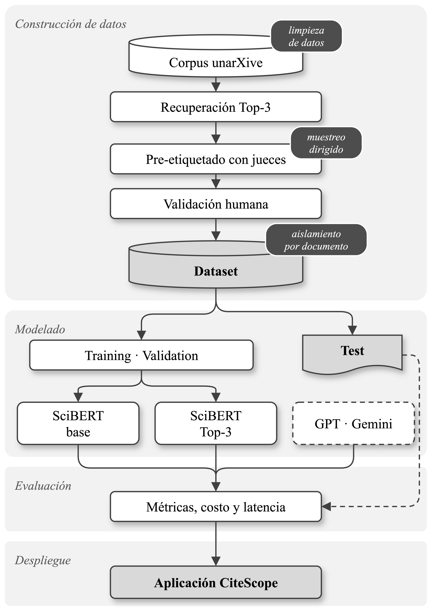
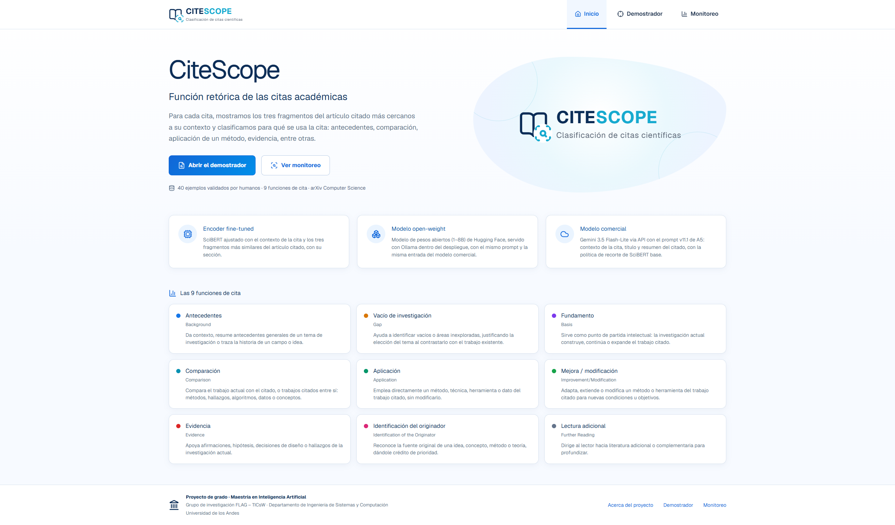

<p align="center">
  <picture>
    <source media="(prefers-color-scheme: dark)" srcset="assets/logo-uniandes-oscuro.svg">
    
  </picture>
</p>

# CiteScope

**Clasificación de la función de citas en Computer Science con modelos de lenguaje y recuperación semántica del artículo citado.**


Una cita puede aportar antecedentes, servir como fundamento de un método, comparar resultados o respaldar una afirmación. CiteScope busca distinguir esas funciones: relaciona el contexto de una cita con el contenido del artículo citado y asigna una de **nueve categorías**.

El proyecto recorre la construcción del corpus, la recuperación de fragmentos, el pre-etiquetado con modelos de lenguaje, la validación humana y la comparación entre SciBERT ajustado y modelos comerciales sin ajuste. El resultado se presenta en una aplicación web que permite explorar ejemplos y consultar el historial de sus clasificaciones.

**Proyecto de grado · Maestría en Inteligencia Artificial · Universidad de los Andes.** La construcción de datos, el pre-etiquetado y la validación humana se realizaron con el Grupo 14; el modelado, la evaluación y el demostrador de este repositorio corresponden al Grupo 15.

**Equipo:** Camilo Bejarano, Germán Rodríguez, José Arteaga y Sebastián Toro.

[Informe final](Documents/Informe%20Final%20G15.md) · [Descargar Word](Documents/Informe%20Final%20G15.docx) · [Recorrido por las etapas](#recorrido-por-las-etapas) · [Modelos e inferencia](#modelos-e-inferencia) · [Demostrador](#explorar-el-demostrador)

## Información general y documentación

| Área de consulta | Documentación de referencia |
|---|---|
| Planteamiento del problema, metodología y conclusiones | [Informe final del proyecto](Documents/Informe%20Final%20G15.md). |
| Construcción y validación del conjunto de datos | [A1](A3/A1_Recuperacion/), [A2](A3/A2_Preetiquetado/) y [A3](A3/A3_Validacion/). |
| Diseño experimental y resultados de SciBERT | [Métricas de A4](A4/Final/M%C3%A9tricas.md) y [experimentos](A4/Final/Experimentos/README.md). |
| Evaluación comparativa con modelos comerciales | [Análisis de A5](A5/Analisis_Final_A5.md) y [comparación de métricas](A5/Comparacion_SciBERT/resultados/Comparacion_Final.md). |
| Modelos entrenados e integración de la inferencia | [Modelos e inferencia](#modelos-e-inferencia). |
| Instalación y uso de la aplicación web | [Guía del demostrador](Demostrador/README.md). |

## Recorrido por las etapas

El flujo va desde los artículos científicos hasta la clasificación y su presentación en CiteScope. Las actividades A1–A3 están reunidas dentro de `A3/`; A6 y A7 se documentan en los resultados de evaluación y en el informe, sin carpetas independientes con esos nombres.

| Etapa | Qué hicimos | Dónde consultar |
|---|---|---|
| **A1 · Corpus y recuperación** | Limpiamos los textos de unarXive, vinculamos cada cita con su artículo citado y recuperamos con SciBERT los tres fragmentos más similares al párrafo citante. Conservamos su sección y filtramos trabajos relacionados del citado. | [Material de recuperación](A3/A1_Recuperacion/) e informe, §§III-A y III-B. |
| **A2 · Pre-etiquetado** | Tres modelos de pesos abiertos propusieron funciones de cita. El acuerdo entre sus votos permitió obtener pre-etiquetas a escala y orientar la búsqueda de categorías escasas. | [Pool, jueces y decisiones de A2](A3/A2_Preetiquetado/RESUMEN_01_A2_pool_y_jueces.md). |
| **A3 · Validación humana** | Elaboramos reglas de anotación, calibramos a los anotadores y adjudicamos desacuerdos. Construimos el test humano y las reglas de separación de datos. | [Validación y acuerdo](A3/A3_Validacion/), [guía de anotación](A3/A3_Validacion/guia_anotacion_funcion_cita_rev3.1.md) e informe, §III-C. |
| **A4 · Clasificador supervisado** | Ajustamos dos SciBERT: uno recibe contexto, título y resumen; el otro, contexto y Top-3 con secciones. Exploramos hiperparámetros, reparto de tokens, pesos de clases y regularización, con seguimiento en MLflow. | [Experimentos y conclusiones](A4/Final/Experimentos/README.md), [métricas](A4/Final/M%C3%A9tricas.md) y [evaluación final](A4/Evaluacion_Final/README.md). |
| **A5 · Modelos comerciales** | Evaluamos GPT-6 Luna y Gemini 3.5 Flash-Lite sin ajuste, combinando instrucciones genéricas o específicas y ausencia o presencia de ejemplos. | [Análisis final de A5](A5/Analisis_Final_A5.md), [notebook comercial](A5/A5_Modelo_Comercial_G15.ipynb) y [notebook Gemini](A5/Gemini/A5_Gemini_G15.ipynb). |
| **A6 · Evaluación comparativa** | Contrastamos las predicciones con las mismas referencias humanas: precisión, recall, F1, confusiones y diferencias entre modelos. | [Resultados de SciBERT](A4/Final/M%C3%A9tricas.md), [comparación con comerciales](A5/Comparacion_SciBERT/resultados/Comparacion_Final.md) e informe, §IV-B. |
| **A7 · Eficiencia y formato** | Analizamos tiempos, costos y validez de las respuestas. Distinguimos inferencia por lotes de consultas a servicios externos para interpretar sus diferencias. | [Costos y comportamiento de A5](A5/Analisis_Final_A5.md), [latencia de A4](A4/Final/M%C3%A9tricas.md) e informe, §IV-C. |
| **A8 · Demostrador** | Integramos la clasificación y los fragmentos en una interfaz, con un historial de predicciones y errores para explorar el funcionamiento. | [CiteScope y su instalación](Demostrador/README.md), [frontend](Demostrador/frontend/) y [API](Demostrador/api/). |

Los resúmenes de construcción conservan sus propios cortes de avance. Para los conteos y conclusiones del cierre, la referencia es el **[informe final](Documents/Informe%20Final%20G15.md)**.

## Arquitectura general

El flujo conecta la construcción y validación de los datos con el entrenamiento, la evaluación y la aplicación web.



[Arquitectura global del proyecto](A3/Figuras/GR_Fig1_arquitectura.png).

## Qué encontramos

El dataset construido contiene **34.988 instancias**. El aislamiento por documento dejó **11.616 para entrenamiento**, **1.653 para validación** y un **test de 2.968 citas con etiquetas humanas**. El acuerdo de los anotadores del test fue **κ de Cohen = 0,854**. El total construido y los ejemplos utilizados para entrenar no representan la misma población: la separación de artículos evita que el modelo aprenda con documentos que luego aparecen en el test.

En la evaluación final, SciBERT obtuvo **F1 macro 0,800 con Top-3** y **0,797 con título y resumen**. La diferencia no fue concluyente: el intervalo de confianza incluye cero. GPT-6 Luna con instrucciones específicas y ejemplos alcanzó **0,795**, cercano al modelo base. La comparación completa incluye las cuatro condiciones de cada modelo comercial, no solo su mejor resultado.

Una lección del trabajo es que **incorporar más evidencia no garantiza una mejor clasificación**. Con el límite de 512 tokens de SciBERT, redistribuir el espacio entre contexto y fragmentos tampoco mejoró el F1 macro medio frente al control. La recuperación debe evaluarse junto con la forma en que la evidencia llega al clasificador. Entre las limitaciones están la concentración del corpus en visión por computador, las categorías escasas y el recorte de los textos.

**Fuentes:** [informe, §§III–VI](Documents/Informe%20Final%20G15.md), [resultados de A4](A4/Final/M%C3%A9tricas.md) y [comparación con modelos comerciales](A5/Comparacion_SciBERT/resultados/Comparacion_Final.md).

## Modelos e inferencia

Los modelos finales ya están entrenados; puedes descargarlos sin repetir los experimentos.

| Modelo | Qué recibe | Dónde encontrarlo |
|---|---|---|
| **SciBERT base** | Contexto de la cita y título y resumen del artículo citado. | [Carpeta del estudio en Drive](https://drive.google.com/drive/folders/1UvtcwLFYgN48_atCVkB5XECjW24dvXu6), archivo `scibert_base_final.zip`. |
| **SciBERT Top-3** | Contexto de la cita y tres fragmentos del artículo citado, con sus secciones. | [Descargar paquete Top-3](https://drive.google.com/file/d/1Y6_RADwbvXl9VY5OLfpaOY8BL77syUrd/view). |

Cada paquete reúne los pesos, el tokenizador, la política de entrada y `inference.py`, que proporciona la clase `CitationClassifier` para cargar el modelo y predecir. Recibe textos y devuelve una categoría, nueve puntajes y una auditoría del texto procesado. **No hay que enviar embeddings precalculados**. El recuperador selecciona fragmentos; el clasificador utiliza sus textos para predecir la función de cita.

Para integrar los modelos, consulta [entradas y salidas](A4/Final/Modelos_Entradas_Salidas.md), la [selección final documentada](A4/Final/M%C3%A9tricas.md) y los contratos incluidos en el paquete descargado. `inference.py` no es por sí solo un servidor web; la API de la aplicación está en [Demostrador/api](Demostrador/api/).

Las predicciones, métricas y auditorías del test están en la [carpeta de evaluación final de Drive](https://drive.google.com/drive/folders/1eXx0tR2C8813sXzNvt8n39fQNMwbDg2E). El [inventario de A4](A4/Final/M%C3%A9tricas.md) enlaza cada archivo para consultar los resultados sin volver a ejecutar inferencias. El acceso a los recursos de Drive depende de sus permisos.

## Explorar el demostrador



La aplicación permite elegir entre **40 ejemplos con etiquetas humanas**, revisar los fragmentos y comparar la predicción con su referencia. Ofrece un encoder SciBERT, una alternativa open-weight mediante Ollama y una comercial mediante API. Los fragmentos del demostrador ya están recuperados; sus estadísticas describen las consultas registradas y no sustituyen la evaluación del test completo.

**Para instalarlo y ejecutarlo, sigue la [guía del demostrador](Demostrador/README.md).** La interfaz está desarrollada con Next.js y TypeScript; el servicio de inferencia utiliza FastAPI y PostgreSQL.

## Documentación y archivos

```text
├── README.md                 # recorrido general del proyecto
├── Documents/               # metodología, resultados y conclusiones
├── A3/                      # construcción de datos: A1, A2 y A3
├── A4/                      # entrenamiento, experimentos y evaluación SciBERT
├── A5/                      # modelos comerciales y comparación de resultados
├── Demostrador/             # aplicación web, API y guía de instalación
└── CITATION.cff              # datos para citar el repositorio
```

Los notebooks e históricos conservan el avance de los experimentos. Para reutilizar la entrega, comienza por las métricas finales y la selección congelada; las variantes exploratorias no sustituyen automáticamente los modelos finales.

El corpus completo y los pesos se distribuyen mediante los recursos enlazados, no dentro del código. Las claves, configuraciones privadas y respaldos de seguimiento tampoco forman parte de la entrega pública. Los textos de los artículos conservan sus condiciones de licencia y atribución; para los ejemplos del demostrador, consulta la [documentación de procedencia y licencias](A3/Demostrador/README.md).

[👉 Cita este repositorio](CITATION.cff)

--------------------------------------------------------


<p align="center">
  
</p>
