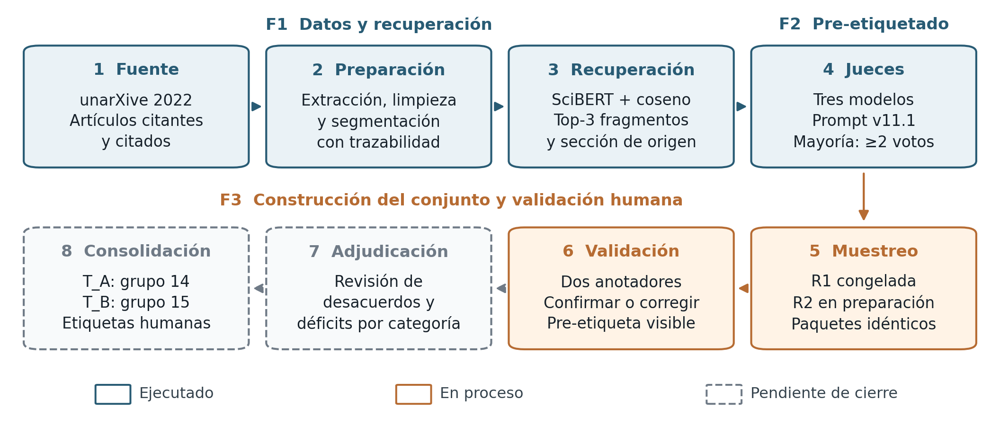
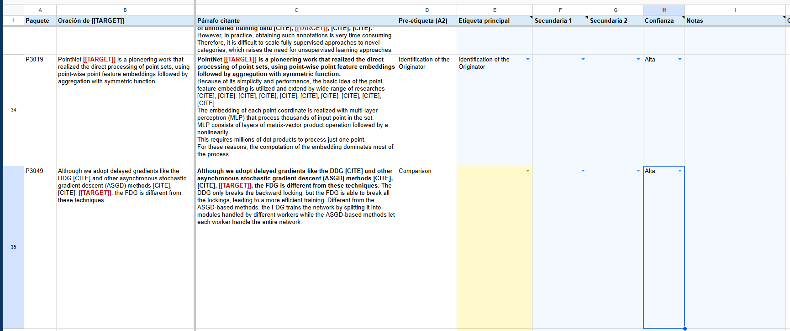
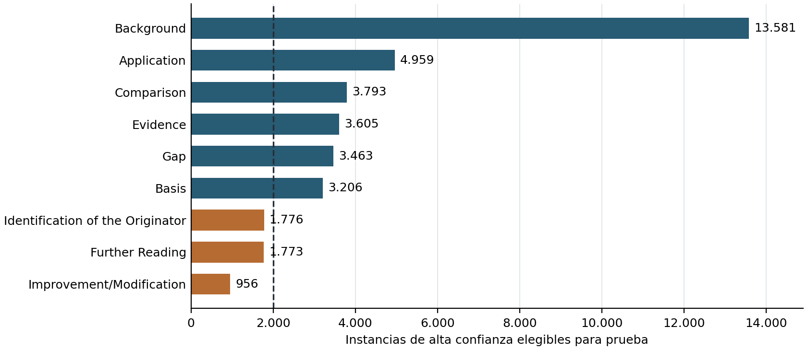

<h1 align="center">Primer informe de avance</h1>

**Título del proyecto:** Recuperación semántica y clasificación de la función de citas académicas en Computer Science.

**Integrantes:** Camilo Bejarano, German Rodriguez, Jose Arteaga y Sebastian Toro.

**Grupo:** 15 — conjunto de prueba T_B.  
**Fecha de corte:** 23 de octubre de 2026.

**Documento rector del procedimiento y las cuotas:** contrato de datos compartido de los grupos 14 y 15. [3]

## 1. Descripción breve de la propuesta de solución

El proyecto aborda la identificación automática de la función que cumple una cita en artículos científicos en inglés del área de Computer Science. La solución articula dos componentes: la recuperación semántica de los tres fragmentos más relevantes del artículo citado, mediante representaciones de SciBERT y similitud coseno, y la clasificación de la función de la cita. Se consideran nueve categorías: *Background, Gap, Basis, Comparison, Application, Improvement/Modification, Evidence, Identification of the Originator* y *Further Reading*. La evaluación prevista comparará un clasificador supervisado que recibe el contexto de cita, el título y el resumen del artículo citado con otro que incorpora el contexto, las secciones de origen y los fragmentos recuperados; adicionalmente, se contrastará su desempeño con un modelo de lenguaje comercial. [1, 10, 11]

La motivación surge de la dificultad de caracterizar las relaciones entre publicaciones mediante el conteo de citas. Una referencia puede proporcionar contexto, fundamentar un método, respaldar una afirmación o señalar una limitación, entre otras funciones. Distinguir estos propósitos exige criterios de anotación consistentes y datos que vinculen el contexto citante con el contenido del artículo citado. El proyecto busca construir ese recurso y evaluar el aporte de la evidencia recuperada a la clasificación. [1]

Durante el periodo reportado se desarrollaron actividades de extracción, limpieza, segmentación y recuperación de fragmentos; se consolidó un conjunto compartido de pre-etiquetas mediante tres jueces de lenguaje; y se formalizó y comenzó a ejecutar la validación humana con el grupo 14. El avance comprende F1, F2 y parte de F3. Al corte, la validación y la adjudicación continúan en proceso; no se presentan todavía resultados del ajuste supervisado, de la evaluación comparativa final ni del despliegue. [3–6]

**Nota de nomenclatura.** Las fases F1, F2 y F3 de la propuesta corresponden a las actividades A1, A2 y A3 de la documentación de desarrollo, respectivamente. Este informe utiliza la denominación «fase» y los identificadores F para mantener consistencia con la propuesta; los títulos de los documentos y los identificadores de los artefactos conservan su denominación original. F1 macro y F1 micro designan métricas de clasificación. [1, 3]

## 2. Recolección y preparación de los datos

### 2.1. Fuente y delimitación del corpus

Se utilizó unarXive 2022, derivado de fuentes LaTeX de arXiv, que conserva texto estructurado, secciones, párrafos y vínculos bibliográficos. El perfilamiento documentado identificó 405.947 artículos con alguna categoría `cs.*`. De sus 13.326.381 entradas bibliográficas, el 11,0 % se vinculaba con identificadores de arXiv; entre las referencias resueltas, el 66,1 % correspondía a artículos presentes en el subconjunto. Al restringir la categoría primaria a `cs.*`, `eess.*` o `stat.ML`, se obtuvieron 358.494 artículos y una cobertura interna del 72,6 %. [2, 12]

La construcción inicial se concentró en artículos citantes de cs.CV, cs.SI, cs.HC, cs.CY y cs.ET. El citado podía pertenecer a otro subcampo, siempre que estuviera disponible en el corpus. La consolidación más reciente registra, después de la limpieza, **1.113.513 contextos de cita, 50.538 artículos citantes y 31.532 artículos citados**, con 1.229.408 fragmentos. Estas cifras describen el corpus piloto preparado para la recuperación y el pre-etiquetado.

### 2.2. Limpieza, segmentación y trazabilidad

La preparación identificó marcadores resolubles, extrajo los contextos y almacenó una sola copia del texto de cada artículo citado. La segmentación respetó las secciones y adoptó como configuración de referencia un máximo de 300 palabras y dos párrafos por fragmento. Se eliminaron fragmentos duplicados, textos de menos de 15 palabras, segmentos sin sección identificada y residuos reconocibles de plantillas LaTeX; también se descartaron artículos sin fragmentos utilizables y sus contextos huérfanos. El filtrado inicial excluyó contextos de más de 1.000 palabras. El análisis exploratorio detectó excepciones al tamaño objetivo y motivó controles posteriores con el tokenizador de SciBERT. [2]

En la selección vigente de candidatos se exigió un cuerpo del citado de al menos 1.000 palabras tras la limpieza. Se descartaron extracciones de menos de 2.000 palabras que presentaban secciones nombradas pero ninguna introductoria, como control de artículos representados solo por apéndices. Los contextos de más de 512 tokens se excluyeron sin truncamiento; se retiraron los citantes detectados en otros idiomas y los casos con el mismo identificador como citante y citado. El control de idioma excluyó 11 artículos citantes del piloto y 21 de la extensión. [3]

Cada instancia conserva una clave formada por el artículo citante, el índice original del párrafo, las posiciones del marcador y el artículo citado. La clave de grupo identifica las citas contiguas, y cada fragmento recuperado mantiene un localizador estable. Se verificó la reconstrucción exacta por localizadores en una muestra de 300/300 contextos y fragmentos. Los archivos compartidos de pre-etiquetas contienen identificadores, localizadores y etiquetas; los paquetes con texto se distribuyen en hojas privadas. El demostrador se restringe a pares con licencias permisivas. [3, 4]

### 2.3. Ampliación del conjunto de trabajo

La escasez de algunas funciones motivó un lote dirigido a *Basis* y la ampliación a cs.LG, cs.CL y cs.DS. Esta última partió de 405.545 contextos y 31.446 artículos citados; después de la limpieza conservó 368.296 contextos, 50.456 artículos citantes y 30.153 artículos citados. Se recuperaron fragmentos para 196.622 pares sobre 1.574.790 fragmentos. Los 12.839 artículos compartidos con el piloto conservaron su segmentación y limpieza, sin diferencias registradas en la verificación. La extensión se utilizó para el lote dirigido a categorías escasas; no se pre-etiquetó su totalidad. [5]

La ejecución de re-etiquetado de producción comprendió un lote de 28.553 instancias. Por separado, `pool_cue_yield` contiene **885 instancias** previamente etiquetadas con la misma configuración y con los casos de eval60 ya excluidos. Las muestras de calibración comprenden 117 instancias —60 de eval60, 30 de calib30 y 27 de calib2— y se excluyen de los conjuntos de prueba y modelado según el contrato. La versión congelada `pool_v11.1` registra un total consolidado de **29.336 instancias**, reportado por el conteo del archivo del conjunto. [3]

La versión ampliada añade a esas 29.336 instancias otras 5.539 del lote dirigido a *Basis* y 3.905 de categorías escasas, para un total de 38.780. Ambas versiones se mantienen separadas para preservar la muestra de la primera ronda. El conjunto ampliado constituye el marco de la segunda ronda y la base prevista para construir las particiones de modelado. Los manifiestos conservan los hashes de cada versión como control de trazabilidad, conforme al contrato. [3, 5, 6]

## 3. Descripción del proceso de construcción de los modelos o solución

*Figura 1. Flujo metodológico compartido por los grupos 14 y 15, con corte al 23 de octubre de 2026. Se distinguen los componentes ejecutados, la anotación en curso y la adjudicación y consolidación pendientes. T_B corresponde al grupo 15. Elaboración a partir de la propuesta, el contrato de datos y la guía vigente. [1, 3, 4]*

### 3.1. Extracción y recuperación semántica — F1

La recuperación se realiza dentro del artículo citado, con SciBERT sin ajuste fino (`allenai/scibert_scivocab_uncased`). Se utiliza el promedio de representaciones con máscara de atención, normalización L2 y similitud coseno. Se conserva un contexto representativo por par citante–citado y se seleccionan los tres fragmentos de mayor similitud, con su sección de origen: 524.713 pares del piloto y 196.622 de la extensión, para 721.335 pares procesados entre ambos corpus. [1]

El filtro de trabajos relacionados (`norw`) considera la sección propia o su sección padre. En el piloto, esos fragmentos representaban el 8,55 % de los candidatos y el 31,6 % de las primeras posiciones recuperadas, una sobrerrepresentación de 3,7 veces. Se excluyeron para reducir la recuperación de descripciones de trabajos ajenos al aporte del citado. Cuando quedaban menos de tres candidatos, se conservaron los fragmentos originales como respaldo: 14 artículos del piloto y 13 de la extensión. Todas las instancias recuperadas conservaron tres fragmentos y no se truncaron contextos.

La conservación de claves de fragmento permitió ampliar el corpus sin alterar las referencias existentes. En la extensión se reprodujo la segmentación de 200 artículos compartidos, con coincidencia en los 200 casos, y se verificó la ausencia de diferencias de limpieza en los 12.839 artículos comunes. Estos controles acreditan consistencia del procesamiento; la evaluación manual de relevancia mediante P@3 sigue siendo una actividad prevista en la propuesta. [1, 5]

### 3.2. Pre-etiquetado mediante jueces — F2

La configuración se construyó mediante revisión de casos de eval60, adjudicación de desacuerdos y pruebas sucesivas del prompt. Inicialmente se evaluó un trío de modelos pequeños —Llama 3.1 8B, Qwen 2.5 7B y Mistral 7B—, que obtuvo 13/41 aciertos; el trío posteriormente seleccionado alcanzó 30/41 en la comparación con prompt v8. Esta evolución antecede a la comparación de los dos tríos de mayor tamaño descrita a continuación. Las reglas se refinaron para distinguir *Gap* de *Evidence*, *Application* de *Improvement/Modification* y *Comparison* de *Background*. La versión v11.1 se congeló con los siguientes modelos. [3, 7]

| Juez | Revisión registrada |
| --- | --- |
| Qwen/Qwen3.8-27B | `1d4bf0f2ff` |
| google/gemma-4-26B-A4B-it | `4d7ae4984b` |
| mistralai/Mistral-Small-3.2-24B-Instruct-2506 | `95a6d26c4b` |

**Nota sobre la selección del trío.** Se compararon dos combinaciones que compartían Qwen3.8-27B y Gemma 4 26B, y diferían en el tercer juez: Ministral 3 14B o Mistral Small 3.2 24B. Con el prompt v11.1, el trío con Mistral Small obtuvo 48/60 aciertos sobre eval60 adjudicado, frente a 45/60 con Ministral. La revisión de muestras de 20 nuevas etiquetas *Gap* por combinación identificó 17 correctas con Mistral Small y 12 con Ministral. Estas comprobaciones de desarrollo sustentaron la elección del trío actual; corresponden a una etapa previa a la evaluación final sobre T_B. [7]

Cada juez recibe las definiciones y reglas, el título y resumen del citado, sus tres fragmentos con sección, el párrafo citante y la oración de la cita objetivo. Produce una salida JSON con evidencia textual, etiqueta principal y posibles secundarias. La decodificación es determinista por selección del token más probable, con semilla 0. El entorno documentado utiliza vLLM 0.29.0, Transformers 5.16.1 y PyTorch 2.13.0. [3, 8]

La votación considera únicamente las etiquetas principales. Una categoría con al menos dos votos coincidentes genera una pre-etiqueta de alta confianza; los empates quedan sin pre-etiqueta. Las respuestas con JSON inválido no votan; tampoco las que citan evidencia ajena al párrafo citante. Esta exigencia busca anclar la decisión en lo que el artículo citante expresa sobre la referencia. Las secundarias se conservan como información complementaria. [3]

Las reglas v11.1 se mantuvieron para todo el conjunto, incluida su ampliación. El ensayo v12, que reforzaba instrucciones sobre los fragmentos, fue descartado al obtener 47 aciertos sobre eval60 frente a los 48 de v11.1 y cambiar a incorrectos dos casos previamente acertados. La configuración de producción conservó los fragmentos Top-3. Este proceso corresponde a inferencia y selección de configuración de los jueces; el ajuste supervisado de SciBERT pertenece a F4. [7, 8]

### 3.3. Construcción del conjunto de prueba y validación humana — F3

La validación se realiza con la guía rev3.1 de la carpeta de trabajo, actualizada el 23 de octubre sin modificar definiciones ni reglas. Se asigna una etiqueta principal; las secundarias se reservan para casos excepcionales. Las reglas exigen leer primero la oración de `[[TARGET]]` y considerar otras oraciones cuando se refieran a esa cita. Se distingue el trabajo que presenta una limitación (*Gap*) de la fuente que informa una limitación ajena (*Evidence*), y la comparación explícita de trabajos de su mera enumeración. [4]

Los grupos construyen dos conjuntos disjuntos por instancia y artículo citante: T_A corresponde al grupo 14 y T_B al grupo 15. La cuota final por conjunto es de al menos 2.700 instancias humanas válidas, **300 por categoría**, de acuerdo con el contrato y la validación del equipo. Para alcanzar esa cuota se prevén, por categoría y conjunto, 330 paquetes activos, 30 de reserva y un segundo colchón de 30. El muestreo es estratificado por pre-etiqueta, con semilla fija `LCR-G14G15-A3-2026`, un máximo de dos instancias por citante y una por grupo de citas. El diseño comprende 5.940 paquetes activos —2.970 por conjunto— y 11.880 anotaciones previstas, al contar dos por paquete. [3, 13]

Cada paquete se anota independientemente por una persona de cada grupo. En T_B, la anotación del grupo 15 constituye su validación y la del grupo 14 aporta la segunda evaluación; en T_A se invierten los roles. Ambos reciben el mismo material, con pre-etiqueta visible, y trabajan sin conocer la respuesta del otro. Registran etiqueta principal, posibles secundarias, confianza y notas; los fragmentos se consultan cuando la decisión exige verificar el contenido del citado. La herramienta utiliza hojas nativas de Google Sheets con campos controlados y registro de tiempo. [3, 4]

La Figura 2 muestra cómo se realiza el registro de la validación manual. Cada fila corresponde a una instancia de cita. Las **columnas E a I** contienen los campos que completan los anotadores: etiqueta principal (E), etiquetas secundarias cuando corresponda (F y G), nivel de confianza (H) y notas (I). En estos campos seleccionan las categorías y, cuando es necesario, añaden observaciones que justifican o aclaran su decisión.

*Figura 2. Interfaz utilizada para la validación manual de las funciones de cita. Las columnas E–I corresponden al registro realizado por cada anotador.*

La primera ronda cubre seis categorías y comprende 3.960 paquetes activos entre ambos conjuntos, distribuidos en 72 lotes de 55. Su primera ola terminó el 21 de octubre y la segunda continúa en curso. La meta de los equipos es finalizar la validación manual de esta ronda el domingo 25 de octubre, al cierre del día. La segunda ronda contempla *Basis*, *Improvement/Modification* y *Further Reading*, con 1.980 paquetes activos previstos e inicio programado para el lunes 26 de octubre. La adjudicación y las reposiciones seguirán el procedimiento establecido en el contrato. [3, 13]

La adjudicación conserva las anotaciones originales. Si las principales coinciden, se adopta esa etiqueta, salvo `unclear`, que exige revisión. Los desacuerdos pasan a una pareja de grupos distintos que no haya anotado el paquete ni sea responsable del muestreo. La confianza organiza la revisión, pero no determina la decisión. Las instancias que permanezcan `unclear` se excluyen del conjunto de prueba. Desde el 23 de octubre, la reserva se libera según el déficit posterior a adjudicación, con un margen del 10 %; la corrección de la primera ola se utiliza como información de seguimiento. [3, 4]

### 3.4. Preparación de la evaluación posterior

El aislamiento mínimo V0 excluye del entrenamiento y la validación todos los artículos citantes de T_B, incluidos reserva y colchón, y los citantes de las tres calibraciones. V1 amplía la exclusión a los artículos citados de T_B; V2 impide además que esos documentos aparezcan con el rol inverso. La elección del grupo 15 continúa pendiente en el contrato. El protocolo permite utilizar T_A para entrenamiento, sujeto a las exclusiones correspondientes, con pre-etiquetas que podrán sustituirse por etiquetas humanas adjudicadas. [3]

La partición de entrenamiento y validación se agrupará por citante. Después se realizará la comparación prevista de las dos entradas de SciBERT y del modelo comercial, con precisión, exhaustividad, F1 macro y micro y matrices de confusión. No se documenta todavía el entrenamiento ni su evaluación sobre un T_B consolidado. [1, 3]

## 4. Resultados obtenidos

### 4.1. Disponibilidad de datos, recuperación y pre-etiquetado

La recuperación registró un coseno medio Top-1 de 0,9195 en el piloto sin filtro, 0,9148 con `norw` y 0,9128 en la extensión con ese filtro. En el piloto filtrado, las medianas del Top-1 y Top-3 fueron 0,9192 y 0,9042, con una brecha mediana de 0,0130. Estos puntajes ordenan candidatos; la similitud coseno por sí sola no establece su relevancia para la función de la cita.

El conjunto ampliado contiene 38.780 instancias: 37.254 con pre-etiqueta de alta confianza —aproximadamente el 96,1 %—, 1.520 empates y 6 casos restantes por otros motivos sin voto. De las instancias de alta confianza, 37.112 son elegibles para prueba; las 142 restantes corresponden a artículos citantes de calibración excluidos de ese uso. Hay 521 instancias con ambos artículos de licencia permisiva aptas para el demostrador. [3]

La distribución elegible para prueba se muestra en la Figura 3. Seis categorías superan la referencia de 2.000 instancias; *Identification of the Originator*, *Further Reading* e *Improvement/Modification* cuentan con 1.776, 1.773 y 956, respectivamente. Estas cantidades preceden a las exclusiones de cada grupo y a la revisión humana; no representan el tamaño final de entrenamiento de T_B.

*Figura 3. Instancias del conjunto ampliado con alta confianza y elegibilidad para prueba. La línea señala la referencia de 2.000 ejemplos por categoría de la propuesta. Fuente: contrato de datos compartido, sección 6.3. [3]*

El lote de producción de 28.553 instancias se re-etiquetó en una sesión con GPU A100. La duración reportada de 8 h 44 min y las 85.659 salidas de jueces corresponden a ese lote; entre esas salidas se registraron 30 respuestas inválidas. El acuerdo entre jueces fue κ de Fleiss de 0,67 y la unanimidad alcanzó el 63 %. En una repetición de 300 instancias se mantuvieron 294 pre-etiquetas, equivalentes al 98 %. Más del 99 % de las citas textuales de evidencia procedió del párrafo citante; 56 respuestas que citaron otro origen se abstuvieron de votar. [6]

### 4.2. Evaluación de desarrollo de los jueces

| Configuración del trío con Mistral Small | Aciertos sobre la referencia adjudicada de eval60 |
| --- | ---: |
| Prompt v8 | 43/60 |
| Prompt v11 | 47/60 |
| Prompt v11.1 | 48/60 |

La versión congelada alcanza 48/60 aciertos, equivalentes al 80 %. En los 41 casos con acuerdo inicial entre grupos, pasa de 30 aciertos con v8 a 33 con v11.1. Como las reglas se desarrollaron parcialmente a partir de eval60, estas cifras constituyen resultados de desarrollo, y deben distinguirse de la evaluación final sobre T_B. Además, la referencia adjudicada no contiene casos principales de *Basis*, cuya estabilidad se comprobó en otra muestra aleatoria. [7]

### 4.3. Calibración y avance de la validación humana

| Ejercicio | Muestra y protocolo | Resultado de acuerdo |
| --- | --- | --- |
| eval60 | 60 instancias; una etiqueta por grupo; guía rev1.4 | 41 acuerdos; κ de Cohen = 0,63 |
| calib30 | 30 instancias; siete anotadores; sesión grupal con reglas recién revisadas | κ de Fleiss = 0,47; 3 de 21 parejas con κ ≥ 0,6 |
| calib2 | 27 instancias; ocho anotadores; trabajo individual y pre-etiqueta visible | κ de Fleiss = 0,87; las 16 parejas entre grupos con κ ≥ 0,6; mínimo 0,71 y media 0,87 |

Calib2 superó el requisito de inicio de F3 el 18 de octubre. Hubo 16 correcciones entre 216 respuestas, equivalentes al 7,4 %. Tres casos concentraron 11 de ellas en las fronteras *Background–Evidence*, *Basis–Improvement/Modification–Application* y *Comparison–Background*. [3, 9]

La primera ola de la ronda 1 completó 880 anotaciones sobre 440 paquetes de ambos conjuntos. Se corrigieron 71 pre-etiquetas —8,1 % de las anotaciones—; 58 paquetes tuvieron al menos una corrección y 13 presentaron correcciones de ambos anotadores. Agregadas por categoría entre ambos conjuntos, las tasas de corrección fueron 15,8 % en *Gap*, 12,3 % en *Comparison* y 10,8 % en *Background*. En T_B, *Gap* alcanzó el 22,2 %, frente al rango global por celda de 0,0–22,2 %. El tiempo conjunto fue de 1.409 minutos, equivalente a 1,60 minutos por anotación. Estos resultados son parciales y compartidos; el 8,1 % no se atribuye exclusivamente al grupo 15. [3, 6]

Al 23 de octubre de 2026, la validación manual de la primera ronda presenta un avance estimado entre el 60 % y el 70 %, según la actualización del equipo. La meta conjunta es terminar esta ronda el domingo 25 de octubre, al finalizar el día, para iniciar la segunda el lunes 26 de octubre. [13]

Al corte, permanecen pendientes los resultados finales de acuerdo interanotador de T_B, incluidos el kappa de Cohen y el alfa de Krippendorff, así como la evaluación manual P@3 y los resultados F1 del clasificador. El alfa de Krippendorff medirá el acuerdo entre anotadores: se contempla su variante nominal para la etiqueta principal y, como análisis complementario, la variante con distancia MASI para el conjunto de etiquetas principales y secundarias. El Macro F1 de 0,68 consignado en la propuesta corresponde al antecedente CiteScope. [1, 3, 4]

## 5. Análisis de los resultados obtenidos. Reflexión sobre los retos encontrados y cómo proseguir

**Disponibilidad y representatividad.** La ampliación resolvió el suministro necesario para preparar la segunda ronda, pero persisten límites para un conjunto balanceado. El piloto concentra el 97,8 % de sus contextos en cs.CV; por ello, sus resultados no describen uniformemente Computer Science. La necesidad del muestreo dirigido se observa en *Further Reading*: se obtuvieron solo 20 pre-etiquetas de alta confianza en 7.000 instancias aleatorias —0,29 %—, frente a un rendimiento del 54,8 % en su estrato dirigido del piloto. Estos porcentajes describen el suministro por muestreo, no la exactitud del clasificador. Tres categorías siguen por debajo de 2.000 ejemplos antes de las exclusiones; se trabaja con metas diferenciadas y las ampliaciones adicionales quedan como trabajo futuro. [3, 5]

**Calidad y ambigüedad de las etiquetas.** El aumento del acuerdo en calib2 permitió comenzar la validación. Sin embargo, cambiaron simultáneamente la muestra, las reglas, la modalidad de trabajo y la visibilidad de la pre-etiqueta; no puede atribuirse la diferencia a una intervención aislada. Tampoco el acuerdo alto entre jueces garantiza exactitud. La corrección del 22,2 % en la celda T_B–Gap muestra que las fronteras semánticas requieren revisión activa. En consecuencia, el acuerdo final debe acompañarse de tasas de corrección por categoría y anotador y de las decisiones de adjudicación. [3, 4, 9]

**Aporte de los fragmentos recuperados.** La prueba de ablación pasó de 48 a 49 aciertos sobre eval60 al retirar los fragmentos. En 885 instancias difíciles cambiaron entre el 9 % y el 12 % de las etiquetas por juez; entre 45 decisiones modificadas del trío, 16 se juzgaron mejores con fragmentos, 18 sin ellos y 11 sin ventaja. La evidencia disponible no muestra una mejora neta clara del pre-etiquetado por incorporar el Top-3. Este hallazgo se limita a los jueces y muestras examinados: la hipótesis sobre el clasificador supervisado requiere la comparación de F4 y la evaluación manual de relevancia. [1, 8]

**Aislamiento y suficiencia para modelado.** La exclusión por documento reduce los datos disponibles, especialmente en las clases escasas. Para el grupo 15, la estimación de entrenamiento más prueba propia en *Basis* pasa de 2.936 instancias con V0 a 1.516 con V1 y 1.438 con V2. Son escenarios de planificación, no tamaños definitivos de entrenamiento. [3, 6] Bajo V0, 2.463 de los 2.970 paquetes activos de T_B —82,93 %— citan artículos que también aparecen como citados en entrenamiento, y 507 —17,07 %— corresponden a citados no vistos. El grupo deberá elegir la variante antes de particionar; si adopta V0, reportará F1 macro por separado para ambos subconjuntos.

**Carga operativa y continuidad.** El tiempo observado de 1,60 minutos por anotación supera la referencia inicial de aproximadamente un minuto. La carga estimada por persona es de 26,4 horas para los 990 paquetes de la primera ronda y de 11,7 horas para los 440 de las dos primeras olas de la segunda; las olas posteriores, las reservas y la adjudicación añaden trabajo. La meta es finalizar la validación manual de la primera ronda el domingo 25 de octubre de 2026, al cierre del día, e iniciar la segunda el lunes 26. El avance estimado del 60–70 % corresponde a la primera ronda; la adjudicación y la consolidación continúan pendientes. [13]

Los siguientes pasos son completar la anotación, adjudicar los desacuerdos, calcular los déficits por etiqueta humana y liberar las reservas necesarias. Posteriormente se consolidarán `test_set_gold.jsonl`, `exclusion_list.jsonl` e `iaa_report.md`, incluyendo las métricas específicas de T_B. La elección de la exclusión y el congelamiento de las muestras permitirán construir los datos para F4. La continuación comprenderá el ajuste de SciBERT en ambas configuraciones, la comparación con el modelo comercial, la evaluación manual de recuperación y el despliegue previsto. El contrato mantiene pendiente la asignación del responsable de métricas y algunas fechas de cierre. [1, 3, 6]

## Referencias

El contrato de datos compartido [3] es el documento rector del procedimiento, las cuotas y los criterios de exclusión. Las referencias [1–9] aportan el contexto y los registros del desarrollo; las referencias [10–12] provienen de la bibliografía de la propuesta. La referencia [13] recoge las actualizaciones y validaciones comunicadas por el equipo. El corte operativo del informe se mantiene en el 23 de octubre de 2026.

- **[1]** Grupo 15. [Propuesta del proyecto de grado](<https://github.com/sebastianToroTeam/Proyecto_Grado_MAIA/blob/main/entrega1/PropuestaProyectoGrado.md>). Secciones 1, 2, 4, 5, 7 y 8.
- **[2]** Equipo del proyecto. [Documento de propuesta en formato IEEE](<https://github.com/sebastianToroTeam/Proyecto_Grado_MAIA/blob/main/entrega1/ejemploPropuesta-Proyecto_IEEE.docx>). Sección V: exploración y descripción de los datos.
- **[3]** Grupos 14 y 15. [Contrato de datos compartido — Anotación de función de cita (A3)](<https://github.com/sebastianToroTeam/Proyecto_Grado_MAIA/blob/main/entrega1/Folder_trabajo_Equipos_14_y_15/Contrato_Datos_A3_2026-10-23_guia_rev3.1.md>). Actualización documental del 24 de octubre de 2026; conserva la fecha del 23 de octubre en el nombre del archivo.
- **[4]** Grupos 14 y 15. [Guía de anotación — Clasificación de función de cita, rev3.1](<https://github.com/sebastianToroTeam/Proyecto_Grado_MAIA/blob/main/entrega1/Folder_trabajo_Equipos_14_y_15/guia_anotacion_funcion_cita_rev3.1.md>). Actualización del 23 de octubre de 2026.
- **[5]** Grupos 14 y 15. [A3 Pool Extension for Round 2](<https://github.com/sebastianToroTeam/Proyecto_Grado_MAIA/blob/main/entrega1/Folder_trabajo_Equipos_14_y_15/A3%20Pool%20Extension%20for%20Round%202.pptx>). 21–22 de octubre de 2026.
- **[6]** Grupos 14 y 15. [A2 Pool Results and A3 Plan](<https://github.com/sebastianToroTeam/Proyecto_Grado_MAIA/blob/main/entrega1/Folder_trabajo_Equipos_14_y_15/A2%20Pool%20Results%20and%20A3%20Plan.pptx>). 23 de octubre de 2026.
- **[7]** Grupos 14 y 15. [A2 — Prompt v11.1 and the frozen judges](<https://github.com/sebastianToroTeam/Proyecto_Grado_MAIA/blob/main/entrega1/Folder_trabajo_Equipos_14_y_15/A2%20%E2%80%94%20Prompt%20v11.1%20and%20the%20frozen%20judges%20%281%29.pptx>). 13 de octubre de 2026.
- **[8]** Grupos 14 y 15. [A2 calibration and prompt review](<https://github.com/sebastianToroTeam/Proyecto_Grado_MAIA/blob/main/entrega1/Folder_trabajo_Equipos_14_y_15/A2%20calibration%20and%20prompt%20review.pptx>). 14 de octubre de 2026.
- **[9]** Grupos 14 y 15. [calib2 Results and A3 Round 1](<https://github.com/sebastianToroTeam/Proyecto_Grado_MAIA/blob/main/entrega1/Folder_trabajo_Equipos_14_y_15/calib2%20Results%20and%20A3%20Round%201.pptx>). 18 de octubre de 2026. Archivos de contraste: [EvaluacionEquipoTotal.xlsx](<https://github.com/sebastianToroTeam/Proyecto_Grado_MAIA/blob/main/entrega1/Folder_trabajo_Equipos_14_y_15/EvaluacionEquipoTotal.xlsx>), [A3_calibration_votes_agreement.xlsx](<https://github.com/sebastianToroTeam/Proyecto_Grado_MAIA/blob/main/entrega1/Folder_trabajo_Equipos_14_y_15/A3_calibration_votes_agreement.xlsx>) y [referencia adjudicada de eval60](<https://github.com/sebastianToroTeam/Proyecto_Grado_MAIA/blob/main/entrega1/Folder_trabajo_Equipos_14_y_15/eval60_reference_adjudicated.csv>).
- **[10]** Beltagy, I., Lo, K., y Cohan, A. (2019). SciBERT: A pretrained language model for scientific text. *Proceedings of EMNLP-IJCNLP 2019*, 3615–3620.
- **[11]** Lyu, D., Ruan, X., Xie, J., y Cheng, Y. (2021). The classification of citing motivations: A meta-synthesis. *Scientometrics, 126*(4), 3243–3264.
- **[12]** Saier, T., Krause, J., y Färber, M. (2023). unarXive 2022: All arXiv publications pre-processed for NLP, including structured full-text and citation network. *Proceedings of JCDL 2023*.
- **[13]** Grupo 15. Actualización del avance de validación manual y de la meta conjunta de los equipos 14 y 15. Comunicación del 23 de octubre de 2026, con aclaración del calendario y validación de las 885 instancias de `pool_cue_yield` y la cuota final de 300 etiquetas válidas por categoría el 24 de octubre para este informe.

---

## Notas internas de revisión y continuidad

**Fecha de incorporación:** 3 de noviembre de 2026. **Uso:** seguimiento del equipo y preparación de las siguientes entregas.

Estas notas se incorporan después de la evaluación de la primera entrega y no forman parte del documento originalmente presentado. Los apartados 1–5 y sus referencias conservan el corte del 23 de octubre de 2026. Las aclaraciones siguientes distinguen lo documentado para ese corte, el desarrollo posterior registrado en A4 y los puntos que todavía requieren evidencia. La fecha de incorporación de estas notas no actualiza automáticamente los resultados históricos del informe.

La revisión otorgó 81/100 puntos. La mayor oportunidad de mejora corresponde a la explicación de la construcción de los modelos: 20/35 puntos, equivalentes a 15 de los 19 puntos descontados. El propósito de este registro es vincular las decisiones de preparación y anotación con el experimento central de clasificación, y responder las preguntas metodológicas de la evaluación.

**Origen de las aclaraciones:** [Observaciones de la primera entrega](observacionesentrega1.md#retroalimentación-por-criterio). Cada apartado identifica el criterio que motivó su inclusión.

### NI.1. Aporte diferenciador y pregunta que organiza el proyecto

*Según las observaciones de la revisión, criterio «Descripción breve de la propuesta de solución», se requiere sintetizar el aporte diferenciador y sus beneficios.*

El aporte que se busca evaluar consiste en incorporar evidencia del contenido del artículo citado a la clasificación de la función de una cita. Para ello se comparan dos configuraciones de un mismo modelo base, SciBERT: una recibe el contexto citante junto con el título y el resumen del citado; la otra recibe el contexto citante junto con las secciones de origen y los tres fragmentos recuperados del citado. La pregunta central es si esta segunda configuración mejora el F1 macro de clasificación respecto de la primera. El modelo comercial constituye una comparación adicional prevista en la propuesta. [1, secciones 4.1–4.3 y 6]

El beneficio esperado es determinar si la recuperación aporta evidencia útil para distinguir las nueve funciones de cita y, posteriormente, mostrar esa evidencia en la aplicación. Esta utilidad es una hipótesis de trabajo; su confirmación requiere la evaluación de recuperación y la comparación de los clasificadores. Las cifras de suministro de datos, el acuerdo entre jueces y los aciertos de eval60 describen avances necesarios para construir el experimento, pero no demuestran todavía esa mejora.

El hilo conductor para las siguientes etapas será: **preparar pares citante–citado → recuperar evidencia → construir y revisar etiquetas → ajustar las dos entradas de SciBERT → evaluar sobre T_B humano → interpretar el aporte de la evidencia → integrar la solución en la aplicación**.

### NI.2. Representación de textos: promedio con máscara de atención

*Según las observaciones de la revisión, criterio «Recolección y preparación de los datos», se debe explicar qué se promedia, qué considera la máscara y por qué se usa esta operación. Amplía el apartado 3.1 del informe.*

La operación documentada para recuperación es el promedio de las representaciones de tokens producidas por SciBERT, utilizando la máscara de atención, seguido de normalización L2 y comparación mediante coseno. Su propósito es obtener un vector de tamaño fijo para cada contexto y cada fragmento, de modo que puedan compararse dentro del artículo citado. El promedio se realiza sobre las representaciones vectoriales de las posiciones incluidas por la máscara; no es un promedio de etiquetas ni de puntajes de similitud.

La operación puede expresarse como `v = suma(m_i * h_i) / suma(m_i)`, donde `h_i` es la representación del token en la posición `i` y `m_i` indica si esa posición participa. Las posiciones de relleno con máscara 0 no aportan a la suma ni al denominador. Después se divide el vector por su norma L2 y se ordenan los fragmentos por similitud coseno respecto del contexto. Esta es una explicación de la operación registrada en A1, no un nuevo resultado experimental.

El promedio permite combinar las posiciones participantes en una representación del texto completo. Sin embargo, la documentación revisada no acredita una comparación entre este promedio y otras estrategias de representación. En consecuencia, no se afirma que sea la alternativa óptima. Tampoco debe afirmarse que se excluyeron los tokens especiales: la máscara de atención, por sí sola, no documenta esa exclusión. Para cerrar la reproducibilidad de A1 se debe recuperar la implementación original y registrar la capa utilizada, el tratamiento de tokens especiales y el enmascaramiento efectivo. La motivación histórica de esa elección queda pendiente de corroboración si no aparece en dicho registro.

**Respaldo:** operación de recuperación descrita en el apartado 3.1 y estrategia SciBERT de la propuesta [1]. **Pendiente específico:** detalle de implementación y justificación comparativa del promedio.

### NI.3. Selección del corpus, concentración temática y clases minoritarias

*Según las observaciones de la revisión, criterio «Recolección y preparación de los datos», se debe justificar la selección temática y explicar el desbalance. Amplía los apartados 2.1, 2.3 y 5.*

El documento de propuesta en formato IEEE [2], apartado «Construcción incremental (estrategia piloto)», establece que las cinco subcategorías iniciales se seleccionaron por un criterio combinado de volumen y diversidad estilística. Se incluyeron cs.CV, cs.SI, cs.HC, cs.CY y cs.ET del lado citante; el artículo citado podía pertenecer a otro subcampo si su texto estaba disponible. El mismo documento explica que las categorías adicionales pretendían mitigar el riesgo de concentrar las funciones de cita en un subcampo aplicado.

La selección pretendía aportar diversidad, pero el piloto descrito en el informe quedó concentrado en cs.CV, con el 97,8 % de sus contextos. Ese porcentaje no debe trasladarse sin recálculo al corpus ampliado ni a las particiones finales. Deben distinguirse dos fenómenos: la concentración temática de los artículos y el desbalance entre funciones de cita. Seleccionar subcategorías diversas no garantiza una distribución equilibrada de las nueve funciones.

La respuesta documentada al suministro insuficiente consistió en muestreo dirigido por frases indicadoras y ampliación a cs.LG, cs.CL y cs.DS. Las clases escasas continúan condicionando la disponibilidad después de aplicar exclusiones por documento. Para las siguientes entregas se reportarán por separado los conteos del corpus, las pre-etiquetas, las instancias elegibles, las etiquetas humanas finales y las filas efectivas de entrenamiento y validación. La meta de 300 etiquetas humanas válidas por categoría y conjunto de prueba no equivale a 2.000 ejemplos de entrenamiento por categoría. [1, 3, 5]

### NI.4. Función de eval60, selección y justificación de su tamaño

*Según las observaciones de la revisión, criterio «Descripción del proceso de construcción de los modelos», se pregunta por qué se escogieron 60 instancias y cómo se seleccionaron. Amplía los apartados 3.2, 4.2 y 4.3.*

Eval60 es un conjunto de desarrollo utilizado para comparar jueces, revisar reglas y construir una referencia adjudicada. Los dos grupos anotaron las mismas 60 instancias. La presentación [«eval60 Results 101226 Meeting»](<Folder_trabajo_Equipos_14_y_15/eval60 Results 101226 Meeting.pptx>), diapositiva 4, registra cuatro integrantes por equipo y 15 instancias por integrante. Hubo 41 acuerdos iniciales y 19 desacuerdos, posteriormente revisados. El informe distingue los resultados sobre los 41 acuerdos iniciales de los obtenidos sobre la referencia adjudicada de 60 casos.

La distribución de 15 instancias por integrante explica la organización del trabajo, pero no prueba por sí sola por qué se fijó ese tamaño. No se ha localizado una justificación estadística del número 60 ni un registro completo del muestreo que permita reconstruir aquí su composición, semilla y criterios de inclusión. Por ello, no se presenta como una muestra aleatoria representativa, ni se le asigna un margen de error o nivel de confianza no documentado.

La consolidación auxiliar consultada apunta a selección dirigida a categorías escasas y errores de los jueces; ese detalle debe corroborarse con el muestreador o manifiesto original antes de incorporarlo como procedimiento definitivo. El Excel conserva su función de guía de revisión y no se incorpora a la bibliografía del informe como documento rector.

**Respuesta sustentada:** 60 casos de desarrollo anotados por ambos equipos, distribuidos operativamente en cuatro bloques de 15 por equipo, para comparar configuraciones y adjudicar fronteras semánticas. **Pendiente:** recuperar la razón original del tamaño y el procedimiento completo de selección, con universo, criterios, composición, semilla si existió y claves de las instancias. La ausencia de ese registro se mantiene explícita; no se completa mediante una suposición.

Los 48/60 aciertos de v11.1 son desempeño de desarrollo sobre una referencia utilizada para refinar reglas. No deben interpretarse como la exactitud esperada en todo el conjunto ni como resultado del clasificador supervisado sobre T_B. Los artículos citantes de las calibraciones se excluyen del entrenamiento, la validación y la prueba de A4 según el contrato. [3, 7]

### NI.5. Modelo de clasificación, entradas y configuración de ajuste

*Según las observaciones de la revisión, criterio «Descripción del proceso de construcción de los modelos», se requiere explicar el fine-tuning, el modelo propuesto y su configuración. Amplía el apartado 3.4.*

Existen tres funciones distintas dentro de la solución:

| Componente | Función | Tratamiento documentado |
| --- | --- | --- |
| SciBERT para recuperación, F1 | Representar contexto y fragmentos; seleccionar el Top-3 dentro del citado | Sin ajuste fino para esta etapa |
| Trío de modelos de lenguaje, F2 | Producir pre-etiquetas y evidencia textual mediante voto | Inferencia con prompt y revisiones congeladas; no entrenamiento de estos jueces |
| SciBERT para clasificación, F4 | Predecir una función principal entre nueve categorías | Ajuste supervisado del modelo con una cabeza de clasificación y entropía cruzada |

La propuesta [1, secciones 4.1 y 4.2] ya define un único modelo base, SciBERT, ajustado bajo dos configuraciones de entrada. En ambas se concatena el contexto citante con la información del citado mediante un separador. La configuración **base** utiliza título y resumen; la configuración **fragmentos** utiliza las secciones y el Top-3. Son dos ajustes comparables del mismo modelo preentrenado, destinados a evaluar el efecto de cambiar la información de entrada. El modelo comercial previsto se evalúa por inferencia con estrategias sin ejemplos y con pocos ejemplos; no sustituye la comparación supervisada.

**Desarrollo posterior al corte del informe.** La documentación local de A4 concreta la siguiente configuración de trabajo. Estos parámetros corresponden a la continuidad documentada después del 23 de octubre y no se presentan como entrenamiento ejecutado durante la primera entrega.

| Aspecto | Configuración registrada en A4 |
| --- | --- |
| Modelo base | `allenai/scibert_scivocab_uncased`; registrar la revisión exacta por ejecución |
| Salida y objetivo | Una etiqueta principal entre nueve; entropía cruzada sin ponderación en la comparación inicial |
| Inicialización | Cada configuración parte del mismo modelo preentrenado; fragmentos no continúa los pesos ajustados de base |
| Tasa de aprendizaje | `2e-5` |
| Épocas máximas | 4 |
| Lote efectivo de entrenamiento | 32: lote de 16 con acumulación de gradientes de 2 |
| Optimizador | AdamW; decaimiento de pesos `0,01` |
| Programa de aprendizaje | Calentamiento del 10 % y descenso lineal |
| Semilla de entrenamiento | 42 |
| Partición | Variante V0 en la configuración de trabajo; validación objetivo del 10 % agrupada por citante, con identificador `G15-A4-split-v1` |
| Longitud máxima | 512 tokens, incluidos los especiales |
| Contexto citante | Presupuesto de hasta 192 tokens centrado en `[[TARGET]]` |
| Información del citado | En base, título de hasta 64 tokens y resumen con el resto; en fragmentos, reparto del presupuesto entre los tres y sus secciones |
| Selección del modelo | Mayor F1 macro de validación; evaluación por época y parada temprana con paciencia 2 |
| Entorno de trabajo | Colab con A100 y BF16; versiones y artefactos registrados por ejecución |
| Evaluación final | T_B con etiquetas humanas adjudicadas; sin utilizarlo para elegir hiperparámetros |

**Fuentes de esta configuración posterior:** [análisis y plan de A4](../A4/analisis_y_plan_A4.md#6-configuración-inicial-para-colab-pro-a100), [configuración del notebook](../A4/A4_SciBERT_G15_Colab_A100.ipynb) y [continuación base–fragmentos](../A4/SEGUNDA_CORRIDA.md). Son archivos de trabajo que deben contrastarse con los manifiestos de cada ejecución al redactar resultados definitivos.

La documentación posterior registra una primera corrida base completada y una comparación con fragmentos preparada. Estas notas no certifican la finalización de esa comparación ni agregan sus métricas al corte histórico. La siguiente entrega deberá enlazar los resultados con los artefactos efectivos de ejecución.

El límite de tokens exige una aclaración adicional: tres fragmentos de hasta 300 palabras no caben necesariamente completos junto con el contexto en 512 tokens. A4 asigna presupuestos y registra recortes. Este tratamiento de las entradas del clasificador es distinto del descarte de contextos de más de 512 tokens en la preparación de A1. El resultado de la comparación debe interpretarse considerando cuánto texto se conserva en cada configuración.

La implementación actual de A4 no aplica el corte temporal contemplado en la propuesta ni fuerza estratificación por sección. Estas diferencias deben declararse como decisiones de ejecución, con sus limitaciones, al presentar el experimento; no debe afirmarse que tales condiciones se cumplieron. La elección del modelo se realiza con validación y la interpretación final debe considerar el desbalance, las métricas por clase y los citados vistos o no vistos bajo la variante de aislamiento utilizada.

### NI.6. Evaluación humana de recuperación: P@3

*Según las observaciones de la revisión, criterio «Resultados obtenidos», falta la evaluación humana P@3. Amplía los apartados 3.1 y 4.1.*

La propuesta [1, secciones 4.3 y 6] contempla una muestra aproximada de 150–200 contextos de cita, cuyos tres fragmentos serán evaluados independientemente por dos anotadores. Un fragmento se considera relevante cuando contiene evidencia directamente relacionada con la función de la cita. La precisión de cada contexto se define como `P@3 = número de fragmentos relevantes / 3`; el valor agregado corresponde al promedio sobre los contextos evaluados, identificando la regla utilizada para tratar desacuerdos.

La evaluación debe reportar el tamaño efectivo de la muestra, su procedimiento de selección, la versión de recuperación examinada, el acuerdo entre anotadores y el tratamiento de sus discrepancias. También debe distinguir si se revisa el Top-3 recuperado completo o el texto que efectivamente recibe el clasificador después de aplicar el presupuesto de tokens. Esta distinción se incorpora como recomendación de seguimiento para interpretar conjuntamente la recuperación y el resultado de A4.

**Estado sustentado al corte del 23 de octubre:** P@3 pendiente, sin resultado humano consignado en este informe. La similitud coseno, la reconstrucción de textos y el acuerdo de etiquetas evalúan propiedades distintas y no sustituyen P@3. Para cerrar la observación se requiere ejecutar la evaluación y conservar sus registros; redactar este protocolo no equivale a haberla realizado.

### NI.7. Indicadores consolidados y alcance de sus resultados

*Según las observaciones de la revisión, criterio «Resultados obtenidos», se recomienda consolidar los indicadores de recuperación, pre-etiquetado y validación humana.*

La siguiente tabla reúne resultados ya consignados en el informe. Su corte sigue siendo el 23 de octubre; no representa el estado global del proyecto al 3 de noviembre.

| Componente | Indicador y resultado | Unidad o referencia | Alcance de la interpretación |
| --- | --- | --- | --- |
| Recuperación | 721.335 pares procesados entre piloto y extensión | Pares citante–citado | Volumen procesado, no calidad de relevancia |
| Recuperación | Coseno medio Top-1: 0,9148 en piloto con `norw`; 0,9128 en extensión con `norw` | Puntajes de similitud | Ordenamiento semántico; no evaluación humana |
| Trazabilidad | Reconstrucción exacta en 300/300 verificaciones | Muestra de contextos y fragmentos | Consistencia de localizadores y textos |
| Recuperación | P@3 humano: pendiente | Muestra prevista de unos 150–200 contextos | No existe resultado que pueda derivarse del coseno |
| Jueces, desarrollo | 48/60 aciertos con v11.1 | Referencia adjudicada de eval60 | Selección y desarrollo de reglas; no prueba final |
| Jueces, producción | κ de Fleiss = 0,67; unanimidad del 63 % | Lote de 28.553 instancias | Acuerdo entre jueces, no exactitud contra gold humano |
| Jueces, repetición | 294/300 pre-etiquetas conservadas, 98 % | Muestra repetida | Estabilidad de las salidas |
| Calibración humana | κ de Fleiss = 0,87 | Calib2: 27 casos, ocho anotadores | Acuerdo en calibración; no acuerdo final de T_B |
| Validación humana parcial | 71 correcciones de 880 anotaciones, 8,1 % | Primera ola: 440 paquetes de ambos conjuntos | Correcciones por anotación, no porcentaje de paquetes erróneos |
| Validación humana parcial | 1,60 minutos por anotación | 1.409 minutos / 880 anotaciones | Carga operativa observada |
| Avance manual comunicado | 60–70 % de la primera ronda | Estimación del equipo al 23 de octubre | Avance histórico de esa ronda; no del conjunto completo actual |
| Clasificación supervisada | F1 macro, F1 micro y evaluación por clase pendientes al corte | T_B humano consolidado | No se sustituyen con aciertos de los jueces |

**Respaldo:** apartados 3.1 y 4.1–4.3 del informe y sus referencias [3, 6, 7, 9, 13]. En la siguiente entrega, cada resultado nuevo deberá indicar fecha, muestra, versión de datos y artefacto de evaluación. Un indicador pendiente solo se actualizará cuando exista evidencia de su ejecución.

### NI.8. Experimentos: pregunta, comparación, resultado y decisión

*Según las observaciones de la revisión, criterio «Análisis de los resultados obtenidos», se debe organizar mejor la experimentación mediante hipótesis y resultados. Amplía el apartado 5.*

La tabla reorganiza comparaciones documentadas. Las preguntas explicitan su propósito para el seguimiento; no se afirma que todas hayan sido registradas como hipótesis formales antes de experimentar.

| Pregunta experimental | Comparación documentada | Resultado | Decisión o límite |
| --- | --- | --- | --- |
| ¿Conviene sustituir el trío pequeño inicial? | Trío de 7–8B frente al trío mayor, con prompt v8 sobre los 41 acuerdos iniciales | 13/41 frente a 30/41 | Sustitución sustentada en desarrollo; no extrapolar al conjunto completo |
| ¿Qué tercer juez conviene con v11.1? | Ministral 3 14B frente a Mistral Small 3.2 24B, compartiendo Qwen y Gemma | 45/60 frente a 48/60; revisión Gap de 12/20 frente a 17/20 | Se seleccionó Mistral Small para el trío congelado |
| ¿Mejoran las reglas revisadas? | Prompt v8, v11 y v11.1 del trío con Mistral Small | 43/60, 47/60 y 48/60 | Se congeló v11.1; eval60 fue parte del desarrollo |
| ¿Aporta el Top-3 al pre-etiquetado? | Trío v11.1 con fragmentos frente a retirarlos | 48/60 frente a 49/60; revisión de 45 cambios: 16 mejores con fragmentos, 18 sin ellos y 11 sin ventaja | Sin mejora neta clara en estas pruebas; no resuelve la hipótesis del clasificador supervisado |
| ¿Ayuda reforzar las instrucciones sobre fragmentos? | Prompt v12 frente a v11.1 | 47/60 frente a 48/60; dos regresiones | Se descartó v12 y se conservó v11.1 |
| ¿Los fragmentos mejoran SciBERT supervisado? | Contexto + título/resumen frente a contexto + secciones/Top-3 | Pendiente al corte del informe | Comparación central de F4 sobre el mismo T_B humano |
| ¿Es relevante la evidencia recuperada? | Evaluación independiente del Top-3 por dos anotadores | P@3 pendiente al corte | Necesaria para interpretar la calidad de recuperación y su relación con F4 |

**Respaldo de las comparaciones realizadas:** apartados 3.2, 4.2 y 5; referencias [7, 8]. **Respaldo de los experimentos previstos:** propuesta [1]. La mejora del acuerdo entre calibraciones se mantiene como resultado descriptivo: cambiaron simultáneamente reglas, muestra y modalidad de anotación, por lo que no identifica el efecto aislado de una intervención.

Para continuar, cada experimento registrará una pregunta, qué factor cambia, qué condiciones se mantienen, qué datos se emplean, su criterio de selección, el resultado y la decisión. En la comparación base–fragmentos se mantendrán la partición, las etiquetas y las condiciones de entrenamiento documentadas; se registrarán las diferencias de longitud y recorte. Los resultados de desarrollo o validación no se denominarán resultados de prueba humana.

### NI.9. Definiciones y pauta de redacción para las siguientes entregas

*Según las observaciones de la revisión, criterio «Presentación y redacción», se deben definir los términos y distinguir decisiones metodológicas de resultados principales.*

| Término | Definición para este proyecto |
| --- | --- |
| Contexto citante | Texto del artículo que contiene la cita objetivo |
| Fragmento o chunk | Segmento del artículo citado que puede recuperarse como evidencia |
| Top-3 | Tres fragmentos seleccionados por similitud dentro del artículo citado |
| Pool o conjunto de trabajo | Conjunto versionado de instancias disponible antes de las selecciones y exclusiones de cada uso |
| Pre-etiqueta | Categoría propuesta por los jueces, sujeta a confirmación o corrección humana |
| Alta confianza | Estado de votación con al menos dos principales coincidentes entre votos válidos; no equivale a verdad garantizada |
| Paquete y anotación | El paquete es la instancia distribuida para revisión; una anotación es la respuesta de una persona sobre ella |
| Adjudicación | Resolución documentada de desacuerdos conservando las respuestas originales |
| Gold humano | Etiqueta humana final que resulta del procedimiento de acuerdo o adjudicación |
| Ablación | Comparación en la que se retira un componente, como los fragmentos, para examinar su aporte |
| Ajuste fino o fine-tuning | Entrenamiento supervisado que adapta los parámetros del modelo a las nueve categorías |
| V0, V1 y V2 | Variantes de exclusión por documentos: citantes; citantes y citados; y exclusión adicional de roles inversos, respectivamente |
| F1 macro y F1 micro | Métricas de clasificación; no son identificadores de la fase F1 |

El relato de cada componente seguirá el orden **objetivo → decisión y justificación → procedimiento → resultado → interpretación y limitación → siguiente paso**. Se presentarán primero los resultados que responden la pregunta del proyecto y después los detalles necesarios para reproducirlos. Las versiones, revisiones y manifiestos conservan su función de trazabilidad, con una explicación breve de su relevancia.

En particular, «se decidió usar» identifica una decisión; «se obtuvo» exige una medición y su muestra; «se espera mejorar» identifica una hipótesis; y «se evaluará» indica trabajo pendiente. El acuerdo entre anotadores, la exactitud de los jueces y el F1 del clasificador deben conservar nombres y denominadores distintos.

### NI.10. Cierre de observaciones y continuidad documental

Las aclaraciones anteriores resuelven la explicación del aporte, la selección inicial del corpus, los roles de los modelos, el diseño y configuración documentada de A4, la organización de indicadores y experimentos y la definición de términos. Se mantienen los siguientes compromisos de evidencia para completar las respuestas:

| Punto | Evidencia que falta o debe consolidarse | Condición para darlo por cerrado |
| --- | --- | --- |
| Representación de A1 | Implementación original: capa, máscara y tratamiento de tokens especiales; razón de la elección si fue registrada | Descripción coherente con el código o manifiesto de recuperación |
| Muestreo de eval60 | Procedimiento completo de selección y razón del tamaño 60 | Registro original o aclaración explícita del equipo, sin atribuir representatividad no demostrada |
| Calidad de recuperación | Anotaciones independientes de relevancia, acuerdo y cálculo P@3 | Resultado humano trazable con tamaño y selección de muestra |
| Experimento supervisado | Manifiestos, particiones, configuración efectiva y resultados de ambas entradas | Comparación reproducible y evaluación final sobre gold de T_B |
| Cierre de validación | Gold, adjudicación, exclusiones y métricas finales de acuerdo | Denominadores y versiones definitivos de los conjuntos humanos |

**Control de versiones para la siguiente etapa.** El contrato de la primera entrega [3] y la validación del equipo establecen 885 instancias en `pool_cue_yield`. El [contrato posterior del 28 de octubre](../Folder_trabajo_Equipos_14_y_15/Contrato_Datos_A3_2026-10-28_guia_rev3.1.md), en el párrafo «Cifras del pool de la ronda 1», vuelve a mencionar 900 y una conciliación que descuenta 90 calibraciones. Esa redacción requiere contraste con la corrección validada y los manifiestos originales antes de reutilizarla. Estas notas no modifican dicho contrato ni sustituyen el valor de 885 ya validado. El cierre de esta discrepancia debe conservar la conciliación sustentada en archivos, sin introducir ajustes aritméticos supuestos.

Para las siguientes entregas se mantendrá la secuencia de versiones: primera entrega con corte al 23 de octubre; aclaraciones internas del 3 de noviembre; y resultados posteriores con su propia fecha, versión de datos y ejecución. El contrato posterior rige la operación de su etapa, pero sus cifras deben verificarse ante discrepancias con correcciones previamente validadas. Las notas no convierten automáticamente propuestas de configuración en decisiones históricas ni pendientes en resultados.

**Nota final de trazabilidad.** Este bloque se añade **según las observaciones de la revisión de la primera entrega**, registradas en [observacionesentrega1.md](observacionesentrega1.md). NI.1 responde a la descripción de la solución; NI.2–NI.3 a recolección y preparación; NI.4–NI.5 a construcción de modelos; NI.6–NI.7 a resultados; NI.8 al análisis experimental; y NI.9 a presentación y redacción. NI.10 conserva los pendientes y el control de versiones para dar continuidad a las etapas posteriores. El documento de observaciones permanece como registro de la evaluación recibida.
