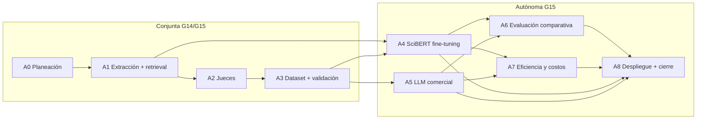

# Plan de Trabajo
### Recuperación semántica y clasificación de la función de citas académicas en Computer Science

> **Equipo:** Grupo 15 (conjunto de prueba **T_B**).
> - **A1–A3:** trabajo conjunto con el Grupo 14 (T_A) bajo un contrato de datos compartido.
> - **A4 en adelante:** el Grupo 15 trabaja de forma **autónoma**.
>
> **Calendario:** 8 semanas, del **4-oct-2026** al **28-nov-2026**.

## 1. Objetivo del proyecto

Objetivo general (resumido de la propuesta, §2.1):

> Desarrollar un sistema de PLN que, para un contexto de cita en inglés dentro del área de Computer Science, recupere los fragmentos más relevantes del artículo citado y clasifique la función de la cita en una de nueve categorías, evaluando el aporte de los fragmentos recuperados al desempeño de la clasificación.

## 2. Entregables principales

| # | Entregable | Descripción breve |
|---|------------|-------------------|
| E1 | Corpus procesado | Subconjunto CS de unarXive 2022 con contextos de cita auto-referenciales y citados segmentados |
| E2 | Módulo de recuperación | Top-3 fragmentos por contexto + sección de origen |
| E3 | Dataset etiquetado | Pool pre-etiquetado (38.780 instancias), test T_B validado (≥2.700, 300/clase), guía rev3.1, acuerdo interanotador, `test_set_gold.jsonl`, `exclusion_list.jsonl`, `iaa_report.md` |
| E4 | Clasificador SciBERT | Fine-tuning en 2 configuraciones: **base** (contexto + título + abstract del citado) y **con fragmentos** (contexto + sección + Top-3) |
| E5 | Evaluación LLM comercial | Zero-shot vs. few-shot con puntaje 0–1 por categoría |
| E6 | Informe comparativo | F1 macro/micro, matrices de confusión, eficiencia, latencia y costos |
| E7 | Aplicación web | Flujo completo con selección de clasificador (SciBERT, open-weight 1–8B, API comercial) |
| E8 | Informe final | Documento y sustentación |

## 3. Actividades

Se usa una sola nomenclatura, **A0–A8**, alineada con las actividades A1–A7 de la universidad y con el contrato G14/G15. A0 (planeación) y A8 (despliegue y cierre) son propias del plan.

| Actividad | Tareas principales | Entregable | Depende de | Modalidad | Estado |
|------|------------------------|------------|------------|-----------|--------|
| A0. Planeación y definiciones | Propuesta, contrato de datos con Grupo 14, roles, infraestructura (Git, DVC/S3, MLflow) | Propuesta + contrato | – | Conjunta G14/G15 | Completada |
| A1. Extracción, segmentación y retrieval | Filtro CS en unarXive, contextos de cita, restricción auto-referencial, limpieza, chunking (≤300 palabras / ≤2 párrafos), embeddings SciBERT + coseno, Top-3 con sección | E1, E2 | A0 | Conjunta G14/G15 | Completada |
| A2. Etiquetado asistido (jueces) | Prompt v11.1 congelado; jueces Qwen3.8-27B, Gemma-4-26B-A4B, Mistral-Small-3.2-24B; voto mayoritario; ampliación del pool para clases escasas | Pool de pre-etiquetas | A1 | Conjunta G14/G15 | Completada |
| A3. Dataset y validación humana | Calibraciones, anotación cruzada G14/G15 (rondas 1 y 2), adjudicación, liberación de reservas por déficit, consolidación de gold T_B e IAA | E3 | A2 | Conjunta G14/G15 | En curso |
| A4. Clasificador supervisado | Elección de aislamiento (V0/V1/V2), partición train/val por citante, **liberación temprana de SciBERT base v0** para integrar la aplicación, SciBERT fine-tuned (CE, 9 clases) en configuraciones **base** (título+abstract) y **con fragmentos** (sección+Top-3) | E4 | A1, A3 | Autónoma G15 | Por iniciar |
| A5. Evaluación con LLM comercial | Un modelo de frontera (p. ej. GPT-4o), zero-shot vs. few-shot, salida con puntaje 0–1 por categoría | E5 | A3 | Autónoma G15 | Por iniciar |
| A6. Evaluación comparativa | Precision/Recall/F1 macro y micro, matrices de confusión, aporte del Top-3 | E6 | A4, A5 | Autónoma G15 | Por iniciar |
| A7. Eficiencia, latencia y costos | Costo de fine-tuning vs. tokens de API, latencia por inferencia, tasa de errores de formato | E6 | A4, A5 | Autónoma G15 | Por iniciar |
| A8. Despliegue y cierre | Aplicación web (Next.js/React + FastAPI) con 3 clasificadores; informe final y sustentación | E7, E8 | A1, A4, A5, A6 | Autónoma G15 | Por iniciar |

### Vista de dependencias

### Cronograma (8 semanas: 4-oct → 28-nov-2026)

| Actividad | S1 4–10 oct | S2 11–17 oct | S3 18–24 oct | S4 25–31 oct | S5 1–7 nov | S6 8–14 nov | S7 15–21 nov | S8 22–28 nov |
|---|:--:|:--:|:--:|:--:|:--:|:--:|:--:|:--:|
| A1 Extracción + retrieval | ● | ● | ● |  |  |  |  |  |
| A2 Jueces |  | ● | ● |  |  |  |  |  |
| A3 Validación + adjudicación |  | ● | ● | ● |  |  |  |  |
| **Fin del trabajo conjunto** |  |  |  | ◆ |  |  |  |  |
| A4 SciBERT base y con fragmentos |  |  |  |  | ● | ● | ● |  |
| **Liberación SciBERT base v0** |  |  |  |  | ◆ |  |  |  |
| A5 LLM comercial |  |  |  |  | ● | ● |  |  |
| A6 Evaluación comparativa |  |  |  |  |  |  | ● |  |
| A7 Eficiencia y costos |  |  |  |  |  |  | ● |  |
| A8 Plataforma AWS |  |  |  |  | ● | ● | ● |  |
| A8 Backend y frontend |  |  |  |  | ● | ● | ● |  |
| A8 Informe final + sustentación |  |  |  |  |  |  | ● | ● |

S1–S3 reflejan lo ejecutado según el informe de avance. Semana actual: **S4**.

## 4. Hitos

| Hito | Criterio de cumplimiento | Fecha objetivo | Estado |
|------|--------------------------|----------------|--------|
| H1 | Propuesta y contrato de datos G14/G15 | S1 (10-oct) | Cumplido |
| H2 | Prompt v11.1 y jueces congelados | S2 (13-oct) | Cumplido |
| H3 | Calibración aprobada para iniciar A3 (calib2) | S3 (18-oct) | Cumplido |
| H4 | Pool ampliado (38.780) + informe de avance | S3 (23-oct) | Cumplido |
| H5 | Validación manual terminada | S4 (25-oct) | Por confirmar |
| H6 | Adjudicación + gold T_B + IAA consolidados; **cierre del trabajo conjunto** | S4 (31-oct) | Pendiente |
| H7 | Aislamiento elegido y partición train/val lista | S5 (2-nov) | Pendiente |
| H8 | SciBERT base v0 liberado para integración con la aplicación | S5 (4-nov) | Pendiente |
| H9 | SciBERT base y con fragmentos finales y LLM comercial evaluado | S7 (15-nov) | Pendiente |
| H10 | Evaluación comparativa completa y aplicación desplegada | S7 (21-nov) | Pendiente |
| H11 | Informe final y sustentación | S8 (28-nov) | Pendiente |

## 5. Decisiones

### 5.1 Vigentes

- **Clasificación:** 9 clases, etiqueta única.
- **Modelos evaluados:** SciBERT (base y con fragmentos) y un LLM comercial (zero-/few-shot). El open-weight 1–8B solo en la demo.
- **Éxito:** F1 macro de la configuración con fragmentos frente a la base.
- **Test:** T_B validado por humanos (meta 300/clase).
- **Entrenamiento:** pre-etiquetas + T_A, train/val agrupado por citante.
- **Clases minoritarias:** metas diferenciadas con el suministro disponible.

### 5.2 Pendientes

- Antes del 31-oct: congelar ronda 2 y recibir artefactos del G14.
- Variante de aislamiento (V0/V1/V2) y corte temporal de la partición.
- Modelo comercial y qué información del citado recibe.
- Modelo open-weight para la demo.

## 6. Siguientes pasos

Equipo G15 y focos:
- **CB** (Camilo Bejarano): backend.
- **GR** (German Rodriguez): modelos.
- **JA** (Jose Arteaga): plataforma AWS para la demo.
- **ST** (Sebastian Toro): frontend y modelos.

Tareas en orden cronológico; las fechas son propuestas.

| # | Tarea | Actividad | Responsable | Fecha fin | Estado |
|---|-------|-----------|-------------|-----------|--------|
| 1 | Congelar muestreo y ejecutar la ronda 2 | A3 | ALL | 31-oct | Pendiente |
| 2 | Adjudicar desacuerdos y liberar reservas por déficit | A3 | ALL | 31-oct | Pendiente |
| 3 | Consolidar `test_set_gold.jsonl`, `exclusion_list.jsonl` e `iaa_report.md` | A3 | ALL | 31-oct | Pendiente |
| 4 | Recibir y versionar (DVC) los artefactos del G14 | A3 | ALL | 31-oct | Pendiente |
| 5 | Elegir variante de aislamiento y corte temporal; construir train/val | A4 | GR, ST | 2-nov | Pendiente |
| 6 | Entrenar y liberar SciBERT base v0 + contrato de API (entrada/salida) | A4 | GR, ST | 4-nov | Pendiente |
| 7 | Definir cómo ajustar la entrada "con fragmentos" al límite de 512 tokens | A4 | GR, ST | 6-nov | Pendiente |
| 8 | Elegir modelo comercial y preparar prompts zero-/few-shot | A5 | GR, ST | 7-nov | Pendiente |
| 9 | Elegir modelo open-weight 1–8B para la demo | A8 | GR, ST | 7-nov | Pendiente |
| 10 | Preparar plataforma AWS para la demo | A8 | JA | 7-nov | Pendiente |
| 11 | Backend (FastAPI): recuperación Top-3 + SciBERT base v0 | A8 | CB | 10-nov | Pendiente |
| 12 | Fine-tuning SciBERT base (versión final) | A4 | GR, ST | 11-nov | Pendiente |
| 13 | Frontend (Next.js): primera versión conectada al backend | A8 | ST | 12-nov | Pendiente |
| 14 | Ejecutar evaluación del LLM comercial sobre T_B | A5 | GR, ST | 14-nov | Pendiente |
| 15 | Fine-tuning SciBERT con fragmentos (versión final) | A4 | GR, ST | 15-nov | Pendiente |
| 16 | Backend: integrar modelos finales, open-weight y API comercial | A8 | CB | 18-nov | Pendiente |
| 17 | Métricas, matrices de confusión y comparación base vs. con fragmentos | A6 | GR, ST | 21-nov | Pendiente |
| 18 | Medir costos, latencia y errores de formato | A7 | GR, ST | 21-nov | Pendiente |
| 19 | Frontend: versión final con visualización de resultados | A8 | ST | 21-nov | Pendiente |
| 20 | Desplegar la aplicación en AWS | A8 | JA | 21-nov | Pendiente |
| 21 | Informe final | A8 | ALL | 28-nov | Pendiente |
| 22 | Preparar sustentación | A8 | ALL | 28-nov | Pendiente |
